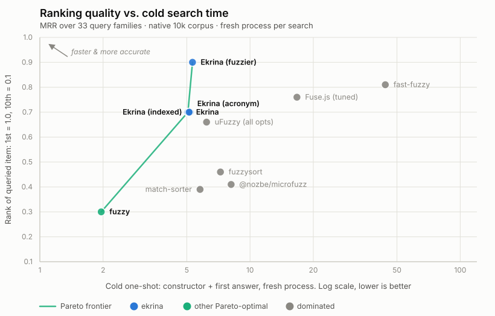

# Ekrina

**Tiny, typed fuzzy matching with ranked matches.**

<p>
<a href="https://www.npmjs.com/package/ekrina"><picture><source media="(prefers-color-scheme: dark)" srcset="https://img.shields.io/npm/v/ekrina?style=flat-square&colorA=151b23&colorB=7c5cff"></picture></a>
<a href="https://github.com/MMMikeM/ekrina/blob/main/LICENSE"><picture><source media="(prefers-color-scheme: dark)" srcset="https://img.shields.io/npm/l/ekrina?style=flat-square&colorA=151b23&colorB=7c5cff"></picture></a>
</p>

<p>
<a href="https://github.com/MMMikeM/ekrina/actions/workflows/ci.yml"><picture><source media="(prefers-color-scheme: dark)" srcset="https://img.shields.io/github/actions/workflow/status/MMMikeM/ekrina/ci.yml?branch=main&label=CI&logo=githubactions&style=flat-square&colorA=151b23&logoColor=f0f6fc"></picture></a>
<a href="https://github.com/MMMikeM/ekrina/actions/workflows/node.yml"><picture><source media="(prefers-color-scheme: dark)" srcset="https://img.shields.io/github/actions/workflow/status/MMMikeM/ekrina/node.yml?branch=main&label=Node%2018%2B&logo=nodedotjs&style=flat-square&colorA=151b23&logoColor=f0f6fc"></picture></a>
<a href="https://github.com/MMMikeM/ekrina/actions/workflows/deno.yml"><picture><source media="(prefers-color-scheme: dark)" srcset="https://img.shields.io/github/actions/workflow/status/MMMikeM/ekrina/deno.yml?branch=main&label=Deno&logo=deno&style=flat-square&colorA=151b23&logoColor=f0f6fc"></picture></a>
<a href="https://github.com/MMMikeM/ekrina/actions/workflows/bun.yml"><picture><source media="(prefers-color-scheme: dark)" srcset="https://img.shields.io/github/actions/workflow/status/MMMikeM/ekrina/bun.yml?branch=main&label=Bun&logo=bun&style=flat-square&colorA=151b23&logoColor=f0f6fc"></picture></a>
</p>

<p>
<a href="https://bundlejs.com/?q=ekrina"><picture><source media="(prefers-color-scheme: dark)" srcset="https://img.shields.io/badge/dynamic/json?url=https%3A%2F%2Fdeno.bundlejs.com%2F%3Fq%3Dekrina&query=%24.size.compressedSize&label=minzipped%20size&style=flat-square&colorA=151b23&colorB=3369ff"></picture></a>
<a href="https://github.com/MMMikeM/ekrina/actions/workflows/ci.yml"><picture><source media="(prefers-color-scheme: dark)" srcset="https://img.shields.io/badge/coverage-100%25-gray?style=flat-square&colorA=151b23&colorB=3369ff"></picture></a>
<a href="https://scorecard.dev/viewer/?uri=github.com/MMMikeM/ekrina"><picture><source media="(prefers-color-scheme: dark)" srcset="https://img.shields.io/ossf-scorecard/github.com/MMMikeM/ekrina?label=OpenSSF%20Scorecard&style=flat-square&colorA=151b23"></picture></a>
<a href="https://www.bestpractices.dev/projects/16088"><picture><source media="(prefers-color-scheme: dark)" srcset="https://img.shields.io/cii/level/16088?label=OpenSSF%20Best%20Practices&style=flat-square&colorA=151b23"></picture></a>
</p>

A fuzzy matcher usually hands back a number.
Ranking on it is guesswork, highlighting means re-running the match yourself, and one transposed character makes the whole thing return nothing at all.
Ekrina returns a categorical `tier`, the numeric `ranges` to highlight, and a score whose scale is pinned by tests; it also corrects up to two typos per query, in ~6.4 kB with zero dependencies, on any runtime with ES2022.

- **Tells you how it matched.**
  Every match carries `tier`, `ranges` and `score`, so ranking, highlighting and "showing results for…" are all reads off the result.
- **Survives a typo, or two.**
  A transposition, an insertion or a substitution each break the subsequence property; Ekrina corrects up to two of them, a key held down, and a space typed or left out.
- **Tops the match-quality scorecard.**
  0.91–0.92 MRR on each of three real-world corpora at about a millisecond per query, answering none of the queries nothing answers, against seven other libraries.
- **Runs anywhere.**
  No `node:` imports, no DOM, nothing above ES2022: browsers, Node, Deno, Bun and edge runtimes, ESM and CJS.
- **Stays small.**
  ~6.4 kB gzip, zero runtime dependencies, TS-first.

What it corrects, when the query as typed matches poorly:

- up to two mistakes: a wrong, missing, extra or swapped character, or a space typed inside a word or left out between two; a word takes two from eight letters, a phrase word one from five;
- a word typed sparsely: at least four of its letters, in order, starting with its first and covering at least half of it (`hget` for "Huguette");
- a key held down: a run of three or more of one letter is one mistake (`twaaain`);
- two neighbouring letters swapped in a four-letter word, where the fix starts a word (`tahn` for "Than").

It is not general edit distance, which keeps it small and fast.
Inspired by [@nozbe/microfuzz](https://github.com/Nozbe/microfuzz), [benchmarked](./docs/benchmarks.md) against it and six others, and there is a [migration diff](./docs/migrating/microfuzz.md) if you are coming from it.

## Install

```bash
npm i ekrina  # or pnpm add ekrina
```

Nothing in the package touches a platform global.
`src/` compiles against `lib: ["ES2022"]` alone, so there is no `node:crypto`, no `document`, and nothing to polyfill on Workers, Deno or Bun.
Both ESM and CJS ship, with types for each.

## Usage

### Searching a collection

```typescript
import { createFuzzySearch, SCORES } from "ekrina";

// array of strings
const search = createFuzzySearch(["apple", "banana", "cherry"]);
search("ban"); // [{ item: "banana", score: 0.5, fields: [...] }]

// objects: a function extracts the text to search
const byName = createFuzzySearch(users, (u) => u.name);
byName("john");

// multiple fields, per-field config
const posts = [
	{ title: "Banana bread", body: "best baked goods" },
	{ title: "Release notes", body: "banana picker shipped" },
];
const byField = createFuzzySearch(posts, [
	{ selectField: (p) => p.title },
	{ selectField: (p) => p.body, demoteBy: SCORES.CONTAINS }, // body's best hit ranks like a bare contains
]);
byField("ban");
// [
//   { item: posts[0], score: 0.5, fields: [{ score: 0.5, tier: "prefix", ranges: [[0, 2]] }, null] },
//   { item: posts[1], score: 2.5, fields: [null, { score: 2.5, tier: "prefix", ranges: [[0, 2]] }] },
// ]
// item score = the best field score; body scores are demoted by 2 (0.5 + 2 = 2.5),
// so the title hit leads even though both are prefix matches.
```

Results are sorted best-first; within a score, a match that ends on a word boundary comes first (`will` finds "Will Smith" before "Willa Corkery"), then list order.
Preprocessing is cached.
Each item is prepared the first time a query matches it, and the whole-list mask index the first time a query needs it.

A one-character query matches only where it starts a word (`"o"` finds "Open File", not "Folder"), since one character anywhere matches most of any list.
Queries under five characters are corrected only when nothing matches them as typed, except a swap in a four-letter word, which is undone whenever nothing matches it literally.
A query is matched on its first 256 characters, and one holding a word over 64 characters is never corrected.

When only the top of the list is shown, pass `limit`:

```typescript
search("ma", { limit: 10 }); // the same ten results as search("ma").slice(0, 10)
```

Once `limit` items match the query as typed, the fuzzy and corrected matches that could not outrank them are never computed, which matters most for one- and two-character queries over a large list.
With or without `limit`, corrections are only tried while fewer than ten items match the query as typed: past that, the extra rows are guesses ranked below every literal match.

To build the mask index ahead of time instead, once the list has loaded or during idle time, call `buildIndex()`:

```typescript
const search = createFuzzySearch(products, (p) => p.title);
search.buildIndex();
```

Over 100k items it takes 10–16 ms, after which a first answer averages ~5 ms instead of 15–19 ms and a 24-query session drops from 81–93 to 60–74 ms (the `Ekrina (indexed)` rows in [docs/benchmarks.md](./docs/benchmarks.md)).
Results are identical either way.
A searcher that answers a single query and is thrown away comes out slightly behind, so leave it lazy there.

### Highlighting a result

`ranges` are `[start, end]` pairs, both inclusive, in ascending order, and they index the string you passed in rather than a normalised copy of it.
Slicing the original text is therefore the whole job, accents and casing included:

```typescript
import { createFuzzySearch, type HighlightRanges } from "ekrina";

const highlight = (text: string, ranges: HighlightRanges): string => {
	let html = "";
	let cursor = 0;
	for (const [start, end] of ranges) {
		html += `${text.slice(cursor, start)}<mark>${text.slice(start, end + 1)}</mark>`;
		cursor = end + 1;
	}
	return html + text.slice(cursor);
};

const commands = [
	{ title: "Open File…" },
	{ title: "Open Recent" },
	{ title: "Preferences: Open User Settings" },
	{ title: "Close Editor" },
];
const search = createFuzzySearch(commands, (c) => c.title);

for (const { item, fields } of search("opn")) {
	console.log(highlight(item.title, fields[0]?.ranges ?? []));
}
// <mark>Op</mark>e<mark>n</mark> File…
// <mark>Op</mark>e<mark>n</mark> Recent
// Preferences: <mark>Op</mark>e<mark>n</mark> User Settings
```

Every tier fills `ranges` the same way, so the one helper covers all of them: `"user open"` highlights both words in place (`Preferences: <mark>Open</mark> <mark>User</mark> Settings`), and a corrected query highlights what it actually found (`"recnet"` gives `Open <mark>Recent</mark>`, `tier: "corrected"`, `corrected: "recent"`).

In React the searcher is the memo boundary, so no hook is needed:

```typescript
const search = useMemo(() => createFuzzySearch(commands, (c) => c.title), [commands]);
const results = useMemo(() => search(query), [search, query]);
```

### Matching a single string

Scores one string against a query; reach for it directly when there is no list, e.g. matching inside a document.

```typescript
import { fuzzyMatch } from "ekrina";

fuzzyMatch("Hello World", "wor");
// { score: 1, tier: "boundary", ranges: [[6, 8]] }

fuzzyMatch("cherry", "xyz"); // null
```

Options: `fuzzyMatch(text, query, { acronym? })`.
`acronym: true` adds the initials tier (`tfts` finds "Two for the Seesaw" at rank 1) at a per-query cost inside the bench's noise.

`fuzzyMatch` judges one string on its own.
A searcher also skips corrections once ten items match literally, since none could reach the top ten, and corrects a query under five characters only when no item matches it as typed.
So for a short query, a list can show fewer corrections than `fuzzyMatch` returns for each item.

## Where it fits

- **Command palettes and pickers**: `tier` + `ranges` rank and highlight results without reverse-engineering a score.
- **Search-as-you-type**: a keystroke that extends the query rescans only the previous one's survivors, so a word gets faster as it is typed, 3.5× by its last letter even over 100k items.
  Starting a second word, typing five or more characters that match fewer than ten items literally (a possible typo), or four that match nothing, rescans the full list instead, and the first such keystroke also builds the mask index, once per searcher, unless `buildIndex()` already has.
- **Filter UIs that show every match**: the narrowest result sets of the subsequence engines; the exact long word `gensler` returns 1 row where the chain engines return 12 and Fuse.js 971 on its defaults.
- **Backend one-shot lookups**: constructor + first answer takes 6 ms in a cold process over 10k items, so indexing per request is fine.
- **Finding a phrase inside a document**: `fuzzyMatch` scans 16,000 characters in 0.48 ms, and the density floor, the minimum share of its span a fuzzy chain must cover, holds false matches of absent words to 2–4%.

## Scores and tiers

Lower is better.
Each match reports a numeric `score` (for sorting) and a categorical `tier`:

| score | tier               | meaning                                    |
| ----- | ------------------ | ------------------------------------------ |
| 0     | `exact`            | exact match                                |
| 0.1   | `normalised-exact` | case / diacritics-insensitive exact        |
| 0.5   | `prefix`           | starts with query                          |
| 0.9   | `boundary-cased`   | at a word boundary, exact case             |
| 1     | `boundary`         | at a word boundary                         |
| 1.5   | `multi-word`       | every query word starts a word, any order  |
| 1.8   | `acronym`          | word initials (opt-in via `acronym: true`) |
| 2     | `contains`         | contains query anywhere                    |
| > 2   | `fuzzy`            | fuzzy chain (fewer chunks = better)        |
| +2.1  | `corrected`        | per mistake fixed (`genric`; two add 4.2)  |

A `corrected` match scores as the corrected query's tier + 2.1 per mistake, which puts even a corrected exact hit above `contains` (2).
A word typed sparsely is a `corrected` match too, scored just above `contains` and lower the more of the word was skipped.
A correction is a guess at what you meant, so the literal hit always ranks first.
`score <= SCORES.CONTAINS` is therefore exactly "the query text appears here", and filtering to it opts out of typo matching entirely.

Import `SCORES` for thresholds and `demoteBy` values; or read `tier` directly:

```typescript
results.filter((r) => r.score <= SCORES.CONTAINS); // drop fuzzy chains and deep rescues
results.filter((r) => r.fields[0]?.tier !== "fuzzy"); // drop fuzzy chains only, categorically
```

A `corrected` match carries the fixed query, so you can say what you searched for:

```typescript
const top = results[0]?.fields[0];
if (top?.tier === "corrected") notice(`Showing results for ${top.corrected}`);
```

`demoteBy` shifts `score` but never `tier`, so tier filters stay reliable on demoted fields (a body-field prefix hit can report `score: 2.5, tier: "prefix"`).
All four typo tiers also score above `CONTAINS` (a rescued contains is 4.1) without being fuzzy chains, so filter by `tier` when you mean the kind of match.

> **Long text:** a fuzzy chain assembled from chunks scattered across a document is junk, since a long enough text holds the letters of almost any word somewhere.
> The fuzzy tier refuses any assembly covering less than 18% of its span, which holds the junk rate for absent words to _2–4% at every measured length_ on real text, depending on the corpus and the words drawn ([the long-text table](./docs/benchmarks.md#matching-inside-long-text)).

> **Acronym semantics:** apostrophes are word-internal, so `People's` contributes one initial, `p`, and `lpdr` matches `Lao People's Democratic Republic`.
> Stopwords count too: `Democratic Republic of the Congo` is `drotc`, and `drc` matches nothing (the density floor rejects so sparse a chain).

## The fuzzy tier

When a query doesn't appear as typed, Ekrina looks for its letters in order, in a few pieces: `vsc` matches "**V**isual **S**tudio **C**ode", and `sualdio` matches "Vi**sual** Stu**dio** Code".
These matches have `tier: "fuzzy"` and score above `SCORES.CONTAINS`, so they rank below every match of the text as typed.
The fuzzy tier is always on, with no strategy knob, and it only accepts pieces that follow these rules:

- **Each piece starts a word or is at least three letters long.**
  `iuo` matches nothing in "Visual Studio Code", though its letters are all there in order, because each would be a single letter from the middle of a word.
  `ogerm` fails on "Toggle Terminal" for the same reason: `og` would be two letters from the middle of "Toggle".
- **The query's last one or two letters are exempt**, since a short tail could never be three letters long: `togrm` matches "**Tog**gle Te**rm**inal".
- **The pieces must cover at least 18% of the text they stretch across.**
  In "Open the command palette", `oc` matches "**O**pen the **c**ommand", 2 letters in a stretch of 10, but `ocp` doesn't, since "**O**pen the **c**ommand **p**" is 3 letters in 18.
  A long enough document holds the letters of almost any word somewhere, and this floor is what holds false matches of absent words to 2–4% on real text.

Anything the fuzzy tier refuses either matched a better tier already or wasn't worth showing.
To keep only matches of the text as typed, filter to `score <= SCORES.CONTAINS`.

## Migrating

Each guide has the diff and every behavioural difference: [from @nozbe/microfuzz](./docs/migrating/microfuzz.md), [from Fuse.js](./docs/migrating/fuse.md), [from match-sorter](./docs/migrating/match-sorter.md) and [from fast-fuzzy](./docs/migrating/fast-fuzzy.md).

## How it compares

Ekrina answers in a few milliseconds at any realistic size: a 24-query session over 100,000 items averages ~3–3.6 ms per query after the first (~1 ms at 10k), every number measured in a fresh, cold process, and `fuzzyMatch` over a 16,000-character document takes 0.48 ms.
Between the libraries, the differences are _match quality_, _what they answer that they shouldn't_, and _what you get back_.

Each library at its best-scoring configuration, native corpus at 10k items, measured November 2026 (the exact versions are the devDependencies in [`bench/package.json`](./bench/package.json)).
That configuration is chosen by these same benchmarks, so every row is the library tuned to the tests it is ranked on; uFuzzy's defaults score 0.21 and Fuse.js's 0.72 ([how each was configured](./docs/benchmarks.md#libraries)):

<!-- bench:compare -->
| Library           |    Gzip | Deps |  MRR | junk | ms/query | Tiers | Ranges | Typos     |
|-------------------|--------:|-----:|-----:|-----:|---------:|:-----:|:------:|-----------|
| **Ekrina**        | ~6.4 kB |    0 | 0.91 | 0.00 |     1.06 |  🟢   |   🟢   | two edits |
| fast-fuzzy        |  ~11 kB |    1 | 0.81 | 0.24 |     6.20 |  🔴   |   🟡   | full      |
| Fuse.js (tuned)   | ~9.3 kB |    0 | 0.76 | 0.47 |    12.21 |  🔴   |   🟡   | full      |
| uFuzzy (all opts) | ~4.1 kB |    0 | 0.66 | 0.00 |     0.64 |  🔴   |   🟢   | one edit  |
| fuzzysort         | ~3.7 kB |    0 | 0.46 | 0.07 |     0.41 |  🔴   |   🟢   | 🔴        |
| @nozbe/microfuzz  | ~1.7 kB |    0 | 0.41 | 0.07 |     2.10 |  🔴   |   🟢   | 🔴        |
| match-sorter      | ~3.4 kB |    2 | 0.39 | 0.07 |     2.70 |  🟢   |   🔴   | 🔴        |
| fuzzy             | ~0.8 kB |    0 | 0.30 | 0.07 |     2.10 |  🔴   |   🟡   | 🔴        |
<!-- bench:end -->

The corpora are 100,000 real Wikidata names, under their English labels and under their native ones, plus an emoji picker's labels and tags, and the ranking is the same on all three ([the corpora](./docs/benchmarks.md#the-corpora-and-the-query-families)).
**MRR** is the mean reciprocal rank of the first right answer over 33 query families of ten sampled queries each (typos, phonetic and real misspellings, partial words, query shapes and noise, weighted by group before anything was measured), each query one that at most three items could answer, top-10 cutoff; any item the query could have meant counts ([how](./docs/benchmarks.md#match-quality-by-query-family)).
**junk** is the share of queries with no right answer anywhere in the list that the library answers anyway.
**ms/query** is how long one query takes once the searcher has answered twenty-three real ones, the search-as-you-type number.
Gzip is `esbuild --bundle --minify` tree-shaken to each library's primary API.
The size badge above measures the whole published package, which is why it reads higher.
The full matrix, every feature cell verified against the library's current source, is in [docs/benchmarks.md](./docs/benchmarks.md#libraries).

Accuracy against one whole cold search (index + one query) is the least flattering way to measure Ekrina, since a library with no constructor does no work up front (the frontend chart in [docs/benchmarks.md](./docs/benchmarks.md), query time only, has fuzzysort and uFuzzy (all opts) beside Ekrina on its frontier, at 0.46 and 0.66 MRR):

<picture>
  <source media="(prefers-color-scheme: dark)" srcset="./docs/pareto-total-dark.svg">
  
</picture>

Ekrina is the only library that by default:

- returns a categorical `tier` _and_ numeric `ranges`
- folds diacritics
- matches multi-word
- takes per-field config

It is built for matching in-memory lists on the client, and the cold-process numbers hold up for serverside work too.

### What to pick

Pick Ekrina.
It tops the quality scorecard on all three benchmark corpora, answers nothing it shouldn't, and runs its session several times faster than the two libraries closest to it on quality.
At ~6.4 kB gzip it is the third-largest of the eight, and the correction machinery is both where the size goes and where the quality lead comes from (the unfold table is generated from the fold logic at first use, not shipped).
Only Fuse.js and fast-fuzzy are larger, at 1.5–1.7×.
The exception:

- **A query word the item lacks must still match** (an OR-style search): Ekrina requires every word, so pick `fast-fuzzy` there, at 1.7× the bundle and ~6 ms queries, or split the query yourself.

The rest of the field is dominated on these benchmarks; the full argument, per-library, is in [the recommendation](./docs/benchmarks.md#the-recommendation).

## Other exports

- `normaliseText(text)`: lowercase, strip diacritics.
- `splitWords(text)`: tokenise on any non-alphanumeric run (keeps `_`).
- `SCORES`: the tier constants.
- `TYPO_PENALTY`: the 2.1 a `corrected` score adds to its corrected tier for each typo fixed.

## Types

Every exported type, with each field documented, is in [`src/types.ts`](./src/types.ts).

## The name

Ancient Greek ἔκρινα, eh-KREE-na, "I sifted, I judged", is the aorist of κρίνω, the root of criterion and critic, and cognate with the Latin _cernere_ behind discern.
It sifts a list and judges each candidate against a criterion.

## Security

Ekrina has no runtime dependencies and no install scripts, its tests cover every line and branch, and each release is built in CI with npm provenance and goes live only after a maintainer approves it.
Reporting a vulnerability, verifying a release and the limits on hostile input are in [SECURITY.md](./SECURITY.md).

## Contributing

Bug reports and feature requests go in [GitHub issues](https://github.com/MMMikeM/ekrina/issues), and [CONTRIBUTING.md](./CONTRIBUTING.md) covers changing the code.

## License

MIT
