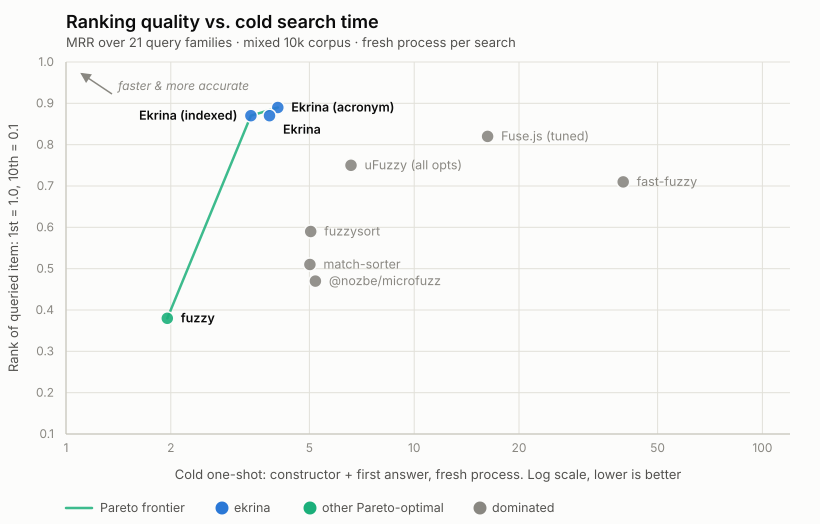

# Ekrina

**Tiny, typed fuzzy matching with ranked matches.**

<p>
<a href="https://www.npmjs.com/package/ekrina"><picture><source media="(prefers-color-scheme: dark)" srcset="https://img.shields.io/npm/v/ekrina?style=flat-square&colorA=151b23&colorB=7c5cff"></picture></a>
<a href="https://github.com/MMMikeM/ekrina/blob/main/LICENSE"><picture><source media="(prefers-color-scheme: dark)" srcset="https://img.shields.io/npm/l/ekrina?style=flat-square&colorA=151b23&colorB=7c5cff"></picture></a>
</p>

<p>
<a href="https://github.com/MMMikeM/ekrina/actions/workflows/ci.yml"><picture><source media="(prefers-color-scheme: dark)" srcset="https://img.shields.io/github/actions/workflow/status/MMMikeM/ekrina/ci.yml?branch=main&label=CI&logo=githubactions&style=flat-square&colorA=151b23&logoColor=f0f6fc"></picture></a>
<a href="https://github.com/MMMikeM/ekrina/actions/workflows/node.yml"><picture><source media="(prefers-color-scheme: dark)" srcset="https://img.shields.io/github/actions/workflow/status/MMMikeM/ekrina/node.yml?branch=main&label=Node%2018%2B&logo=nodedotjs&style=flat-square&colorA=151b23&logoColor=f0f6fc"></picture></a>
<a href="https://github.com/MMMikeM/ekrina/actions/workflows/deno.yml"><picture><source media="(prefers-color-scheme: dark)" srcset="https://img.shields.io/github/actions/workflow/status/MMMikeM/ekrina/deno.yml?branch=main&label=Deno&logo=deno&style=flat-square&colorA=151b23&logoColor=f0f6fc"></picture></a>
<a href="https://github.com/MMMikeM/ekrina/actions/workflows/bun.yml"><picture><source media="(prefers-color-scheme: dark)" srcset="https://img.shields.io/github/actions/workflow/status/MMMikeM/ekrina/bun.yml?branch=main&label=Bun&logo=bun&style=flat-square&colorA=151b23&logoColor=f0f6fc"></picture></a>
</p>

<p>
<a href="https://bundlejs.com/?q=ekrina"><picture><source media="(prefers-color-scheme: dark)" srcset="https://img.shields.io/badge/dynamic/json?url=https%3A%2F%2Fdeno.bundlejs.com%2F%3Fq%3Dekrina&query=%24.size.compressedSize&label=minzipped%20size&style=flat-square&colorA=151b23&colorB=3369ff"></picture></a>
<a href="https://github.com/MMMikeM/ekrina/actions/workflows/ci.yml"><picture><source media="(prefers-color-scheme: dark)" srcset="https://img.shields.io/badge/coverage-100%25-gray?style=flat-square&colorA=151b23&colorB=3369ff"></picture></a>
<a href="https://scorecard.dev/viewer/?uri=github.com/MMMikeM/ekrina"><picture><source media="(prefers-color-scheme: dark)" srcset="https://img.shields.io/ossf-scorecard/github.com/MMMikeM/ekrina?label=OpenSSF%20Scorecard&style=flat-square&colorA=151b23"></picture></a>
</p>

A fuzzy matcher usually hands back a number.
Ranking on it is guesswork, highlighting means re-running the match yourself, and one transposed character makes the whole thing return nothing at all.
Ekrina returns a categorical `tier`, the numeric `ranges` to highlight, and a score whose scale is pinned by tests; it also corrects single-character typos, in ~6.2 kB with zero dependencies, on any runtime with ES2022.

- **Tells you how it matched.**
  Every match carries `tier`, `ranges` and `score`, so ranking, highlighting and "showing results for…" are all reads off the result.
- **Survives a typo.**
  A transposition, an insertion or a substitution each break the subsequence property; the one-edit tiers still take all three at rank 1.
- **Tops the match-quality scorecard.**
  0.89 MRR on the mixed corpus at ~0.7 ms per query, against seven other libraries.
- **Runs anywhere.**
  No `node:` imports, no DOM, nothing above ES2022: browsers, Node, Deno, Bun and edge runtimes, ESM and CJS.
- **Stays small.**
  ~6.2 kB gzip, zero runtime dependencies, TS-first.

Corrects single-character typos, not general edit distance, which keeps it small and fast.
Inspired by [@nozbe/microfuzz](https://github.com/Nozbe/microfuzz), [benchmarked](./docs/benchmarks.md) against it and six others, and there is a [migration diff](#migrating-from-nozbemicrofuzz) if you are coming from it.

## Install

```bash
npm i ekrina  # or pnpm add ekrina
```

Nothing in the package touches a platform global.
`src/` compiles against `lib: ["ES2022"]` alone, so there is no `node:crypto`, no `document`, and nothing to polyfill on Workers, Deno or Bun.
Both ESM and CJS ship, with types for each.

## Usage

### Searching a collection

```typescript
import { createFuzzySearch, SCORES } from "ekrina";

// array of strings
const search = createFuzzySearch(["apple", "banana", "cherry"]);
search("ban"); // [{ item: "banana", score: 0.5, fields: [...] }]

// objects: a function extracts the text to search
const byName = createFuzzySearch(users, (u) => u.name);
byName("john");

// multiple fields, per-field config
const posts = [
	{ title: "Banana bread", body: "best baked goods" },
	{ title: "Release notes", body: "banana picker shipped" },
];
const byField = createFuzzySearch(posts, [
	{ text: (p) => p.title },
	{ text: (p) => p.body, atBest: SCORES.CONTAINS }, // body's best hit ranks like a bare contains
]);
byField("ban");
// [
//   { item: posts[0], score: 0.5, fields: [{ score: 0.5, tier: "prefix", ranges: [[0, 2]] }, null] },
//   { item: posts[1], score: 2.5, fields: [null, { score: 2.5, tier: "prefix", ranges: [[0, 2]] }] },
// ]
// item score = the best field score; body scores are shifted by atBest (0.5 + 2 = 2.5),
// so the title hit leads even though both are prefix matches.
```

Results are sorted best-first; within a score, a match that ends on a word boundary comes first (`will` finds "Will Smith" before "Willa Corkery"), then list order.
Preprocessing is cached.
Each item is prepared the first time a query matches it, and the whole-list mask index the first time a query needs it.

A one-character query matches only where it starts a word (`"o"` finds "Open File", not "Folder"), since one character anywhere matches most of any list.
Queries under five characters are corrected only when nothing matches them as typed.

When only the top of the list is shown, pass `limit`:

```typescript
search("ma", { limit: 10 }); // the same ten results as search("ma").slice(0, 10)
```

Once `limit` items match the query as typed, the fuzzy and corrected matches that could not outrank them are never computed, which matters most for one- and two-character queries over a large list.
With or without `limit`, corrections are only tried while fewer than ten items match the query as typed: past that, the extra rows are one-edit guesses ranked below every literal match.

To build the mask index ahead of time instead, once the list has loaded or during idle time, call `buildIndex()`:

```typescript
const search = createFuzzySearch(products, (p) => p.title);
search.buildIndex();
```

Over 100k items it takes ~21 ms, after which a first answer averages ~2.4 ms instead of ~19 ms and a 24-query session drops from ~63 to ~31 ms (the `Ekrina (indexed)` rows in [docs/benchmarks.md](./docs/benchmarks.md)).
Results are identical either way.
A searcher that answers a single query and is thrown away comes out slightly behind, so leave it lazy there.

### Highlighting a result

`ranges` are `[start, end]` pairs, both inclusive, in ascending order, and they index the string you passed in rather than a normalised copy of it.
Slicing the original text is therefore the whole job, accents and casing included:

```typescript
import { createFuzzySearch, type HighlightRanges } from "ekrina";

const highlight = (text: string, ranges: HighlightRanges): string => {
	let html = "";
	let cursor = 0;
	for (const [start, end] of ranges) {
		html += `${text.slice(cursor, start)}<mark>${text.slice(start, end + 1)}</mark>`;
		cursor = end + 1;
	}
	return html + text.slice(cursor);
};

const commands = [
	{ title: "Open File…" },
	{ title: "Open Recent" },
	{ title: "Preferences: Open User Settings" },
	{ title: "Close Editor" },
];
const search = createFuzzySearch(commands, (c) => c.title);

for (const { item, fields } of search("opn")) {
	console.log(highlight(item.title, fields[0]?.ranges ?? []));
}
// <mark>Op</mark>e<mark>n</mark> File…
// <mark>Op</mark>e<mark>n</mark> Recent
// Preferences: <mark>Op</mark>e<mark>n</mark> User Settings
```

Every tier fills `ranges` the same way, so the one helper covers all of them: `"user open"` highlights both words in place (`Preferences: <mark>Open</mark> <mark>User</mark> Settings`), and a corrected query highlights what it actually found (`"recnet"` gives `Open <mark>Recent</mark>`, `tier: "corrected"`, `corrected: "recent"`).

In React the searcher is the memo boundary, so no hook is needed:

```typescript
const search = useMemo(() => createFuzzySearch(commands, (c) => c.title), [commands]);
const results = useMemo(() => search(query), [search, query]);
```

### Matching a single string

Scores one string against a query; reach for it directly when there is no list, e.g. matching inside a document.

```typescript
import { fuzzyMatch } from "ekrina";

fuzzyMatch("Hello World", "wor");
// { score: 1, tier: "boundary", ranges: [[6, 8]] }

fuzzyMatch("cherry", "xyz"); // null
```

Options: `fuzzyMatch(text, query, { acronym? })`.
`acronym: true` adds the initials tier (`rsaw` finds "Rath, Streich and Witting" at rank 1) for under a millisecond more per query.

`fuzzyMatch` judges one string on its own.
A searcher also skips corrections once ten items match literally, since none could reach the top ten, and corrects a query under five characters only when no item matches it as typed.
So for a short query, a list can show fewer corrections than `fuzzyMatch` returns for each item.

## Where it fits

- **Command palettes and pickers**: `tier` + `ranges` rank and highlight results without reverse-engineering a score.
- **Search-as-you-type**: a keystroke that extends the query rescans only the previous one's survivors, so a word gets faster as it is typed, 3.9× by its last letter even over 100k items.
  Starting a second word, typing five or more characters that match fewer than ten items literally (a possible typo), or four that match nothing, rescans the full list instead, and the first such keystroke also builds the mask index, once per searcher, unless `buildIndex()` already has.
- **Filter UIs that show every match**: the narrowest result sets of the subsequence engines; an exact long word returns a median of 5 rows where Fuse.js returns 153.
- **Backend one-shot lookups**: constructor + first answer takes ~3.8 ms in a cold process over 10k items, so indexing per request is fine.
- **Finding a phrase inside a document**: `fuzzyMatch` scans 16,000 characters in 0.21 ms, and the density floor, the minimum share of its span a fuzzy chain must cover, keeps absent words at exactly 0 false matches.

## Scores and tiers

Lower is better.
Each match reports a numeric `score` (for sorting) and a categorical `tier`:

| score | tier               | meaning                                    |
| ----- | ------------------ | ------------------------------------------ |
| 0     | `exact`            | exact match                                |
| 0.1   | `normalised-exact` | case / diacritics-insensitive exact        |
| 0.5   | `prefix`           | starts with query                          |
| 0.9   | `boundary-exact`   | at a word boundary, exact case             |
| 1     | `boundary`         | at a word boundary                         |
| 1.5   | `multi-word`       | every query word starts a word, any order  |
| 1.8   | `acronym`          | word initials (opt-in via `acronym: true`) |
| 2     | `contains`         | contains query anywhere                    |
| > 2   | `fuzzy`            | fuzzy chain (fewer chunks = better)        |
| +2.1  | `corrected`        | one-character typo fixed (`genric`)        |

A `corrected` match scores as the corrected query's tier + 2.1, which puts even a corrected exact hit above `contains` (2).
A correction is a guess at what you meant, so the literal hit always ranks first.
`score <= SCORES.CONTAINS` is therefore exactly "the query text appears here", and filtering to it opts out of typo matching entirely.

Import `SCORES` for thresholds and `atBest` values; or read `tier` directly:

```typescript
results.filter((r) => r.score <= SCORES.CONTAINS); // drop fuzzy chains and deep rescues
results.filter((r) => r.fields[0]?.tier !== "fuzzy"); // drop fuzzy chains only, categorically
```

A `corrected` match carries the fixed query, so you can say what you searched for:

```typescript
const top = results[0]?.fields[0];
if (top?.tier === "corrected") notice(`Showing results for ${top.corrected}`);
```

`atBest` shifts `score` but never `tier`, so tier filters stay reliable on demoted fields (a body-field prefix hit can report `score: 2.5, tier: "prefix"`).
All four typo tiers also score above `CONTAINS` (a rescued contains is 4.1) without being fuzzy chains, so filter by `tier` when you mean the kind of match.

> **Long text:** a fuzzy chain assembled from chunks scattered across a document is junk; unguarded, a word _absent_ from the text still "matches" 35% of the time by 512 chars, ~100% by 16k.
> The fuzzy tier refuses any assembly covering less than 18% of its span (measured junk density never exceeds 0.143, the sparsest genuine match is 0.211), which holds the junk rate at _0% at every measured length_, with label matching identical with and without it ([the long-text table](./docs/benchmarks.md#matching-inside-long-text)).

> **Acronym semantics:** apostrophes are word-internal, so `People's` contributes one initial, `p`, and `lpdr` matches `Lao People's Democratic Republic`.
> Stopwords count too: `Democratic Republic of the Congo` is `drotc`, and `drc` matches nothing (the density floor rejects so sparse a chain).

## The fuzzy tier

Ekrina ships one opinionated fuzzy mode, always on, with no strategy knob.
Chunks must start at a word boundary or run 3+ characters (the query's last 1-2 characters are exempt, since a short tail could never satisfy the run rule), and the whole assembly must cover at least 18% of the span it stretches across (the density floor that keeps long text junk-free).
Anything it refuses either matched a higher tier already or wasn't worth showing; keep only `score <= SCORES.CONTAINS` if you want literal matches only.

## Migrating from `@nozbe/microfuzz`

```diff
- import createFuzzySearch from "@nozbe/microfuzz";
+ import { createFuzzySearch } from "ekrina";

  // one field
- const search = createFuzzySearch(items, { key: "title" });
+ const search = createFuzzySearch(items, (item) => item.title);

  // several fields
- const search = createFuzzySearch(items, { getText: (i) => [i.title, i.body] });
+ const search = createFuzzySearch(items, [{ text: (i) => i.title }, { text: (i) => i.body }]);

  // reading a result
- for (const { item, matches } of search(query)) highlight(item.title, matches[0]);
+ for (const { item, fields } of search(query)) highlight(item.title, fields[0]?.ranges);
```

Behavioural differences:

- **`matches` became `fields`, and carries more than ranges.**
  microfuzz returns `Array<HighlightRanges | null>`, one entry per `getText` string.
  Ekrina returns `Array<MatchResult | null>`, with the ranges at `fields[i].ranges` next to that field's own `score` and `tier`.
  The `[start, end]` inclusive convention is unchanged, so an existing highlight helper keeps working once it reads `.ranges`.
- **The scores are an API contract here.**
  microfuzz documents its values as "not an API contract, can change between releases"; the shared tiers happen to agree today.
  Ekrina exports them as `SCORES`, pins them in `test/tier-constants.test.ts`, and treats a changed score as a breaking change with a CHANGELOG entry.
- **There is no `strategy` option.**
  `'smart'` is the always-on behaviour.
  `'off'` becomes `results.filter((r) => r.score <= SCORES.CONTAINS)`, which is exactly "the query text appears here".
  `'aggressive'` has no equivalent on purpose, because the density floor that refuses scattered chains holds the long-text junk rate at 0%.
- **Typos match.**
  On the same queries microfuzz scores 0.47 MRR and Ekrina 0.87, most of the gap from the one-edit tiers ([the scorecard](./docs/benchmarks.md#scorecard)).
- **`normalizeText` is `normaliseText`.**
  EU spelling across the public surface, `splitWords` and `normaliseText` included.
- **No React hook.**
  microfuzz ships `useFuzzySearchList`; Ekrina doesn't, because the searcher is already the memo boundary.
  `useMemo(() => createFuzzySearch(list, getText), [list])` gives you the same caching, and the list of results is a second `useMemo` on the query.

Ekrina is ~6.2 kB gzip against microfuzz's ~1.7 kB, and adds an ESM build to microfuzz's CJS-only one.

## How it compares

Ekrina answers in a few milliseconds at any realistic size: a 24-query session over 100,000 items averages ~2.4 ms per query after the first (~0.7 ms at 10k), every number measured in a fresh, cold process, and `fuzzyMatch` over a 16,000-character document takes 0.21 ms.
Between the libraries, the differences are _match quality_ and _what you get back_.

Each library at its best-scoring configuration, mixed corpus at 10k items, measured October 2026 (the exact versions are the devDependencies in [`bench/package.json`](./bench/package.json)).
That configuration is chosen by these same benchmarks, so every row is the library tuned to the tests it is ranked on, Ekrina included; uFuzzy's defaults score 0.25 and Fuse.js's 0.69 ([how each was configured](./docs/benchmarks.md#libraries)):

| Library                     |    Gzip | Deps |  MRR | ms/query | Tiers | Ranges | Typos    |
| --------------------------- | ------: | ---: | ---: | -------: | :---: | :----: | -------- |
| **Ekrina** (acronym)        | ~6.2 kB |    0 | 0.89 | **0.67** |  🟢   |   🟢   | one edit |
| Fuse.js (tuned)             | ~9.3 kB |    0 | 0.82 |    13.46 |  🔴   |   🟡   | full     |
| uFuzzy (all opts)           | ~4.1 kB |    0 | 0.75 |     0.91 |  🔴   |   🟢   | one edit |
| fast-fuzzy                  |  ~11 kB |    1 | 0.71 |     6.40 |  🔴   |   🟡   | full     |
| fuzzysort                   | ~3.7 kB |    0 | 0.59 |     0.37 |  🔴   |   🟢   | 🔴       |
| match-sorter                | ~3.4 kB |    2 | 0.51 |     2.46 |  🟢   |   🔴   | 🔴       |
| @nozbe/microfuzz            | ~1.7 kB |    0 | 0.47 |     1.19 |  🔴   |   🟢   | 🔴       |
| fuzzy                       | ~0.8 kB |    0 | 0.38 |     1.80 |  🔴   |   🟡   | 🔴       |

**MRR** is the mean reciprocal rank of the first right answer over 21 query families of ten sampled queries each, each query one that at most three items could answer, top-10 cutoff; any item the query could have meant counts ([how](./docs/benchmarks.md#match-quality-by-query-family)).
**ms/query** is how long one query takes once the searcher has answered twenty-three real ones, the search-as-you-type number.
Gzip is `esbuild --bundle --minify` tree-shaken to each library's primary API.
The size badge above measures the whole published package, which is why it reads higher.
The full matrix, every feature cell verified against the library's current source, is in [docs/benchmarks.md](./docs/benchmarks.md#libraries).

Accuracy against one whole cold search (index + one query) is the least flattering way to measure Ekrina, since a library with no constructor does no work up front (the frontend chart in [docs/benchmarks.md](./docs/benchmarks.md), query time only, has only fuzzysort beside Ekrina on its frontier, at 0.59 MRR):

<picture>
  <source media="(prefers-color-scheme: dark)" srcset="./docs/pareto-total-dark.svg">
  
</picture>

Ekrina is the only library that by default:

- returns a categorical `tier` _and_ numeric `ranges`
- folds diacritics
- matches multi-word
- takes per-field config

It is built for matching in-memory lists on the client, and the cold-process numbers hold up for serverside work too.

### The evidence

Full method and data live in [docs/benchmarks.md](./docs/benchmarks.md).

- **Match quality**: Ekrina scores 0.97–1.00 on every phrase family (reversed, half-typed, and with either word mistyped), and 0.98–1.00 on the plain words and single-edit typos, which no other library matches across the board.
  A transposition, an insertion and a substitution each break the subsequence property, so the subsequence engines score 0.10 or less there; Ekrina's one-edit tiers correct them, and inside a phrase the words that do occur pin the field so only the failing word is rescued.
  Ekrina refuses sparse chains on purpose, so it scores 0 on the two deeper scatter families against up to 0.95 for the chain engines, and long-text junk stays at 0%; two or more edits in one query remain the edit-distance engines' edge.
- **Speed, measured cold**: a 24-query session (one searcher, 24 distinct queries, fresh process) runs 18 ms at 10k and 63 ms at 100k, ~0.7–2.5 ms per query after the first, level with uFuzzy (all opts) and ~3–55× under every typo-tolerant or tiered alternative; `buildIndex()` brings it to 14 and 31 ms, the fastest of anything above 0.7 MRR.
  Preparation is lazy: the first query prepares only the items it matches, and the first multi-word query or possible typo builds the mask index over the whole list, or `buildIndex()` builds it up front.
  A first answer averages ~3.7 ms at 10k and 12–19 ms at 100k across the timed queries, the cold columns in [docs/benchmarks.md](./docs/benchmarks.md).
  Of the other libraries, bare uFuzzy and fuzzysort run the 10k session faster, at 0.25 and 0.59 MRR ([uFuzzy's configurations](./docs/libraries/ufuzzy.md)).
  A prefix-narrowing cache makes each keystroke that extends a word faster than the last.
  These speeds are for Latin text.
  Results are identical in any script, but the mask index cannot tell non-Latin letters apart, so it admits every item and each query scans the whole list (`bench/non-latin.test.ts`, over a Cyrillic copy of the corpus).

### What to pick

Pick Ekrina.
It tops the quality scorecard on both benchmark corpora outright, and with `buildIndex()` it runs the fastest realistic session of anything above 0.7 MRR at every published size.
At ~6.2 kB gzip it is the third-largest of the eight, and the one-edit rescue machinery is both where the size goes and where the quality lead comes from (the unfold table is generated from the fold logic at first use, not shipped).
Only Fuse.js and fast-fuzzy are larger, at 1.5–1.8×.
The exception:

- **Typos beyond a single edit must still match** (user-typed queries over messy data): the four typo tiers cover every one-character mistake from five characters up, and a swap or substitution at a word start from four when nothing else matches, but two or more edits in one query need real edit distance.
  Pick `Fuse.js` (Bitap) or `fast-fuzzy`, at 1.5–1.8× the bundle and ~6–13 ms queries.

The rest of the field is dominated on these benchmarks; the full argument, per-library, is in [the recommendation](./docs/benchmarks.md#the-recommendation).

## Other exports

- `normaliseText(text)`: lowercase, strip diacritics.
- `splitWords(text)`: tokenise on any non-alphanumeric run (keeps `_`).
- `SCORES`: the tier constants.
- `TYPO_PENALTY`: the 2.1 every `corrected` score adds to its corrected tier.

## Types

```typescript
type Range = [number, number]; // [start, end] inclusive
type HighlightRanges = Range[];
type Tier =
	| "exact"
	| "normalised-exact"
	| "prefix"
	| "boundary-exact"
	| "boundary"
	| "multi-word"
	| "acronym"
	| "contains"
	| "fuzzy"
	| "corrected";

type MatchResult = {
	score: number;
	tier: Tier;
	corrected?: string; // the fixed query, when tier is "corrected"
	ranges: HighlightRanges;
};

type FieldSpec<T> = {
	text: (item: T) => string | null;
	acronym?: boolean; // default false
	atBest?: number; // shifts this field's scores; its best possible hit ranks here
};

type FuzzyResult<T> = {
	item: T;
	score: number; // min effective score across fields
	fields: (MatchResult | null)[]; // one per field spec
};

type SearchOptions = {
	limit?: number; // a positive integer; at most this many results, best first
};
```

## The name

Ancient Greek ἔκρινα, eh-KREE-na, "I sifted, I judged", is the aorist of κρίνω, the root of criterion and critic, and cognate with the Latin _cernere_ behind discern.
It sifts a list and judges each candidate against a criterion.

## Security

Ekrina has no runtime dependencies and no install scripts, its tests cover every line and branch, and each release is built in CI with npm provenance and goes live only after a maintainer approves it.
Reporting a vulnerability, verifying a release and the limits on hostile input are in [SECURITY.md](./SECURITY.md).

## Contributing

Bug reports and feature requests go in [GitHub issues](https://github.com/MMMikeM/ekrina/issues), and [CONTRIBUTING.md](./CONTRIBUTING.md) covers changing the code.

## License

MIT
