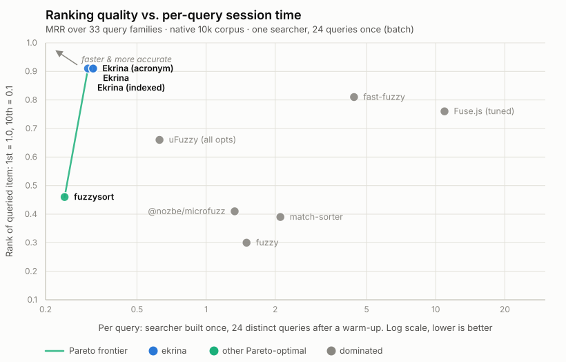

# Match quality and speed benchmarks

Full data behind the README's summary: what each library calls a match, where it ranks the right answer, and how long a query takes.
Every measured table below is generated, and `pnpm bench` regenerates all of them: it measures, writes [`bench/results.json`](../bench/results.json), rewrites each table in place, and redraws the Pareto charts.
No measured cell in this document is typed by hand.

- `pnpm bench --docs` re-emits the tables from the committed `results.json` without measuring anything.
- `pnpm bench --check` exits nonzero if any table here disagrees with `results.json`.
- `pnpm bench --speed`, `pnpm bench --quality` and `pnpm bench --memory` run one stage of the measurement; `--runs=N` sets the fresh processes per cold cell (default 1).
- `pnpm bench --scope=native-10k` scopes a dev run (tokens: a corpus, a size, or `corpus-size`, comma-separable).
  A scoped run measures a partial matrix, so it prints and stops: neither `results.json` nor this document is touched.

The pre-filter funnel ([`bench/funnel.test.ts`](../bench/funnel.test.ts)) is a diagnostic rather than a published table; run it with `pnpm --filter=ekrina-bench test`.
Improvements to the benchmarks are welcome.

## Libraries

The eight libraries compared throughout, and the configurations every table below is named after.
Feature coverage first; each cell is verified against the library's current source:

| Library                                                     | Per-field | Ranges | Diacritics | ESM | Multi-word | Typos | Tiers |
| ----------------------------------------------------------- | :-------: | :----: | :--------: | :-: | :--------: | :---: | :---: |
| **Ekrina**                                                   |    🟢     |   🟢   |     🟢     | 🟢  |     🟢     |  🟢   |  🟢   |
| [@nozbe/microfuzz](https://github.com/Nozbe/microfuzz)      |    🟢     |   🟢   |     🟢     | 🔴  |     🟢     |  🔴   |  🔴   |
| [fast-fuzzy](https://github.com/EthanRutherford/fast-fuzzy) |    🟢     |   🟡   |     🔴     | 🟢  |     🔴     |  🟢   |  🔴   |
| [Fuse.js](https://www.fusejs.io/)                           |    🟢     |   🟡   |     🟡     | 🟢  |     🟡     |  🟢   |  🔴   |
| [fuzzy](https://github.com/mattyork/fuzzy)                  |    🔴     |   🟡   |     🔴     | 🔴  |     🔴     |  🔴   |  🔴   |
| [fuzzysort](https://github.com/farzher/fuzzysort)           |    🟢     |   🟢   |     🟢     | 🔴  |     🟢     |  🔴   |  🔴   |
| [match-sorter](https://github.com/kentcdodds/match-sorter)  |    🟢     |   🔴   |     🟢     | 🟡  |     🔴     |  🔴   |  🟢   |
| [uFuzzy](https://github.com/leeoniya/uFuzzy)                |    🔴     |   🟢   |     🟡     | 🟡  |     🟡     |  🟡   |  🔴   |

🟢 built-in / on by default

🟡 opt-in or partial

🔴 not supported

Size and type, Ekrina first, then by bundle size ascending.

<!-- bench:libraries -->
| Library          | Gzip    | Deps | Type                 |
|------------------|---------|------|----------------------|
| **Ekrina**       | ~6.4 kB | 0    | subsequence (tiered) |
| fuzzy            | ~0.8 kB | 0    | substring            |
| @nozbe/microfuzz | ~1.7 kB | 0    | subsequence          |
| match-sorter     | ~3.4 kB | 2    | subsequence (tiered) |
| fuzzysort        | ~3.7 kB | 0    | subsequence          |
| uFuzzy           | ~4.1 kB | 0    | subsequence          |
| Fuse.js          | ~9.3 kB | 0    | typo-tolerant        |
| fast-fuzzy       | ~11 kB  | 1    | typo-tolerant        |
<!-- bench:end -->

The tables below show each library at its best-scoring configuration, plus every Ekrina configuration.
That configuration is picked by running every one a library has against the same query families it is then ranked on, so each headline row is the library tuned to this bench, the most favourable reading of it the bench can produce.
Each library's base row is what installing it gives you, and for two of them it scores much lower: uFuzzy 0.21 MRR rather than 0.66, and Fuse.js 0.72 rather than 0.76.
Ekrina's tuned constants, `TYPO_PENALTY`, the density floor and the rescue cutoff, were set from measurements on the bench's earlier, synthetic corpora, before these existed.
The query families were fixed, weights included, before any library was measured on these corpora, and [`bench/held-out.test.ts`](../bench/held-out.test.ts) scores Ekrina again on items and seeds the published families never drew from.
Every other configuration is on its library's own page, against the rest of that library's: [Ekrina](./libraries/ekrina.md), [Fuse.js](./libraries/fuse.md), [uFuzzy](./libraries/ufuzzy.md), [fast-fuzzy](./libraries/fast-fuzzy.md), [@nozbe/microfuzz](./libraries/microfuzz.md) and [fuzzy](./libraries/fuzzy.md).
An "(all opts)" row shares its base library's size, deps, and type.
Ekrina's opt-in rows are named after the option they switch on: **(acronym)** for `acronym: true` and **(fuzzier)** for the `fuzzier` matcher, which adds two-edit corrections, sparse words, stray spaces and split or joined words.
The specific opt-ins the "(all opts)" rows switch on, and where output formats differ:

- `Ekrina`: Typos 🟢 is the always-on one-edit rescue, reported as the `corrected` tier, a swap, an extra character, a missing one or a wrong one, i.e. Damerau-Levenshtein distance 1, not general edit distance
- `uFuzzy`: folds diacritics via `latinize()`, matches multi-word via `outOfOrder`, and runs its one-typo `SingleError` mode with all four edits, the closest config to Ekrina's one-edit rescue
- `Fuse.js`: returns `ranges` via `includeMatches`, folds diacritics via `ignoreDiacritics`, and matches multi-word via `useExtendedSearch`, which turns space-separated terms into an AND of fuzzy patterns in any order, the same result set Ekrina's multi-word tier returns.
  Fuse's other multi-word switch, `useTokenSearch`, defaults to OR (`tokenMatch: "any"`) and only reaches these semantics at `tokenMatch: "all"`
- `fast-fuzzy`: its `ranges` are one span (`index` + `length`), not per-character, and its default normalisation doesn't strip accents
- `fuzzy`: its "ranges" are a pre-wrapped string, not numeric indices

Every configuration is defined once, in [`bench/configs.ts`](../bench/configs.ts), so a row timed in the speed tables is the same row ranked in the scorecard.
A base row is the library's own defaults.
For Fuse.js that means `threshold` 0.6 and a score that decays with a match's distance from index 0, which return the widest result sets in the field: 971 rows for the exact long word `gensler` on native, where Ekrina returns 1 ([`bench/results.json`](../bench/results.json)).
A "(tuned)" row is an "(all opts)" row with its settings chosen by a sweep against an earlier version of this bench, and Fuse.js has the only one: at `threshold` 0.45 it scores 0.76 on both Wikidata corpora against the default's 0.72, and returns 73 rows for `gensler` ([Fuse.js](./libraries/fuse.md)).

## How to read these numbers

### One measurement model

Every time cell in this document comes from [`bench/run.ts`](../bench/run.ts): a _fresh node process per sample_, so the JIT, every per-searcher cache, and every process-wide cache (fuzzysort's prepare pool) start empty by construction, nothing is reconstructed by arithmetic, and no harness state can leak between cells.
Each child times:

- **index** = the constructor call, whatever the configuration builds there (uFuzzy (all opts) running `latinize()` over the haystack included; fuzzysort has no constructor at all, so its prepare-all pass lands in its first query, which is where a real user meets it).
- **cold query** = the first answer to one representative query, before any lazy work has run: Ekrina's raw-gate scan and rescue mask build, fuzzysort's prepare-all.
  Six families are timed this way (short word, phrase, substitution, prefix, acronym, garbage), one path through a matcher each.
- **batch** = one process answering a short-word warmup match (`hinton`: guaranteed literal hit, absorbs the JIT and the first full scan) and then every representative query, once each: the realistic session.
  The process warms up only by answering distinct real queries, no query is ever repeated, anywhere in the harness.
  The batch reports its total, the warmup (`first`), the mean of the 24 queries after it (`batch/query`), and each query's own post-warmup time, kept in `results.json`.
- **one-shot** = constructor + first answer, summed inside one child's consecutive windows: the whole of "given a list, get an answer".

The JIT is included deliberately.
A cold first call runs unoptimised code, and that is exactly what a user's first call runs; by the twentieth distinct query the engine is as warm as a real session ever makes it.
The previous harness sampled hundreds of repeats of one query, which tiered the JIT far past anything realistic and hid every first call inside an untimed calibration probe, [docs/measurement.md](./measurement.md) records the move.

Which column matters depends on workload: search-as-you-type → **batch/query** (and the session table below for the keystroke chain); a backend one-shot over fresh data → **one-shot**; a first-keystroke latency budget over a prebuilt index → **cold query**.

### Timing method

Timing noise is one-sided (GC, scheduler, and thermal interruptions only ever _add_ time), so the median across processes rejects spikes; the per-cell minimum, the noise-free floor, stays in [`bench/results.json`](../bench/results.json) but is never the headline, because best-of-N flatters.
One process per cell is the default (`pnpm bench --runs=N` raises it): every number is milliseconds-scale under this model, and the small timed set keeps a whole run near four minutes, which is what makes rerunning on a quiet machine quick.
A single cell is ~15% noisy at one process; the guards below look at sums for that reason.

The guards:

- Result counts must be identical across a cell's processes (a variant whose answer drifts is not timing comparable work).
- Variant order rotates per repetition so thermal and load drift land evenly instead of on whichever library ran last.
- Base Ekrina measuring more than 10% slower than its strictly-more-code acronym configuration, summed over every cell, fails the run outright (more code cannot be faster, a violated invariant means absorbed load, and the artifact is not written).
- The first cell is re-timed after the last as a drift canary.

Numbers are expected to vary per machine: swapping between a Mac ARM host and an AMD x64 showed subtly different relative results.

### The corpora and the query families

Three corpora, benched separately, each a frozen JSON snapshot committed next to the bench, so runs do no generation work and the data cannot drift:

- **en**: the English labels of the best-known Wikidata entities, 100,000 items in a fixed mix of 35% people, 20% places, 20% creative works, 15% organisations and 10% products and brands ("Pedro López", "Hinton St George", "Two for the Seesaw").
  8.9% of items carry a non-ASCII letter.
- **native**: the same items under the native name Wikidata records for them where it has one ("Москва", "孟晚舟", "Sånger från andra våningen"), and the English label otherwise: 20% of items are non-ASCII and 10% are in a non-Latin script.
- **emoji**: every emoji [emojibase-data](https://github.com/milesj/emojibase) names, written as a picker searches it, the label then the tags the label doesn't already say ("pretzel — convoluted, twisted"): 1,923 items, too few for the 10k and 100k timing cells, so it is scored for quality only.

The categories are interleaved in a fixed pattern, so any prefix keeps the mix and the 10k list is the first 10,000 items of the 100k.
Wikidata is CC0; regenerating the two Wikidata corpora ([`bench/corpus-wikidata-gen.test.ts`](../bench/corpus-wikidata-gen.test.ts), `GEN_WIKIDATA=1`) redraws items as well as queries, since Wikidata changes daily, and so changes every rank table here.
The emoji corpus regenerates from a pinned emojibase-data release checked against its SHA-256 ([`bench/corpus-emoji-gen.test.ts`](../bench/corpus-emoji-gen.test.ts), `GEN_EMOJI=1`).

Each query runs against the same 10,000 items in every library (the whole 1,923 for emoji), and for each library the bench records:

- **Where it ranks a right answer.**
  A query's right answers are every item it could have meant ("Match quality, by query family" says how they are decided), and the score is the rank of the first one.
  In most cases, a deep rank is effectively a miss, particularly in a UI, so a rank outside the top 10 counts as a miss.
  Scoring uses the mean reciprocal rank (average of `1/rank`), **MRR** from here on, a bounded score ranging from 0 to 1.
  A rank 1 match gets a score of 1, rank 2 gets 0.5, rank 5 gets 0.2 and rank 10 gets 0.1; a rank outside the top 10, like a miss, gets 0.
- **Whether it answers queries nothing answers.**
  The **junk** rate is the share of queries with no right answer anywhere in the list that a library returns anything for.
  It counts a query, not its rows, so a library that caps its result list gains nothing from the cap.
  The row counts behind it stay in [`bench/results.json`](../bench/results.json) as a diagnostic.
- **The duration taken to run the query.**
  Times spread three orders of magnitude on the same query (0.03 ms to ~120 ms at 100k), and search-as-you-type multiplies the spread: one query per keystroke, where 0.03 ms is invisible and 120 ms blows the frame budget.

The rules that picked the query families ([`bench/catalogue.ts`](../bench/catalogue.ts)):

- **Every query comes from how people mistype, not from any library's tiers.**
  Each family is a fixed rule for turning an item into a query, capped at a strength people actually reach: one or two edits in a word, a sound-alike spelling, a word half typed, two words reversed, a stray space.
  The real-misspelling family takes its misspellings from Wikipedia's list of common English misspellings, at a pinned revision ([`bench/misspellings.json`](../bench/misspellings.json), CC BY-SA 4.0).
  The phonetic rules are written for English, so on names they fire only where a name happens to hold the pattern.
- **Each family samples ten queries** from a fixed shuffle of the whole list, so sources come from every position rather than the head, where a list-order tie-break would favour them.
  A query is kept only if at most three items could answer it: when dozens of items hold a word, any library that matches at all fills its top ten with right answers, and the query measures matching, not ranking.
  A corrupted query that is itself a corpus word is skipped, since it would be a correct query.
- **The headline weights were fixed before measuring**: typos 0.35, phonetic 0.25, partial words 0.15, query shape 0.15 and noise 0.10.
  A library's MRR is the weighted mean of its group means, and the families tables below stay unweighted.
  Acronyms and plurals are reported but carry no weight, since both are behaviours one library was built around.
- **Queries nothing answers are probed at several distances**, so no library's edit budget decides where "unanswerable" starts: corpus words pushed three, four and five edits from every word in the list, random letters four edits from everything, and pairs of words each three edits away, twenty of each.

Separately from the sampled families, each Wikidata corpus derives one representative query per probe kind, the query the speed tables time and the batch answers.
Each kind takes the first item, from a fixed start, that can carry it: two plain words, a long enough word, a word at most two items hold ([`bench/corpus.ts`](../bench/corpus.ts)).
On the native corpus they are:

| #     | probe                         | query                         | isolates                                              |
| ----- | ----------------------------- | ----------------------------- | ----------------------------------------------------- |
| 1     | long single word              | `gensler`                     | baseline agreement                                    |
| 2     | short single word             | `hinton`                      | low-signal input, fewer chars for gates and chunking  |
| 3     | two-word phrase               | `pedro alonso`                | tokenisation (in corpus order: any engine can pass)   |
| 4     | two words, reversed           | `alonso pedro`                | true order-independence                               |
| 5     | reversed, second half-typed   | `alo pedro`                   | a phrase mid-keystroke: word starts, not whole words  |
| 6     | two words, space forgotten    | `pedroalonso`                 | a phrase typed as one word                            |
| 7     | two words plus one absent     | `pedro alonso gensler`        | AND vs OR over query words (0 rows is correct)        |
| 8     | two words, first mistyped     | `pexro alonso`                | a typo inside a phrase; word-level rescue             |
| 9     | two words, second mistyped    | `pedro aloxso`                | the rescue must find the failing word                 |
| 10    | reversed phrase, one mistyped | `alonso pexro`                | the correction must survive order-independence        |
| 11    | two words, both mistyped      | `pexro aloxso`                | two edits: 0 rows unless `fuzzier`                    |
| 12    | prefix / partial word         | `ameri`                       | a word not yet finished                               |
| 13    | mid-word infix                | `ntiag`                       | contains-anywhere vs start-anchored ranking           |
| 14    | plural typed, singular stored | `abrashis`                    | a trailing `-s` the corpus lacks, one deletion        |
| 15    | four-character typo           | `fexg`                        | corrected only when nothing matches as typed          |
| 16–18 | typo gradient (light → heavy) | `gumuova` `guusva` `gmsv`     | each engine's effective fuzzy limit                   |
| 19    | transposition typo            | `gumsuova`                    | adjacent-swap handling, rescue tier vs edit distance  |
| 20    | insertion typo                | `gumussova`                   | a doubled keystroke, one character too many           |
| 21    | substitution typo             | `gumuxova`                    | one wrong character, absent from the source entirely  |
| 22    | acronym                       | `tfts`                        | deliberate acronym support vs accidental subsequences |
| 23    | accent-stripped               | `lopez`                       | diacritic folding                                     |
| 24    | garbage                       | `qxzwkv`                      | the reject path, verifying no impossible matches      |

The en corpus derives the same kinds from its own items (`pedro lopez` for the phrases); each query's rank and row count per library is in [`bench/results.json`](../bench/results.json).
MRR covers 33 scored families and 330 queries on every corpus; with ten queries a family, a single family's MRR can swing by 0.3 between draws while the weighted headline moves by a few hundredths, so read headline differences of ±0.02 as ties and treat single family cells as indicative.

## Build time

<!-- bench:build -->
| build |  Ekrina | Ekrina (indexed) | @nozbe/microfuzz | fast-fuzzy | Fuse.js | uFuzzy (all opts) |
|-------|--------:|-----------------:|-----------------:|-----------:|--------:|------------------:|
| 10k   | 0.17 ms |          3.09 ms |          4.83 ms |   29.44 ms | 1.09 ms |           4.68 ms |
| 100k  | 0.35 ms |         14.67 ms |         54.58 ms |  333.46 ms | 5.48 ms |           8.68 ms |
<!-- bench:end -->

Measured on the native corpus (process-cold constructor timings; build time barely differs between corpora).
Fuse.js's build is minimal because its "index" is trivial, and the work it defers to query time is why its queries are slow.
fast-fuzzy's trie is the heaviest build in the set, and its subtree pruning needs it.
fuzzysort has no constructor at all, so it has no column here, its lazy prepare-all pass lands in its first query's cold cell, where stock usage actually meets it.
uFuzzy's base construction only shows up process-cold, because `new uFuzzy()` compiles the engine's regex machinery on first construction, and it never touches the list.
The (all opts) column shown here also runs `latinize()` over the haystack, which is why it grows with the corpus (4.68 → 8.68 ms).
microfuzz's column is its whole index: the constructor normalises every item and builds its word sets up front, so its first query adds only 0.06 MB to the memory table below.
Ekrina's constructor only allocates - field text is trimmed, normalised and masked the first time an item survives a gate - so a 100k list swap takes about a third of a millisecond, and the first query then carries what construction deferred (its cold cells).
Ekrina (indexed), the same searcher with its mask index built up front, moves the larger part of that deferred work into its constructor: 3.09 ms at 10k and 14.67 ms at 100k.

## Memory

<!-- bench:memory -->
| Library           | built MB | + `hinton` | + `qxzwkv` | + `gensler` | dropped MB |
|-------------------|---------:|-----------:|-----------:|------------:|-----------:|
| Ekrina            |     1.94 |       2.47 |       3.55 |        3.79 |       0.53 |
| Ekrina (acronym)  |     1.94 |       2.47 |       3.55 |        3.80 |       0.54 |
| Ekrina (fuzzier)  |     3.56 |       4.12 |       5.22 |        5.58 |       0.66 |
| Ekrina (indexed)  |     2.99 |       3.78 |       3.80 |        3.99 |       0.50 |
| @nozbe/microfuzz  |    45.94 |      46.00 |      46.00 |       46.00 |       0.12 |
| fast-fuzzy        |   189.66 |     191.63 |     191.63 |      191.64 |       0.18 |
| Fuse.js (tuned)   |     6.92 |       7.04 |       7.12 |        7.07 |       0.18 |
| fuzzy             |     0.02 |       0.05 |       0.05 |        0.05 |       0.05 |
| fuzzysort         |     0.02 |      43.17 |      43.18 |       43.23 |      43.23 |
| match-sorter      |     0.02 |       0.10 |       0.13 |        0.13 |       0.13 |
| uFuzzy (all opts) |     1.15 |       1.22 |       1.22 |        1.23 |       0.10 |
<!-- bench:end -->

What each configuration retains at 100k on the native corpus: `heapUsed + external` over a baseline taken with the list already in memory, so typed arrays count and the caller's own strings don't.
Each row is one fresh process ([`bench/memory.ts`](../bench/memory.ts)): the searcher is built, then answers `hinton`, `qxzwkv` and `gensler` warm in that order, so each column includes every query before it.
**dropped MB** is what is still retained once the searcher is unreachable and collected.
Ekrina allocates its per-item caches empty at construction; `hinton` prepares the items it matches (~0.5 MB), and `qxzwkv`, the first query to reach the one-edit rescue, adds the mask index's bigram arrays (~1.1 MB).
Ekrina (indexed) builds that index at construction instead (2.99 MB built), so `qxzwkv` adds only 0.02 MB.
Ekrina's searcher is collected (`collected` in [`bench/results.json`](../bench/results.json)), but 0.5 MB of process-wide state stays behind on native and 0.2 MB on en: it grows with the characters a corpus holds rather than its items, consistent with the module-level cache of rare-character folds in [`src/normalise.ts`](../src/normalise.ts).
fuzzysort retains nothing until its first `go()` fills its `prepare()` cache, which is process-wide and unevicted, so its **dropped** column equals its footprint until you call `cleanup()`.
Every other library gives its index back, leaving under 0.2 MB.
The en cells, in [`bench/results.json`](../bench/results.json), tell the same story.

## Match quality, by query family

Each library has its own definition of a match, so raw outputs aren't directly comparable.
Every family below is ten queries sampled from across the list with a fixed seed ([`bench/catalogue.ts`](../bench/catalogue.ts)), each one that at most three items could answer, and each scored by the rank of its first relevant result.
A result is relevant when it holds what the query was typed for: every intended word as a word, in any order, for the phrases; the uncorrupted word for the typos and misspellings; the typed prefix for the half-typed words; the same initials for the acronyms.
Relevance is judged on the bench's own accent folding and word split, never on a library's.
So any item a person could have meant counts, and no library is credited for breaking a tie in favour of one particular item.
Ties that list order breaks are found by re-running each query over the reversed list, and a tie mixing relevant and irrelevant items scores its expected first-relevant rank.
Each cell is MRR@10 over the family's ten queries; the scorecard's MRR weights the group means ("The corpora and the query families").

**native corpus:**

<!-- bench:families-native -->
| Group         | Family                        | Ekrina (fuzzier) | Ekrina | Ekrina (acronym) | fast-fuzzy | Fuse.js (tuned) | uFuzzy (all opts) | fuzzysort | @nozbe/microfuzz | match-sorter | fuzzy |
|---------------|-------------------------------|-----------------:|-------:|-----------------:|-----------:|----------------:|------------------:|----------:|-----------------:|-------------:|------:|
| typos         | neighbouring key              |             1.00 |   1.00 |             1.00 |       1.00 |            0.76 |              1.00 |      0.00 |             0.00 |         0.00 |  0.00 |
| typos         | two neighbouring keys         |             0.97 |   0.00 |             0.00 |       1.00 |            0.87 |              0.00 |      0.00 |             0.00 |         0.00 |  0.00 |
| typos         | random letter                 |             0.95 |   0.95 |             0.95 |       0.93 |            0.83 |              0.88 |      0.00 |             0.00 |         0.00 |  0.00 |
| typos         | dropped letter                |             0.97 |   0.78 |             0.78 |       0.63 |            0.71 |              0.80 |      0.90 |             0.77 |         0.93 |  0.62 |
| typos         | two dropped letters           |             1.00 |   0.76 |             0.76 |       0.43 |            0.34 |              0.00 |      0.93 |             0.89 |         1.00 |  0.94 |
| typos         | inserted neighbouring key     |             1.00 |   1.00 |             1.00 |       1.00 |            0.92 |              1.00 |      0.10 |             0.05 |         0.10 |  0.10 |
| typos         | swapped neighbours            |             0.79 |   0.80 |             0.80 |       0.79 |            0.48 |              0.79 |      0.08 |             0.04 |         0.06 |  0.06 |
| typos         | stuck key                     |             0.80 |   0.00 |             0.00 |       1.00 |            0.66 |              0.00 |      0.00 |             0.00 |         0.00 |  0.00 |
| typos         | first letter wrong            |             0.80 |   0.90 |             0.90 |       0.85 |            0.71 |              0.00 |      0.10 |             0.10 |         0.10 |  0.10 |
| typos         | typo in each of two words     |             1.00 |   0.00 |             0.00 |       1.00 |            1.00 |              1.00 |      0.00 |             0.00 |         0.00 |  0.00 |
| typos         | typo then a half-typed word   |             1.00 |   1.00 |             1.00 |       1.00 |            1.00 |              1.00 |      0.00 |             0.00 |         0.00 |  0.00 |
| typos         | two words joined, with a typo |             0.97 |   0.00 |             0.00 |       0.97 |            0.97 |              0.00 |      0.00 |             0.00 |         0.00 |  0.00 |
| phonetic      | consonant spelt another way   |             1.00 |   0.80 |             0.80 |       0.93 |            0.78 |              0.65 |      0.10 |             0.10 |         0.10 |  0.10 |
| phonetic      | letter doubled or singled     |             0.92 |   0.87 |             0.87 |       0.82 |            0.80 |              1.00 |      0.20 |             0.20 |         0.20 |  0.20 |
| phonetic      | silent letters dropped        |             0.61 |   0.58 |             0.58 |       0.60 |            0.47 |              0.53 |      0.70 |             0.56 |         0.56 |  0.62 |
| phonetic      | vowel sound spelt another way |             0.95 |   0.95 |             0.95 |       0.95 |            0.57 |              0.95 |      0.00 |             0.00 |         0.00 |  0.00 |
| partial words | prefix of 3                   |             1.00 |   1.00 |             1.00 |       0.90 |            1.00 |              1.00 |      1.00 |             1.00 |         1.00 |  0.66 |
| partial words | prefix of 5                   |             1.00 |   1.00 |             1.00 |       1.00 |            0.95 |              1.00 |      1.00 |             1.00 |         1.00 |  0.99 |
| partial words | infix of 5                    |             1.00 |   1.00 |             1.00 |       1.00 |            0.93 |              1.00 |      1.00 |             1.00 |         1.00 |  1.00 |
| partial words | two words half typed          |             1.00 |   1.00 |             1.00 |       0.14 |            1.00 |              1.00 |      1.00 |             1.00 |         0.95 |  0.80 |
| partial words | a vowel dropped               |             0.97 |   0.92 |             0.92 |       0.71 |            0.70 |              0.71 |      0.87 |             0.87 |         1.00 |  0.88 |
| partial words | 2 vowels dropped              |             0.95 |   0.25 |             0.25 |       0.37 |            0.43 |              0.03 |      0.90 |             0.80 |         0.95 |  0.76 |
| query shape   | two words                     |             1.00 |   1.00 |             1.00 |       1.00 |            1.00 |              1.00 |      1.00 |             0.88 |         0.90 |  0.68 |
| query shape   | two words reversed            |             1.00 |   1.00 |             1.00 |       0.07 |            1.00 |              0.95 |      1.00 |             0.90 |         0.00 |  0.00 |
| query shape   | two words joined              |             1.00 |   1.00 |             1.00 |       1.00 |            0.90 |              0.00 |      1.00 |             1.00 |         1.00 |  0.90 |
| query shape   | an absent word added          |             0.00 |   0.00 |             0.00 |       0.80 |            0.00 |              0.00 |      0.00 |             0.00 |         0.00 |  0.00 |
| noise         | space inside a word           |             1.00 |   0.00 |             0.00 |       0.91 |            1.00 |              0.90 |      1.00 |             0.00 |         0.00 |  0.00 |
| noise         | punctuation inside a word     |             1.00 |   0.00 |             0.00 |       0.95 |            0.83 |              1.00 |      0.00 |             0.00 |         0.00 |  0.00 |
| noise         | accents stripped              |             1.00 |   1.00 |             1.00 |       0.62 |            0.88 |              0.90 |      0.85 |             0.96 |         0.90 |  0.10 |
| noise         | accents added                 |             1.00 |   1.00 |             1.00 |       0.93 |            1.00 |              1.00 |      1.00 |             0.96 |         1.00 |  0.00 |
| reported only | acronym                       |             0.37 |   0.37 |             0.90 |       0.00 |            0.00 |              0.00 |      0.50 |             0.44 |         0.70 |  0.15 |
| reported only | plural for a singular         |             1.00 |   1.00 |             1.00 |       1.00 |            0.88 |              1.00 |      0.20 |             0.20 |         0.20 |  0.20 |
| phonetic      | real misspelling              |             0.65 |   0.73 |             0.73 |       0.74 |            0.58 |              0.64 |      0.40 |             0.30 |         0.30 |  0.30 |
<!-- bench:end -->

**en corpus:**

<!-- bench:families-en -->
| Group         | Family                        | Ekrina (fuzzier) | Ekrina | Ekrina (acronym) | fast-fuzzy | Fuse.js (tuned) | uFuzzy (all opts) | fuzzysort | @nozbe/microfuzz | match-sorter | fuzzy |
|---------------|-------------------------------|-----------------:|-------:|-----------------:|-----------:|----------------:|------------------:|----------:|-----------------:|-------------:|------:|
| typos         | neighbouring key              |             1.00 |   1.00 |             1.00 |       1.00 |            0.90 |              1.00 |      0.00 |             0.00 |         0.00 |  0.00 |
| typos         | two neighbouring keys         |             1.00 |   0.00 |             0.00 |       1.00 |            0.95 |              0.00 |      0.00 |             0.00 |         0.00 |  0.00 |
| typos         | random letter                 |             0.88 |   0.95 |             0.95 |       0.93 |            0.81 |              0.88 |      0.00 |             0.00 |         0.00 |  0.00 |
| typos         | dropped letter                |             0.95 |   0.77 |             0.77 |       0.64 |            0.73 |              0.83 |      0.90 |             0.77 |         0.91 |  0.68 |
| typos         | two dropped letters           |             1.00 |   0.82 |             0.82 |       0.46 |            0.41 |              0.00 |      1.00 |             1.00 |         1.00 |  0.97 |
| typos         | inserted neighbouring key     |             1.00 |   1.00 |             1.00 |       1.00 |            0.85 |              1.00 |      0.00 |             0.00 |         0.00 |  0.00 |
| typos         | swapped neighbours            |             0.79 |   0.80 |             0.80 |       0.78 |            0.48 |              0.78 |      0.07 |             0.04 |         0.04 |  0.05 |
| typos         | stuck key                     |             0.90 |   0.00 |             0.00 |       1.00 |            0.68 |              0.00 |      0.00 |             0.00 |         0.00 |  0.00 |
| typos         | first letter wrong            |             0.90 |   0.95 |             0.95 |       0.90 |            0.80 |              0.00 |      0.10 |             0.10 |         0.10 |  0.10 |
| typos         | typo in each of two words     |             1.00 |   0.00 |             0.00 |       1.00 |            1.00 |              1.00 |      0.00 |             0.00 |         0.00 |  0.00 |
| typos         | typo then a half-typed word   |             1.00 |   1.00 |             1.00 |       1.00 |            1.00 |              1.00 |      0.00 |             0.00 |         0.00 |  0.00 |
| typos         | two words joined, with a typo |             0.97 |   0.00 |             0.00 |       0.97 |            0.97 |              0.00 |      0.00 |             0.00 |         0.00 |  0.00 |
| phonetic      | consonant spelt another way   |             1.00 |   0.80 |             0.80 |       0.93 |            0.65 |              0.65 |      0.10 |             0.10 |         0.10 |  0.10 |
| phonetic      | letter doubled or singled     |             1.00 |   0.95 |             0.95 |       0.93 |            0.83 |              1.00 |      0.20 |             0.20 |         0.20 |  0.20 |
| phonetic      | silent letters dropped        |             0.60 |   0.57 |             0.57 |       0.53 |            0.48 |              0.58 |      0.66 |             0.54 |         0.51 |  0.58 |
| phonetic      | vowel sound spelt another way |             0.95 |   0.95 |             0.95 |       0.81 |            0.44 |              0.80 |      0.00 |             0.00 |         0.00 |  0.00 |
| partial words | prefix of 3                   |             1.00 |   1.00 |             1.00 |       0.90 |            1.00 |              1.00 |      1.00 |             1.00 |         1.00 |  0.57 |
| partial words | prefix of 5                   |             1.00 |   1.00 |             1.00 |       1.00 |            1.00 |              1.00 |      1.00 |             1.00 |         1.00 |  0.97 |
| partial words | infix of 5                    |             1.00 |   1.00 |             1.00 |       1.00 |            0.92 |              1.00 |      0.95 |             1.00 |         1.00 |  0.94 |
| partial words | two words half typed          |             1.00 |   1.00 |             1.00 |       0.14 |            1.00 |              1.00 |      1.00 |             1.00 |         0.95 |  0.85 |
| partial words | a vowel dropped               |             0.97 |   0.94 |             0.94 |       0.76 |            0.76 |              0.76 |      0.87 |             0.85 |         0.95 |  0.84 |
| partial words | 2 vowels dropped              |             0.93 |   0.13 |             0.13 |       0.28 |            0.35 |              0.02 |      0.93 |             0.80 |         0.93 |  0.81 |
| query shape   | two words                     |             1.00 |   1.00 |             1.00 |       1.00 |            1.00 |              1.00 |      1.00 |             0.88 |         0.90 |  0.68 |
| query shape   | two words reversed            |             1.00 |   1.00 |             1.00 |       0.07 |            1.00 |              1.00 |      1.00 |             0.90 |         0.00 |  0.00 |
| query shape   | two words joined              |             1.00 |   1.00 |             1.00 |       1.00 |            1.00 |              0.00 |      1.00 |             1.00 |         1.00 |  0.80 |
| query shape   | an absent word added          |             0.00 |   0.00 |             0.00 |       0.80 |            0.00 |              0.00 |      0.00 |             0.00 |         0.00 |  0.00 |
| noise         | space inside a word           |             1.00 |   0.00 |             0.00 |       0.91 |            1.00 |              0.90 |      1.00 |             0.00 |         0.00 |  0.00 |
| noise         | punctuation inside a word     |             1.00 |   0.00 |             0.00 |       0.95 |            0.82 |              1.00 |      0.00 |             0.00 |         0.00 |  0.00 |
| noise         | accents stripped              |             1.00 |   1.00 |             1.00 |       0.65 |            0.85 |              1.00 |      0.93 |             0.96 |         1.00 |  0.13 |
| noise         | accents added                 |             1.00 |   1.00 |             1.00 |       0.93 |            0.97 |              1.00 |      1.00 |             0.95 |         1.00 |  0.00 |
| reported only | acronym                       |             0.64 |   0.64 |             0.88 |       0.05 |            0.00 |              0.00 |      0.78 |             0.47 |         0.73 |  0.03 |
| reported only | plural for a singular         |             1.00 |   1.00 |             1.00 |       1.00 |            0.71 |              1.00 |      0.30 |             0.30 |         0.25 |  0.30 |
| phonetic      | real misspelling              |             0.57 |   0.73 |             0.73 |       0.57 |            0.57 |              0.58 |      0.33 |             0.20 |         0.17 |  0.15 |
<!-- bench:end -->

**emoji corpus:**

<!-- bench:families-emoji -->
| Group         | Family                        | Ekrina (fuzzier) | Ekrina | Ekrina (acronym) | fast-fuzzy | Fuse.js (tuned) | uFuzzy (all opts) | fuzzysort | @nozbe/microfuzz | match-sorter | fuzzy |
|---------------|-------------------------------|-----------------:|-------:|-----------------:|-----------:|----------------:|------------------:|----------:|-----------------:|-------------:|------:|
| typos         | neighbouring key              |             1.00 |   1.00 |             1.00 |       1.00 |            0.76 |              1.00 |      0.20 |             0.13 |         0.15 |  0.14 |
| typos         | two neighbouring keys         |             1.00 |   0.00 |             0.00 |       1.00 |            0.58 |              0.00 |      0.00 |             0.00 |         0.00 |  0.00 |
| typos         | random letter                 |             0.78 |   0.88 |             0.88 |       0.95 |            0.79 |              0.95 |      0.23 |             0.20 |         0.23 |  0.20 |
| typos         | dropped letter                |             1.00 |   0.76 |             0.76 |       0.75 |            0.46 |              0.52 |      0.80 |             0.78 |         0.92 |  0.66 |
| typos         | two dropped letters           |             1.00 |   0.90 |             0.90 |       0.74 |            0.49 |              0.00 |      0.83 |             0.68 |         0.82 |  0.69 |
| typos         | inserted neighbouring key     |             0.95 |   0.95 |             0.95 |       1.00 |            0.87 |              1.00 |      0.20 |             0.20 |         0.20 |  0.20 |
| typos         | swapped neighbours            |             1.00 |   1.00 |             1.00 |       1.00 |            0.44 |              1.00 |      0.38 |             0.29 |         0.24 |  0.38 |
| typos         | stuck key                     |             0.90 |   0.00 |             0.00 |       0.88 |            0.81 |              0.00 |      0.23 |             0.23 |         0.22 |  0.30 |
| typos         | first letter wrong            |             0.82 |   0.82 |             0.82 |       0.90 |            0.78 |              0.00 |      0.33 |             0.35 |         0.31 |  0.33 |
| typos         | typo in each of two words     |             1.00 |   0.00 |             0.00 |       1.00 |            1.00 |              1.00 |      0.05 |             0.00 |         0.00 |  0.00 |
| typos         | typo then a half-typed word   |             1.00 |   1.00 |             1.00 |       0.95 |            0.95 |              1.00 |      0.05 |             0.10 |         0.01 |  0.10 |
| typos         | two words joined, with a typo |             1.00 |   0.00 |             0.00 |       0.85 |            0.81 |              0.00 |      0.05 |             0.05 |         0.03 |  0.07 |
| phonetic      | consonant spelt another way   |             1.00 |   0.70 |             0.70 |       1.00 |            0.85 |              0.60 |      0.00 |             0.00 |         0.00 |  0.00 |
| phonetic      | letter doubled or singled     |             0.87 |   0.87 |             0.87 |       0.83 |            0.70 |              0.77 |      0.60 |             0.55 |         0.60 |  0.55 |
| phonetic      | silent letters dropped        |             0.60 |   0.60 |             0.60 |       0.56 |            0.27 |              0.50 |      0.50 |             0.60 |         0.60 |  0.50 |
| phonetic      | vowel sound spelt another way |             0.85 |   0.90 |             0.90 |       0.95 |            0.45 |              0.85 |      0.43 |             0.28 |         0.33 |  0.36 |
| partial words | prefix of 3                   |             1.00 |   1.00 |             1.00 |       0.65 |            0.67 |              1.00 |      0.95 |             1.00 |         1.00 |  0.61 |
| partial words | prefix of 5                   |             1.00 |   1.00 |             1.00 |       1.00 |            0.90 |              1.00 |      1.00 |             1.00 |         1.00 |  0.98 |
| partial words | infix of 5                    |             1.00 |   1.00 |             1.00 |       1.00 |            0.66 |              1.00 |      0.95 |             1.00 |         1.00 |  0.90 |
| partial words | two words half typed          |             1.00 |   1.00 |             1.00 |       0.13 |            0.95 |              1.00 |      1.00 |             1.00 |         0.90 |  0.91 |
| partial words | a vowel dropped               |             1.00 |   0.93 |             0.93 |       0.80 |            0.72 |              0.88 |      0.87 |             0.97 |         0.90 |  0.97 |
| partial words | 2 vowels dropped              |             1.00 |   0.32 |             0.32 |       0.49 |            0.50 |              0.10 |      0.90 |             0.77 |         0.82 |  0.75 |
| query shape   | two words                     |             1.00 |   1.00 |             1.00 |       1.00 |            1.00 |              1.00 |      1.00 |             1.00 |         1.00 |  1.00 |
| query shape   | two words reversed            |             1.00 |   1.00 |             1.00 |       0.23 |            1.00 |              0.92 |      1.00 |             0.70 |         0.12 |  0.10 |
| query shape   | two words joined              |             1.00 |   1.00 |             1.00 |       0.88 |            0.95 |              0.00 |      1.00 |             1.00 |         1.00 |  1.00 |
| query shape   | an absent word added          |             0.00 |   0.00 |             0.00 |       1.00 |            0.00 |              0.00 |      0.00 |             0.00 |         0.00 |  0.00 |
| noise         | space inside a word           |             1.00 |   0.10 |             0.10 |       1.00 |            1.00 |              1.00 |      1.00 |             0.10 |         0.10 |  0.10 |
| noise         | punctuation inside a word     |             1.00 |   0.10 |             0.10 |       1.00 |            1.00 |              1.00 |      0.10 |             0.10 |         0.10 |  0.10 |
| noise         | accents stripped              |             0.95 |   0.95 |             0.95 |       0.80 |            0.74 |              0.70 |      1.00 |             0.95 |         0.95 |  0.04 |
| noise         | accents added                 |             1.00 |   1.00 |             1.00 |       0.97 |            1.00 |              1.00 |      1.00 |             1.00 |         1.00 |  0.00 |
| reported only | acronym                       |             0.35 |   0.35 |             0.90 |       0.02 |            0.00 |              0.00 |      0.78 |             0.62 |         0.23 |  0.04 |
| reported only | plural for a singular         |             1.00 |   1.00 |             1.00 |       1.00 |            0.87 |              1.00 |      0.70 |             0.70 |         0.51 |  0.70 |
| phonetic      | real misspelling              |             0.80 |   0.75 |             0.75 |       0.70 |            0.60 |              0.68 |      0.22 |             0.23 |         0.12 |  0.23 |
<!-- bench:end -->

Queries nothing answers have no rank to score, so each cell is the share of that kind's twenty queries a library answered at all, where 0 is correct.

**native corpus:**

<!-- bench:refusals-native -->
| Query nothing answers                   | Ekrina (fuzzier) | Ekrina | Ekrina (acronym) | fast-fuzzy | Fuse.js (tuned) | uFuzzy (all opts) | fuzzysort | @nozbe/microfuzz | match-sorter | fuzzy |
|-----------------------------------------|-----------------:|-------:|-----------------:|-----------:|----------------:|------------------:|----------:|-----------------:|-------------:|------:|
| a word 3 edits from every word          |             0.00 |   0.00 |             0.00 |       0.65 |            1.00 |              0.00 |      0.25 |             0.25 |         0.25 |  0.25 |
| a word 4 edits from every word          |             0.00 |   0.00 |             0.00 |       0.40 |            0.55 |              0.00 |      0.05 |             0.05 |         0.05 |  0.05 |
| a word 5 edits from every word          |             0.00 |   0.00 |             0.00 |       0.10 |            0.20 |              0.00 |      0.00 |             0.00 |         0.00 |  0.00 |
| random letters, 4 edits from every word |             0.00 |   0.00 |             0.00 |       0.05 |            0.60 |              0.00 |      0.05 |             0.05 |         0.05 |  0.05 |
| two words, each 3 edits from every word |             0.00 |   0.00 |             0.00 |       0.00 |            0.00 |              0.00 |      0.00 |             0.00 |         0.00 |  0.00 |
<!-- bench:end -->

**en corpus:**

<!-- bench:refusals-en -->
| Query nothing answers                   | Ekrina (fuzzier) | Ekrina | Ekrina (acronym) | fast-fuzzy | Fuse.js (tuned) | uFuzzy (all opts) | fuzzysort | @nozbe/microfuzz | match-sorter | fuzzy |
|-----------------------------------------|-----------------:|-------:|-----------------:|-----------:|----------------:|------------------:|----------:|-----------------:|-------------:|------:|
| a word 3 edits from every word          |             0.00 |   0.00 |             0.00 |       0.80 |            1.00 |              0.00 |      0.10 |             0.10 |         0.10 |  0.10 |
| a word 4 edits from every word          |             0.00 |   0.00 |             0.00 |       0.35 |            0.55 |              0.00 |      0.00 |             0.00 |         0.00 |  0.00 |
| a word 5 edits from every word          |             0.00 |   0.00 |             0.00 |       0.10 |            0.10 |              0.00 |      0.00 |             0.00 |         0.00 |  0.00 |
| random letters, 4 edits from every word |             0.00 |   0.00 |             0.00 |       0.05 |            0.65 |              0.00 |      0.05 |             0.05 |         0.05 |  0.05 |
| two words, each 3 edits from every word |             0.00 |   0.00 |             0.00 |       0.00 |            0.00 |              0.00 |      0.00 |             0.00 |         0.00 |  0.00 |
<!-- bench:end -->

**emoji corpus:**

<!-- bench:refusals-emoji -->
| Query nothing answers                   | Ekrina (fuzzier) | Ekrina | Ekrina (acronym) | fast-fuzzy | Fuse.js (tuned) | uFuzzy (all opts) | fuzzysort | @nozbe/microfuzz | match-sorter | fuzzy |
|-----------------------------------------|-----------------:|-------:|-----------------:|-----------:|----------------:|------------------:|----------:|-----------------:|-------------:|------:|
| a word 3 edits from every word          |             0.00 |   0.00 |             0.00 |       0.75 |            0.95 |              0.00 |      0.55 |             0.55 |         0.55 |  0.55 |
| a word 4 edits from every word          |             0.00 |   0.00 |             0.00 |       0.40 |            0.40 |              0.00 |      0.20 |             0.20 |         0.20 |  0.20 |
| a word 5 edits from every word          |             0.00 |   0.00 |             0.00 |       0.10 |            0.00 |              0.00 |      0.10 |             0.10 |         0.10 |  0.10 |
| random letters, 4 edits from every word |             0.00 |   0.00 |             0.00 |       0.00 |            0.30 |              0.00 |      0.35 |             0.35 |         0.35 |  0.35 |
| two words, each 3 edits from every word |             0.00 |   0.00 |             0.00 |       0.05 |            0.10 |              0.00 |      0.05 |             0.00 |         0.00 |  0.00 |
<!-- bench:end -->

### Family by family

MRR reads native / en, and the ten scored queries per family are in [`bench/results.json`](../bench/results.json).

**Typos**

- **One edit** (neighbouring key, random letter, inserted key, swapped neighbours, first letter wrong): Ekrina scores 0.80–1.00, fast-fuzzy 0.78–1.00 and uFuzzy (all opts) 0.78–1.00 bar the first letter, where it scores 0; Fuse.js (tuned) scores 0.48–0.92, and the chain engines 0.10 or less.
- **Dropped letter**: still a subsequence, so the chain engines score 0.62–0.93; base Ekrina scores 0.78 / 0.77 and Ekrina (fuzzier) 0.97 / 0.95.
- **Two edits in one word or phrase** (two neighbouring keys, two dropped letters, stuck key, a typo in each of two words, two words joined with a typo): base Ekrina corrects one edit, so it scores 0 on four of the five; Ekrina (fuzzier) scores 0.80–1.00, fast-fuzzy 0.43–1.00 and Fuse.js (tuned) 0.34–1.00.
  Two dropped letters stay a subsequence, which is why base Ekrina and the chain engines still reach 0.76–1.00 there.

**Phonetic**

- **Consonants and vowels spelt another way** (`kortex`, `marilin`): Ekrina (fuzzier) scores 0.95–1.00, base Ekrina 0.80–0.95 and fast-fuzzy 0.81–0.95; Fuse.js (tuned) falls to 0.44–0.78.
- **Silent letters dropped** (`rong`, `were`): 0.47–0.70 for every library, because several of the rewrites cost two or more edits.
- **Real misspellings** (`tahn`, `rela`): base Ekrina scores 0.73 on both corpora, fast-fuzzy 0.74 / 0.57 and Ekrina (fuzzier) 0.65 / 0.57, the one family where the opt-in scores below the base.

**Partial words**

- **Prefixes and infixes**: 0.90–1.00 for every library but fuzzy, which falls to 0.57–0.66 on three-letter prefixes.
- **Two words half typed** (`ana fra`): 0.80–1.00 everywhere except fast-fuzzy, at 0.14.
- **Vowels dropped**: one vowel is 0.70–1.00 everywhere; with two, base Ekrina falls to 0.25 / 0.13 while Ekrina (fuzzier) and the chain engines keep 0.76–0.95.

**Query shape**

- **Two words reversed**: the order-independent engines score 0.90–1.00; fast-fuzzy scores 0.07, match-sorter and fuzzy 0.
- **Two words joined**: uFuzzy (all opts) scores 0, since it allows no gap inside a term; everything else 0.80–1.00.
- **An absent word added** (`roman lob qboawk`): only fast-fuzzy answers (0.80), since every other engine requires every query word and Ekrina does by design.

**Noise**

- **A space or punctuation inside a word** (`web ster`, `proa-ctiva`): base Ekrina scores 0 and Ekrina (fuzzier) 1.00, beside fast-fuzzy's 0.91–0.95, Fuse.js (tuned)'s 0.82–1.00 and uFuzzy (all opts)'s 0.90–1.00.
- **Accents stripped and added**: the folding engines score 0.85–1.00, fast-fuzzy 0.62–0.93 through edit distance rather than folding, and fuzzy 0.00–0.13 with no folding at all.

**Reported only**

- **Acronym** (`fno`): base Ekrina scores 0.37 / 0.64 and Ekrina (acronym) 0.90 / 0.88; match-sorter (0.70 / 0.73) and fuzzysort (0.50 / 0.78) reach the initials as subsequence chains; Fuse.js and fast-fuzzy score 0.05 or less.
- **Plural for a singular** (`kozarcis`): Ekrina, uFuzzy (all opts) and fast-fuzzy score 1.00, the chain engines 0.20–0.30.

**Emoji**

Labels and tags are short and share words heavily ("face", "hand", "flag: …"), and the ranking holds there: Ekrina (fuzzier) scores 0.90, fast-fuzzy 0.84 and Fuse.js (tuned) 0.71.
fast-fuzzy's lead families on the Wikidata corpora carry over (an absent word added, 1.00), and so do its losses (two words half typed, 0.13; reversed, 0.23).

**Queries nothing answers**

Every Ekrina configuration and uFuzzy (all opts) answer none of them on any corpus.
fast-fuzzy answers 65–80% of the words three edits from everything and 35–40% of those four edits away; Fuse.js (tuned) answers all of the three-edit words, 55% of the four-edit ones and 60–65% of the random strings, and Fuse.js's defaults answer nearly every query of every kind.
The chain engines answer 10–25% of the three-edit words.

### garbage (`qxzwkv`)

<!-- bench:probe-miss -->
| Library           | matches | cold ms | vs `hinton` |
|-------------------|--------:|--------:|------------:|
| Ekrina (fuzzier)  |       0 |   5.293 |         60% |
| Ekrina            |       0 |   5.012 |         60% |
| fast-fuzzy        |       0 |  13.632 |         84% |
| Fuse.js (tuned)   |       0 |  13.939 |         85% |
| uFuzzy (all opts) |       0 |   1.027 |         68% |
| fuzzysort         |       0 |   6.961 |         96% |
| @nozbe/microfuzz  |       0 |   2.716 |         74% |
| match-sorter      |       0 |   3.714 |         48% |
| fuzzy             |       0 |   1.773 |         81% |
<!-- bench:end -->

No rank column: every library correctly returns nothing.
What separates them is how long that answer takes, shown against each library's own time for the short-word query `hinton` (one that does match), so the column reads as "what fraction of a real query does a hopeless one take".
A hopeless six-character query is _rescuable_, so before saying "no results" Ekrina tries harder: the literal pass comes up empty, and rather than fail it builds the union and bigram masks and attempts every one-edit correction of the query, the same second pass that scores 0.80–1.00 on the one-edit typo families above.
That is why its miss takes 5.0 ms cold at 10k, where uFuzzy (all opts) and fuzzy, whose empty result covers only the query as typed, take 1.0–1.8 ms.
The work also happens once per searcher: the masks the garbage query builds are the ones every later rescue reuses, which is why the batch column absorbs it, a session's first query that needs the masks builds them and the other twenty-three reuse them.

## Scorecard

One line per configuration: MRR and junk from [`bench/hits.test.ts`](../bench/hits.test.ts) (ranks are deterministic, measured once, untimed), times from the process-cold matrix ("Timing method"; `pnpm bench --runs=N` sets the processes per cell).
**MRR** = the group-weighted mean of the 33 scored families' MRR@10 ("The corpora and the query families"): ten queries each, scored by the rank of the first relevant result, misses and ranks outside the top 10 scoring 0.
**junk** = the share of the 100 queries nothing answers that the library answered anyway, averaged over the five kinds.
**index ms** = the constructor call (from the batch cell's fresh processes).
**cold ms** = the mean first-answer time across the six timed queries, each in its own fresh process.
**batch ms** = one fresh process answering a short-word warmup match and then every representative query once, the realistic session, whole.
**batch/query** = the mean of the 24 post-warmup queries: how long a query takes once the searcher has answered real queries.
Which column matters depends on workload: search-as-you-type → **batch/query**; backend one-shot → index + cold ("One measurement model"'s one-shot); a first-keystroke budget → **cold**.

**native corpus:**

<!-- bench:scorecard-native -->
| Library           |  MRR | junk | index ms | cold ms | batch ms | batch/query |
|-------------------|-----:|-----:|---------:|--------:|---------:|------------:|
| Ekrina (fuzzier)  | 0.90 | 0.00 |     0.18 |    5.14 |    29.91 |        0.88 |
| fast-fuzzy        | 0.81 | 0.24 |    29.44 |   14.59 |   130.44 |        4.77 |
| Fuse.js (tuned)   | 0.76 | 0.47 |     1.10 |   15.59 |   293.11 |       11.53 |
| Ekrina            | 0.70 | 0.00 |     0.17 |    4.89 |    23.55 |        0.64 |
| Ekrina (indexed)  | 0.70 | 0.00 |     3.09 |    2.02 |    19.43 |        0.63 |
| Ekrina (acronym)  | 0.70 | 0.00 |     0.17 |    4.95 |    23.84 |        0.64 |
| uFuzzy (all opts) | 0.66 | 0.00 |     4.68 |    1.51 |    16.36 |        0.62 |
| fuzzysort         | 0.46 | 0.07 |     0.04 |    7.19 |    13.65 |        0.26 |
| @nozbe/microfuzz  | 0.41 | 0.07 |     4.83 |    3.25 |    36.27 |        1.38 |
| match-sorter      | 0.39 | 0.07 |     0.04 |    5.74 |    60.71 |        2.21 |
| fuzzy             | 0.30 | 0.07 |     0.04 |    1.92 |    39.03 |        1.54 |
<!-- bench:end -->

**en corpus:**

<!-- bench:scorecard-en -->
| Library           |  MRR | junk | index ms | cold ms | batch ms | batch/query |
|-------------------|-----:|-----:|---------:|--------:|---------:|------------:|
| Ekrina (fuzzier)  | 0.90 | 0.00 |     0.19 |    3.98 |    24.64 |        0.74 |
| fast-fuzzy        | 0.80 | 0.26 |    25.78 |   20.93 |   118.87 |        4.16 |
| Fuse.js (tuned)   | 0.76 | 0.46 |     1.10 |   14.13 |   255.32 |        9.99 |
| Ekrina            | 0.70 | 0.00 |     0.17 |    3.96 |    19.81 |        0.54 |
| Ekrina (indexed)  | 0.70 | 0.00 |     1.76 |    1.86 |    16.70 |        0.54 |
| Ekrina (acronym)  | 0.70 | 0.00 |     0.17 |    3.90 |    20.06 |        0.55 |
| uFuzzy (all opts) | 0.66 | 0.00 |     4.60 |    1.47 |    15.21 |        0.57 |
| fuzzysort         | 0.45 | 0.03 |     0.04 |    7.03 |    13.16 |        0.25 |
| @nozbe/microfuzz  | 0.40 | 0.03 |     4.78 |    3.35 |    36.51 |        1.38 |
| match-sorter      | 0.38 | 0.03 |     0.03 |    5.40 |    55.93 |        2.01 |
| fuzzy             | 0.29 | 0.03 |     0.04 |    1.74 |    35.75 |        1.41 |
<!-- bench:end -->

**emoji corpus** (quality only; the list is too short for the timing cells):

<!-- bench:scorecard-emoji -->
| Library           |  MRR | junk | index ms | cold ms | batch ms | batch/query |
|-------------------|-----:|-----:|---------:|--------:|---------:|------------:|
| Ekrina (fuzzier)  | 0.90 | 0.00 |        — |       — |        — |           — |
| fast-fuzzy        | 0.84 | 0.26 |        — |       — |        — |           — |
| Fuse.js (tuned)   | 0.71 | 0.35 |        — |       — |        — |           — |
| Ekrina            | 0.70 | 0.00 |        — |       — |        — |           — |
| Ekrina (indexed)  | 0.70 | 0.00 |        — |       — |        — |           — |
| Ekrina (acronym)  | 0.70 | 0.00 |        — |       — |        — |           — |
| uFuzzy (all opts) | 0.65 | 0.00 |        — |       — |        — |           — |
| fuzzysort         | 0.52 | 0.25 |        — |       — |        — |           — |
| @nozbe/microfuzz  | 0.47 | 0.24 |        — |       — |        — |           — |
| match-sorter      | 0.45 | 0.24 |        — |       — |        — |           — |
| fuzzy             | 0.39 | 0.24 |        — |       — |        — |           — |
<!-- bench:end -->

_Ekrina (fuzzier) tops all three corpora_ at 0.90, with no junk; the nearest rows are fast-fuzzy at 0.80–0.84, answering a quarter of the queries nothing answers, and Fuse.js (tuned) at 0.71–0.76, answering nearly half.
Base Ekrina scores 0.70 on every corpus, with no junk, above uFuzzy (all opts) at 0.65–0.66 and below the typo engines: its one-edit rescue covers the one-edit families, and the two-edit, split and joined families the opt-in exists for score 0 without it.
Read across the family tables, the opt-in's lead comes from covering the edit families without giving up the shape ones:

- **Typos and noise**: Ekrina (fuzzier) scores 0.80–1.00 on every typo family and on a space or punctuation inside a word, where fast-fuzzy and Fuse.js (tuned) also do well (0.43–1.00 and 0.34–1.00).
- **Phrases in any order, half-typed or reversed**: Ekrina scores 1.00 on all of them, where fast-fuzzy scores 0.07–0.23 on reversed phrases and 0.13–0.14 on half-typed ones.
- **Refusal**: Ekrina answers none of the queries nothing answers, at any distance, on any corpus.

The families where Ekrina trails:

- **An absent word added**: 0, where fast-fuzzy scores 0.80–1.00, since Ekrina requires every query word.
- **Silent letters dropped and real misspellings**: 0.57–0.73, level with or just under fast-fuzzy; several of these rewrites cost two or more edits.

Two libraries score far higher with their options on, so for those the options decide the comparison: uFuzzy scores 0.66 with them against 0.21 on its defaults ([uFuzzy](./libraries/ufuzzy.md)), and Fuse.js 0.76 against 0.72 ([Fuse.js](./libraries/fuse.md)).

The scorecard's timing columns are exactly what the Pareto charts draw, one per workload; both draw the native 10k scorecard.

**Frontend workload** (the index is built once at load, so keystrokes run the query only):

<picture>
  <source media="(prefers-color-scheme: dark)" srcset="./pareto-query-dark.svg">
  
</picture>

Its x-axis is the batch's per-query time, how long a query takes once the searcher has answered twenty-three real ones, and its frontier runs fuzzysort → uFuzzy (all opts) → Ekrina (indexed) → Ekrina (fuzzier).
fuzzysort owns the fast end, 0.46 MRR at 0.26 ms with bare output; uFuzzy (all opts) and Ekrina (indexed) sit together at 0.62–0.64 ms with 0.66 and 0.70 MRR, and Ekrina (fuzzier) reaches 0.90 at 0.88 ms.
fast-fuzzy and Fuse.js (tuned), the next rows on quality, take 4.8 ms and 11.5 ms per query.

**Backend one-shot workload** (a fresh process runs constructor + first answer): the chart lives in the README's Comparison section, deliberately the less flattering of the two there.
Its frontier runs `fuzzy` → Ekrina → Ekrina (fuzzier): a no-index substring scan at 0.30 MRR owns the fast end (1.96 ms), and base Ekrina (5.06 ms) and the opt-in (5.32 ms) take the rest.
This is where base Ekrina's lazy preparation shows up, against a 0.17 ms constructor.
A fresh searcher's first answer prepares the text of every item it matches, and a single-word query finds them with a scan of the raw strings.
The per-item mask index is built only on the first query that needs it: one with a second word, one of five or more characters that finds fewer than ten literal matches and so goes to the one-edit rescue, or one holding a character outside Latin letters and digits, which the raw scan cannot fold.
The per-query cells are in [`bench/results.json`](../bench/results.json).

_Both charts read the scorecard above out of [`bench/results.json`](../bench/results.json) ([`pareto.ts`](./pareto.ts)), so they cannot disagree with it; `pnpm bench` redraws them._

## Size, speed & search type

**Gzip** = esbuild `--bundle --minify` + gzip, tree-shaken to each lib's primary API (the size table is in [Libraries](#libraries)).
Every cell is process-cold ("One measurement model"), and each corpus gets two tables.
The scale table measures the one-shot workload: **index** = the constructor, **cold query** = mean first answer across the six timed queries (each in its own fresh process), **total** = the mean of constructor + first answer, summed inside each query's own child, **total rel** = that total relative to Ekrina (100% = same, lower = faster).
The batch table measures the session: **batch total** = one fresh process answering a short-word warmup match then every family's representative query once, **batch/query** = the mean of the 24 post-warmup queries, **batch rel** = batch total relative to Ekrina.
The aggregate row is a **geometric mean**: per-library times span orders of magnitude, so an arithmetic mean would only describe the slowest library; the geomean is the standard aggregate for multiplicative spreads, and the rel cells are equally the geomean of each rel column (a geomean of ratios is the ratio of geomeans).
These tables publish the 100k size; the 10k matrix and the scorecard carry the fine-grained view, and every cell of both sits in [`bench/results.json`](../bench/results.json).
The two corpora are described in "The corpus and the query families"; they're benched separately.
The native table only lists configurations that fold diacritics, i.e. actually do that corpus's task (cross-checked per query by [`bench/hits.test.ts`](../bench/hits.test.ts)); a fast non-folding row would be fast at a different, easier job, so those are omitted and named below the table.
The **_all libraries_** row is the corpus-wide view: the geometric mean of every shown configuration at that size.
**(all opts)** rows switch on every opt-in the library has: diacritic folding, multi-word, highlight/ranges output, and typo modes; base rows are stock defaults, and [Libraries](#libraries) itemises which opt-in is which.
Typo modes are included because Ekrina's one-edit matching is always on and cannot be disabled, so holding another engine's typo mode off would time two engines doing different jobs.
Only uFuzzy is affected in practice.
Fuse.js (Bitap) and fast-fuzzy (edit distance) are typo-tolerant in every configuration here.
Every child consumes its result counts, the runner asserts they are identical across a cell's processes, and [`bench/hits.test.ts`](../bench/hits.test.ts) records per-library match counts for every query, so the timings above are known to be timing comparable work.
Per-cell minimums and heap footprints are in [`bench/results.json`](../bench/results.json).
Ekrina leads its own table; the rest are alphabetical, so nothing is ordered by how well it did.

### en corpus

<!-- bench:speed-en -->
| Library                   |     index | cold query |     total | total rel |
|---------------------------|----------:|-----------:|----------:|----------:|
| **Ekrina**                |   0.39 ms |   10.12 ms |  10.45 ms |  **100%** |
| Ekrina (acronym)          |   0.34 ms |   10.77 ms |  11.11 ms |      106% |
| Ekrina (fuzzier)          |   0.43 ms |   10.74 ms |  11.17 ms |      107% |
| Ekrina (indexed)          |   9.71 ms |    2.71 ms |  12.42 ms |      119% |
| @nozbe/microfuzz          |  52.57 ms |   17.41 ms |  68.95 ms |      660% |
| fast-fuzzy                | 237.15 ms |   98.99 ms | 338.67 ms |     3241% |
| Fuse.js (tuned)           |   5.17 ms |  102.81 ms | 107.85 ms |     1032% |
| fuzzy                     |   0.04 ms |   13.93 ms |  13.97 ms |      134% |
| fuzzysort                 |   0.04 ms |   60.64 ms |  60.68 ms |      581% |
| match-sorter              |   0.03 ms |   25.48 ms |  25.51 ms |      244% |
| uFuzzy (all opts)         |   8.26 ms |    3.33 ms |  11.77 ms |      113% |
| _all libraries (geomean)_ |   1.28 ms |   17.25 ms |  28.56 ms |      273% |
<!-- bench:end -->

**The session batch** (one process: a warmup match, then every family's representative query once):

<!-- bench:batch-en -->
| Library                   | batch/query | batch total | batch rel |
|---------------------------|------------:|------------:|----------:|
| **Ekrina**                |     1.99 ms |    53.66 ms |  **100%** |
| Ekrina (acronym)          |     2.01 ms |    55.64 ms |      104% |
| Ekrina (fuzzier)          |     2.75 ms |    71.76 ms |      134% |
| Ekrina (indexed)          |     1.38 ms |    36.16 ms |       67% |
| @nozbe/microfuzz          |    15.01 ms |   380.04 ms |      708% |
| fast-fuzzy                |    39.68 ms |  1031.13 ms |     1922% |
| Fuse.js (tuned)           |    97.57 ms |  2448.24 ms |     4563% |
| fuzzy                     |    13.35 ms |   337.05 ms |      628% |
| fuzzysort                 |     2.34 ms |   115.43 ms |      215% |
| match-sorter              |    18.58 ms |   473.96 ms |      883% |
| uFuzzy (all opts)         |     2.18 ms |    55.78 ms |      104% |
| _all libraries (geomean)_ |     6.64 ms |   182.86 ms |      341% |
<!-- bench:end -->

### native corpus

<!-- bench:speed-native -->
| Library                   |    index | cold query |     total | total rel |
|---------------------------|---------:|-----------:|----------:|----------:|
| **Ekrina**                |  0.35 ms |   14.18 ms |  14.52 ms |  **100%** |
| Ekrina (acronym)          |  0.37 ms |   14.72 ms |  15.06 ms |      104% |
| Ekrina (fuzzier)          |  0.44 ms |   14.48 ms |  14.90 ms |      103% |
| Ekrina (indexed)          | 14.67 ms |    3.42 ms |  18.48 ms |      127% |
| @nozbe/microfuzz          | 54.58 ms |   19.50 ms |  73.81 ms |      508% |
| Fuse.js (tuned)           |  5.51 ms |  115.65 ms | 121.18 ms |      834% |
| fuzzysort                 |  0.04 ms |   63.87 ms |  63.91 ms |      440% |
| match-sorter              |  0.04 ms |   28.81 ms |  28.85 ms |      199% |
| uFuzzy (all opts)         |  8.68 ms |    3.46 ms |  12.08 ms |       83% |
| _all libraries (geomean)_ |  1.16 ms |   17.43 ms |  28.39 ms |      196% |
<!-- bench:end -->

**The session batch** (one process: a warmup match, then every family's representative query once):

<!-- bench:batch-native -->
| Library                   | batch/query | batch total | batch rel |
|---------------------------|------------:|------------:|----------:|
| **Ekrina**                |     2.59 ms |    68.75 ms |  **100%** |
| Ekrina (acronym)          |     2.62 ms |    70.45 ms |      102% |
| Ekrina (fuzzier)          |     3.27 ms |    85.05 ms |      124% |
| Ekrina (indexed)          |     1.70 ms |    44.31 ms |       64% |
| @nozbe/microfuzz          |    12.24 ms |   314.20 ms |      457% |
| Fuse.js (tuned)           |   112.15 ms |  2809.94 ms |     4087% |
| fuzzysort                 |     2.53 ms |   122.44 ms |      178% |
| match-sorter              |    20.97 ms |   533.87 ms |      777% |
| uFuzzy (all opts)         |     2.32 ms |    59.02 ms |       86% |
| _all libraries (geomean)_ |     5.70 ms |   158.23 ms |      230% |
<!-- bench:end -->

The acronym and fuzzier configurations run strictly _more_ code per query, so their cells above base Ekrina's are that extra work plus load swing.
Read sub-15% differences as statistical ties, the tie band from here on, and larger ones as real.

Configurations that can't fold diacritics are omitted rather than flagged.
A non-folding row on this corpus is timing a different, easier task (it silently misses accented matches), and we already _know_ it fails: on the accent probe `lopez` (from "Pedro Alonso López") at 10k, base uFuzzy finds _0_ matches where its folding (all opts) config finds 6 and Ekrina 7 ([`bench/hits.test.ts`](../bench/hits.test.ts)).
Omitted: fast-fuzzy and fuzzy, which have no folding option at all, and the base rows of uFuzzy and Fuse.js.

### Reading the speed numbers

Every cell is process-cold, so read the columns as three different workloads.
The **batch** column is the headline: one process, 24 distinct queries, so it shows whether the amortisation each design promises actually happens.
Ekrina's batch is carried by its architecture, a staged reject path (a per-item union of char-class bitmasks, then a native regex gate) cuts most items before any ladder work, and the lazy preparation happens once per session: each item's text the first time it matches, and the mask index on the first multi-word query or the first that reaches the rescue.
_Ekrina (indexed) takes the batch at 100k among the configurations above 0.5 MRR_: 67% of base Ekrina's time on en and 64% on native.
Folding uFuzzy ties base Ekrina on en (104%) and is faster on native (86%); bare uFuzzy, which can't fold and so is timed on en only, is faster again (72%, on [its page](./libraries/ufuzzy.md#speed-at-100k)), at 0.21 MRR bare and 0.66 folding.
Ekrina (fuzzier) costs 24–34% over base Ekrina's batch for its 0.70 → 0.90 MRR.
Base Ekrina's batch runs ~4.6–7× faster than microfuzz's, ~2× fuzzysort's, ~8–9× match-sorter's and ~41–46× Fuse.js (tuned)'s, and ~19× faster than fast-fuzzy's on en, the corpus it is timed on since it can't fold.
The **cold query** column is where Ekrina's laziness shows up: 10–14 ms mean at 100k (en, native), most of it the rescue's union-and-bigram mask build (Ekrina (indexed), which builds it in its 10–15 ms constructor, answers first in 2.7–3.4 ms), done once per searcher and visible per query in the cells of [`bench/results.json`](../bench/results.json).
An eager-index engine moves the cost the other way: fast-fuzzy's constructor runs for 237–333 ms before its first answer.
The **index** column plus the first answer is the one-shot measurement: at 100k uFuzzy (all opts) takes it on native (12.1 ms against Ekrina's 14.5) and sits inside the tie band on en (113%), because Ekrina's first answer carries the mask build.
Cross-_type_ speed isn't apples-to-apples: **typo-tolerant** libs (Fuse.js, fast-fuzzy) do far more work per query, and non-folding configurations are omitted from the native table entirely (they would be timing a different task).

## Typing `hinton` at 100k

Typing is a _sequence_: each query extends the last.
Ekrina's prefix-narrowing cache rescans only the previous query's mask-gate survivors, so successive keystrokes get faster; every other library runs a full scan per keystroke.
The probe types the short-word query `hinton` from the 3-character UI gate onward (real UIs gate search behind 2–3 characters, because a 1–2 char query matches a huge fraction of the corpus and every rich-result library has to materialise it).
Each step is timed at its correct cache state (the untimed reset replays the previous prefix before every sample), on the 100k native corpus.

<!-- bench:session -->
| Library            | `hin` | `hint` | `hinto` | session |
|--------------------|------:|-------:|--------:|--------:|
| Ekrina             |  1.43 |   0.73 |    0.45 |    2.61 |
| @nozbe/microfuzz   | 15.89 |  15.39 |   15.06 |   46.34 |
| fuzzysort          |  4.07 |   2.61 |    2.05 |    8.73 |
| uFuzzy (all opts)  |  2.21 |   1.71 |    1.84 |    5.76 |
| Fuse.js (all opts) | 88.35 | 117.16 |  128.28 |  333.79 |
<!-- bench:end -->

Ekrina's per-keystroke time falls _3.2×_ across the word (1.43 → 0.73 → 0.45) as the survivor cache narrows: the 3-character query is the widest candidate set the session ever sees, and it is the one that does the work.
Ekrina takes every step of the session, the wide opener included (1.43 vs uFuzzy's 2.21), and the session total by 2.2× (2.61 vs 5.76), against uFuzzy (all opts) at 0.66 MRR to Ekrina's 0.70.
microfuzz stays at ~15–16 ms: same subsequence approach with no survivor cache, so nothing narrows between keystrokes.
This table is a single process, like every cold cell here, so read its cells with the tie band in mind.
All rows assume a warm process: one-time work (Ekrina's mask build, fuzzysort's lazy target prep) happens at load, not on keystroke one; the cold cells above measure it.
Measured by [`bench/session.test.ts`](../bench/session.test.ts).

## Matching inside long text

Everything above matches short labels in a list; the other workload is one large string: `fuzzyMatch` over a document.
The hazard there is the fuzzy tier assembling a "match" from characters scattered across unrelated words, so the tier rejects any assembly covering less than 18% of the span it stretches across (`DENSITY_FLOOR` in [`src/fuzzy.ts`](../src/fuzzy.ts)).
The constant was set on the bench's earlier synthetic corpora, where junk chains maxed out at 0.143 density and the sparsest genuine match measured 0.211.
Real text is less kind: a few junk chains clear the floor, such as `mueller` across "**M**arc O**uelle**t Gensle**r**" and `andchat` across "**and** the **Cho**col**at**", where others are arguably real sparse matches (`khaj` on "**K**au**haj**").

The probe: the document is the native corpus joined with spaces and sliced to graded lengths; queries are 200 real corpus words verified absent from the largest slice (no substring anywhere).
A hit is then either the fuzzy tier assembling a chain (**fuzzy junk**) or the one-edit rescue correcting the word to a neighbouring one, such as `monster` to "Monterrey" (**corrected**), and the two are counted apart.

<!-- bench:longtext -->
| doc chars | fuzzy junk | corrected | fuzzier junk | present hits | miss ms |
|----------:|-----------:|----------:|-------------:|-------------:|--------:|
|        64 |       0.0% |      0.0% |         0.0% |          7/7 |   0.004 |
|       128 |       0.0% |      0.0% |         0.0% |        14/14 |   0.005 |
|       256 |       0.5% |      0.0% |         0.5% |        20/20 |   0.007 |
|       512 |       1.5% |      0.5% |         1.5% |        20/20 |   0.017 |
|      1024 |       1.5% |      1.0% |         1.5% |        20/20 |   0.029 |
|      2048 |       2.0% |      0.5% |         2.0% |        20/20 |   0.052 |
|      4096 |       2.0% |      2.0% |         2.0% |        20/20 |   0.097 |
|      8192 |       2.0% |      2.5% |         2.0% |        20/20 |   0.186 |
|     16384 |       2.0% |      3.5% |         2.0% |        20/20 |   0.379 |
<!-- bench:end -->

The fuzzy tier junk-matches none of the absent words up to 128 characters, rising to 2% from 2,048, and the fuzzier opt-in adds nothing at any length; every genuinely present word still matches (a present word is a substring, so `contains` needs no fuzzy assembly).
Corrections rise with length to 3.5% at 16k, since a longer document holds more words one edit from any given query.
Miss time includes the one-edit rescues (a miss must fail those too), and it stays under 0.4 ms at 16k chars.
Literal-only matching, for callers that want no fuzzy assemblies or corrections at all, is a one-line `tier` filter.
[`bench/longtext.test.ts`](../bench/longtext.test.ts) keeps this table as a regression guard, failing if any of the three rates rises above 5%.

## The recommendation

The recommendation is to _pick Ekrina for list matching_, with `fuzzier` on when typing quality matters, and with two carve-outs the data supports.

- **Quality**: Ekrina (fuzzier) tops the scorecard on all three corpora (0.90 en, native and emoji) and answers none of the queries nothing answers; the nearest rows, fast-fuzzy (0.80–0.84) and Fuse.js (tuned) (0.71–0.76), answer a quarter to a half of them.
  Base Ekrina scores 0.70 on every corpus with no junk: its one-edit rescue covers the one-edit families, and the opt-in adds the two-edit, split, joined and sparse readings.
- **Speed, measured cold**: Ekrina (indexed) runs the fastest 24-query session of the configurations at 0.70 MRR or above (19.4 ms at native 10k, ~0.64 ms per query after the first), Ekrina (fuzzier) the fastest at 0.80 or above (29.9 ms, ~0.88 ms per query), and both run several times under every typo-tolerant or tiered alternative, with a near-zero constructor, ~6.4 kB gzip and zero deps.
  The exception is the first call: Ekrina prepares lazily, so a fresh searcher's first answer prepares what it matches, and its first multi-word or rescue-bound query builds the mask index over the whole list (a first answer averages 4–5 ms at 10k and 10–14 ms at 100k across the timed queries, or ~2 ms and 2.7–3.4 ms once Ekrina (indexed) has built the index up front); a workload that only ever asks one question of one searcher should read the one-shot numbers, where bare `fuzzy` is faster.
- **Long text**: the density floor holds `fuzzyMatch` junk to 2% or less at every measured document length, so the same engine covers documents as well as labels.

The carve-outs:

- **A query word the item lacks.** Ekrina requires every query word to match, so a query with an absent word returns nothing, where fast-fuzzy scores 0.80–1.00 on that family; an OR-style search needs a different engine or a query split.
- **Raw throughput when a bare index array is enough.** Bare uFuzzy runs the 100k en batch in 72% of base Ekrina's time ([uFuzzy](./libraries/ufuzzy.md)), and folding uFuzzy runs the en and native batches in 86–104%.
  Bare, it gives up most of the match quality to get there (0.21 MRR against Ekrina's 0.70); folded it scores 0.66, losing the joined-phrase, first-letter and two-edit families outright, and it has no ranges, tiers, or per-field config.

The rest of the field is dominated on these benchmarks:

- **fast-fuzzy**: the strongest quality after Ekrina (fuzzier) at 0.80–0.84, but it answers a quarter of the queries nothing answers, scores 0.07–0.23 on reversed phrases and 0.13–0.14 on half-typed ones, and has the heaviest build (237–333 ms at 100k) and the slowest queries after Fuse.js.
- **Fuse.js**: 0.76 tuned and 0.72 on its defaults, at ~10–12 ms per query, answering half of the queries nothing answers tuned and nearly all of them on its defaults.
- **@nozbe/microfuzz**: Ekrina's parent; same subsequence approach, ~4.6–7× the batch at 100k, no tier output, 0.40–0.47 MRR: it scores 0.05 or less on the random-letter, inserted-key and two-word typo families.
- **fuzzysort**: the fastest per-query time after bare uFuzzy, but its prepare-all pass lands a ~7 ms first call (61–64 ms at 100k) that stock usage absorbs inside the first `go()`, and it scores 0.10 or less on every typo family but the dropped-letter ones, which stay a subsequence (0.45–0.52 MRR).
- **match-sorter**: tiered ranking but no ranges and no multi-word; it reaches 0.70–0.73 on acronyms and 0.91–1.00 on the dropped-letter families but 0.10 or less on the other typo families, 0.38–0.45 MRR at mid-pack speed.
- **fuzzy**: substring-only and order-sensitive; 0 on reversed phrases, 0.13 or less on the accent families, no ranges (0.29–0.39 MRR).
