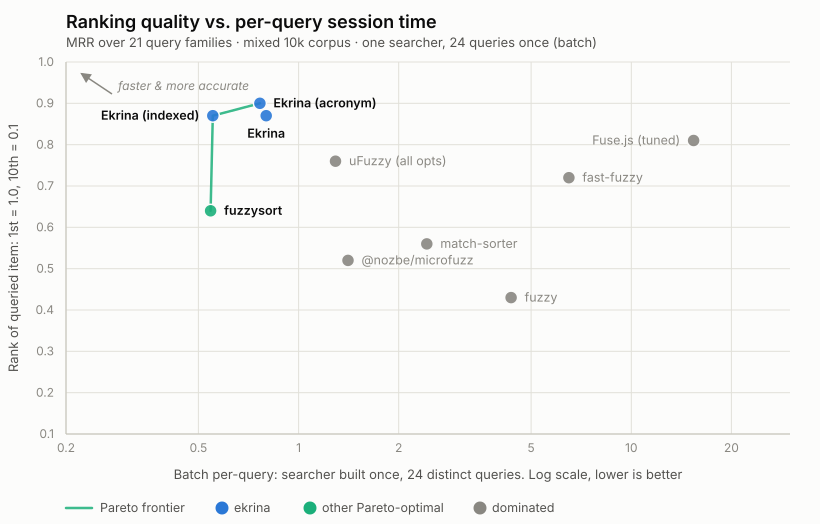

# Match quality and speed benchmarks

Full data behind the README's summary: what each library calls a match, where it ranks the right answer, and how long a query takes.
Every measured table below is generated, and `pnpm bench` regenerates all of them: it measures, writes [`bench/results.json`](../bench/results.json), rewrites each table in place, and redraws the Pareto charts.
No measured cell in this document is typed by hand.

- `pnpm bench --docs` re-emits the tables from the committed `results.json` without measuring anything.
- `pnpm bench --check` exits nonzero if any table here disagrees with `results.json`.
- `pnpm bench --speed`, `pnpm bench --quality` and `pnpm bench --memory` run one stage of the measurement; `--runs=N` sets the fresh processes per cold cell (default 1).
- `pnpm bench --scope=mixed-10k` scopes a dev run (tokens: a corpus, a size, or `corpus-size`, comma-separable).
  A scoped run measures a partial matrix, so it prints and stops: neither `results.json` nor this document is touched.

The pre-filter funnel ([`bench/funnel.test.ts`](../bench/funnel.test.ts)) is a diagnostic rather than a published table; run it with `pnpm --filter=ekrina-bench test`.
Improvements to the benchmarks are welcome.

## Libraries

The eight libraries compared throughout, and the configurations every table below is named after.
Feature coverage first; each cell is verified against the library's current source:

| Library                                                     | Per-field | Ranges | Diacritics | ESM | Multi-word | Typos | Tiers |
| ----------------------------------------------------------- | :-------: | :----: | :--------: | :-: | :--------: | :---: | :---: |
| **Ekrina**                                                   |    🟢     |   🟢   |     🟢     | 🟢  |     🟢     |  🟢   |  🟢   |
| [@nozbe/microfuzz](https://github.com/Nozbe/microfuzz)      |    🟢     |   🟢   |     🟢     | 🔴  |     🟢     |  🔴   |  🔴   |
| [fast-fuzzy](https://github.com/EthanRutherford/fast-fuzzy) |    🟢     |   🟡   |     🔴     | 🟢  |     🔴     |  🟢   |  🔴   |
| [Fuse.js](https://www.fusejs.io/)                           |    🟢     |   🟡   |     🟡     | 🟢  |     🟡     |  🟢   |  🔴   |
| [fuzzy](https://github.com/mattyork/fuzzy)                  |    🔴     |   🟡   |     🔴     | 🔴  |     🔴     |  🔴   |  🔴   |
| [fuzzysort](https://github.com/farzher/fuzzysort)           |    🟢     |   🟢   |     🟢     | 🔴  |     🟢     |  🔴   |  🔴   |
| [match-sorter](https://github.com/kentcdodds/match-sorter)  |    🟢     |   🔴   |     🟢     | 🟡  |     🔴     |  🔴   |  🟢   |
| [uFuzzy](https://github.com/leeoniya/uFuzzy)                |    🔴     |   🟢   |     🟡     | 🟡  |     🟡     |  🟡   |  🔴   |

🟢 built-in / on by default

🟡 opt-in or partial

🔴 not supported

Size and type, Ekrina first, then by bundle size ascending.

<!-- bench:libraries -->
| Library          | Gzip    | Deps | Type                 |
|------------------|---------|------|----------------------|
| **Ekrina**       | ~5.5 kB | 0    | subsequence (tiered) |
| fuzzy            | ~0.8 kB | 0    | substring            |
| @nozbe/microfuzz | ~1.7 kB | 0    | subsequence          |
| match-sorter     | ~3.4 kB | 2    | subsequence (tiered) |
| fuzzysort        | ~3.7 kB | 0    | subsequence          |
| uFuzzy           | ~4.1 kB | 0    | subsequence          |
| Fuse.js          | ~9.3 kB | 0    | typo-tolerant        |
| fast-fuzzy       | ~11 kB  | 1    | typo-tolerant        |
<!-- bench:end -->

The tables below show each library at its best-scoring configuration, plus all three Ekrina configurations.
That configuration is picked by running every one a library has against the same query families it is then ranked on, so each headline row is the library tuned to this bench, the most favourable reading of it the bench can produce.
Each library's base row is what installing it gives you, and for two of them it scores much lower: uFuzzy 0.25 MRR rather than 0.75, and Fuse.js 0.69 rather than 0.82.
Ekrina was tuned against these corpora too: `TYPO_PENALTY`, the density floor and the rescue cutoff are all set from measurements on them, so the scorecard measures how well each library fits these query families, not a held-out test.
Every other configuration is on its library's own page, against the rest of that library's: [Ekrina](./libraries/ekrina.md), [Fuse.js](./libraries/fuse.md), [uFuzzy](./libraries/ufuzzy.md), [fast-fuzzy](./libraries/fast-fuzzy.md), [@nozbe/microfuzz](./libraries/microfuzz.md) and [fuzzy](./libraries/fuzzy.md).
An "(all opts)" row shares its base library's size, deps, and type.
Ekrina's opt-in row is labelled **(acronym)** instead: `acronym: true` is its only matching opt-in, so the row is named after it.
The specific opt-ins the "(all opts)" rows switch on, and where output formats differ:

- `Ekrina`: Typos 🟢 is the always-on one-edit rescue, reported as the `corrected` tier, a swap, an extra character, a missing one or a wrong one, i.e. Damerau-Levenshtein distance 1, not general edit distance
- `uFuzzy`: folds diacritics via `latinize()`, matches multi-word via `outOfOrder`, and runs its one-typo `SingleError` mode with all four edits, the closest config to Ekrina's one-edit rescue
- `Fuse.js`: returns `ranges` via `includeMatches`, folds diacritics via `ignoreDiacritics`, and matches multi-word via `useExtendedSearch`, which turns space-separated terms into an AND of fuzzy patterns in any order, the same result set Ekrina's multi-word tier returns.
  Fuse's other multi-word switch, `useTokenSearch`, defaults to OR (`tokenMatch: "any"`) and only reaches these semantics at `tokenMatch: "all"`
- `fast-fuzzy`: its `ranges` are one span (`index` + `length`), not per-character, and its default normalisation doesn't strip accents
- `fuzzy`: its "ranges" are a pre-wrapped string, not numeric indices

Every configuration is defined once, in [`bench/configs.ts`](../bench/configs.ts), so a row timed in the speed tables is the same row ranked in the scorecard.
A base row is the library's own defaults.
For Fuse.js that means `threshold` 0.6 and a score that decays with a match's distance from index 0, which return the widest result sets in the field: a median of 556 rows for an exact long word on mixed, where Ekrina returns 5 ([`bench/results.json`](../bench/results.json)).
The scorecard doesn't count result-set size against a library ("Match quality, by query family"), so those rows do not lower its MRR.
A "(tuned)" row is an "(all opts)" row with its settings chosen by a sweep against this bench, and Fuse.js has the only one: at `threshold` 0.45 it scores the sweep's best MRR (0.82 / 0.82, against the default's 0.81 / 0.82) from a median 33 rows on mixed, where the default returns 560 ([Fuse.js](./libraries/fuse.md)).

## How to read these numbers

### One measurement model

Every time cell in this document comes from [`bench/run.ts`](../bench/run.ts): a _fresh node process per sample_, so the JIT, every per-searcher cache, and every process-wide cache (fuzzysort's prepare pool) start empty by construction, nothing is reconstructed by arithmetic, and no harness state can leak between cells.
Each child times:

- **index** = the constructor call, whatever the configuration builds there (uFuzzy (all opts) running `latinize()` over the haystack included; fuzzysort has no constructor at all, so its prepare-all pass lands in its first query, which is where a real user meets it).
- **cold query** = the first answer to one representative query, before any lazy work has run: Ekrina's raw-gate scan and rescue mask build, fuzzysort's prepare-all.
  Six families are timed this way (short word, phrase, substitution, prefix, acronym, garbage), one path through a matcher each.
- **batch** = one process answering a short-word warmup match (like `grady`: guaranteed literal hit, absorbs the JIT and the first full scan) and then every family's representative query, once each: the realistic session.
  The process warms up only by answering distinct real queries, no query is ever repeated, anywhere in the harness.
  The batch reports its total, the warmup (`first`), the mean of the 24 queries after it (`batch/query`), and each query's own post-warmup time, kept in `results.json`.
- **one-shot** = constructor + first answer, summed inside one child's consecutive windows: the whole of "given a list, get an answer".

The JIT is included deliberately.
A cold first call runs unoptimised code, and that is exactly what a user's first call runs; by the twentieth distinct query the engine is as warm as a real session ever makes it.
The previous harness sampled hundreds of repeats of one query, which tiered the JIT far past anything realistic and hid every first call inside an untimed calibration probe, [docs/measurement.md](./measurement.md) records the move.

Which column matters depends on workload: search-as-you-type → **batch/query** (and the session table below for the keystroke chain); a backend one-shot over fresh data → **one-shot**; a first-keystroke latency budget over a prebuilt index → **cold query**.

### Timing method

Timing noise is one-sided (GC, scheduler, and thermal interruptions only ever _add_ time), so the median across processes rejects spikes; the per-cell minimum, the noise-free floor, stays in [`bench/results.json`](../bench/results.json) but is never the headline, because best-of-N flatters.
One process per cell is the default (`pnpm bench --runs=N` raises it): every number is milliseconds-scale under this model, and the small timed set keeps a whole run near four minutes, which is what makes rerunning on a quiet machine quick.
A single cell is ~15% noisy at one process; the guards below look at sums for that reason.

The guards:

- Result counts must be identical across a cell's processes (a variant whose answer drifts is not timing comparable work).
- Variant order rotates per repetition so thermal and load drift land evenly instead of on whichever library ran last.
- Base Ekrina measuring more than 10% slower than its strictly-more-code acronym configuration, summed over every cell, fails the run outright (more code cannot be faster, a violated invariant means absorbed load, and the artifact is not written).
- The first cell is re-timed after the last as a drift canary.

Numbers are expected to vary per machine: swapping between a Mac ARM host and an AMD x64 showed subtly different relative results.

### The corpus and the query families

Two seeded [Faker](https://github.com/faker-js/faker) corpora, benched separately: **ascii** (en locale, effectively no diacritics) and **mixed** (mostly en with every 7th item from fr/pl generators, ~5% of items carry a diacritic, a realistic international dataset; items are ~97% unique at 10k, faker repeats a few names).
Both are frozen JSON snapshots (`bench/corpus-*.json`), so runs do no generation work and the data can't drift when faker changes between versions; regenerating them is a deliberate act ([`bench/corpus-gen.test.ts`](../bench/corpus-gen.test.ts)) that changes every rank table here.

Each query runs against the same 10,000 items in every library, and for each library the bench records:

- **Where it ranks a right answer.**
  A query's right answers are every item it could have meant ("Match quality, by query family" says how they are decided), and the score is the rank of the first one.
  In most cases, a deep rank is effectively a miss, particularly in a UI, so a rank outside the top 10 counts as a miss.
  Scoring uses the mean reciprocal rank (average of `1/rank`), **MRR** from here on, a bounded score ranging from 0 to 1.
  A rank 1 match gets a score of 1, rank 2 gets 0.5, rank 5 gets 0.2 and rank 10 gets 0.1; a rank outside the top 10, like a miss, gets 0.
- **How many items it returns.**
  This is reported as a _diagnostic_, not a score.
  If 50% of the corpus is returned as a potential match, it's easy to guarantee that the true match exists.
  However this is not a meaningful quality axis: any ranked list can be sliced to the top N, many of these libraries even provide a limit or threshold option.
  Junk results aren't able to do any harm if they're never considered.
- **The duration taken to run the query.**
  Times spread three orders of magnitude on the same query (0.02 ms to ~40 ms at 10k), and search-as-you-type multiplies the spread: one query per keystroke, where 0.02 ms is invisible and 40 ms blows the frame budget.

The rules that picked the query set:

- **Every query is derived from the corpus.**
  A family is a fixed rule for turning an item into a query: its first word, its first two words reversed, its first word with one character substituted, its initials, and so on ([`bench/corpus.ts`](../bench/corpus.ts)).
  Each family samples ten items from a fixed shuffle of the whole list, so sources come from every position rather than the head, where a list-order tie-break would favour them.
  A query is kept only if at most three items could answer it: when dozens of items hold `rustic`, any library that matches at all fills its top ten with right answers, and the query measures matching, not ranking.
  A corrupted query that is itself a corpus word is skipped, since it would be a correct query.
  Change the corpus snapshot and every query changes with it.
- **One family per matching behaviour, including the ones Ekrina loses.**
  The table below names each family and what it isolates.
- **Graded degradation instead of a pass/fail cliff.**
  The three scatter families mutilate a source word in steps (drop one middle char, drop every third, keep every other) because a single scattered query only says who passes it; the gradient locates each engine's _effective fuzzy limit_, which is the actual design difference between the chain matchers, the typo engines, and uFuzzy's no-gaps default.
  The heavy step is deliberately past any sane threshold: an engine that still "matches" there is matching noise.
  Three further families degrade a source word along a different axis: a **transposition** (two adjacent chars swapped), an **insertion** (a doubled keystroke), and a **substitution** (one wrong character, chosen to be absent from the source so it also removes a character class).
  All three keep the query close to the source but break the subsequence property, so no subsequence chain can represent them: they separate the engines that model edits from the engines that model subsequences.
  The scatter-light family is the fourth single-character edit, a **deletion**, which does stay a subsequence and so is reachable without any rescue.

The families, each with the representative query the speed tables time and the batch answers (from the mixed corpus):

| #     | family                        | example                        | isolates                                              |
| ----- | ----------------------------- | ------------------------------ | ----------------------------------------------------- |
| 1     | long single word              | `ergonomic`                    | baseline agreement; rank on a common word             |
| 2     | short single word             | `grady`                        | low-signal input, fewer chars for gates and chunking  |
| 3     | two-word phrase               | `handcrafted wooden`           | tokenisation (in corpus order: any engine can pass)   |
| 4     | two words, reversed           | `wooden handcrafted`           | true order-independence, substring engines get 0      |
| 5     | reversed, second half-typed   | `woo handcrafted`              | a phrase mid-keystroke: word starts, not whole words  |
| 6     | two words, space forgotten    | `handcraftedwooden`            | a phrase typed as one word                            |
| 7     | two words plus one absent     | `handcrafted wooden ergonomic` | AND vs OR over query words (unscored)                 |
| 8     | two words, first mistyped     | `handcxafted wooden`           | a typo inside a phrase; word-level rescue             |
| 9     | two words, second mistyped    | `handcrafted wooxen`           | the rescue must find the failing word                 |
| 10    | reversed phrase, one mistyped | `wooden handcxafted`           | the correction must survive order-independence        |
| 11    | two words, both mistyped      | `handcxafted wooxen`           | two edits: 0 rows is correct (unscored)               |
| 12    | plural typed, singular stored | `romanowskis`                  | a trailing `-s` the corpus lacks, one deletion        |
| 13    | four-character typo           | `anxe`                         | corrected only when nothing matches as typed          |
| 14    | prefix / partial word         | `auxen`                        | a word not yet finished                               |
| 15    | mid-word infix                | `gonom`                        | contains-anywhere vs start-anchored ranking           |
| 16–18 | typo gradient (light → heavy) | `hugutte` `huuete` `hget`      | each engine's effective fuzzy limit                   |
| 19    | transposition typo            | `hugeutte`                     | adjacent-swap handling, rescue tier vs edit distance  |
| 20    | insertion typo                | `hugueette`                    | a doubled keystroke, one character too many           |
| 21    | substitution typo             | `huguxtte`                     | one wrong character, absent from the source entirely  |
| 22    | acronym                       | `rsaw`                         | deliberate acronym support vs accidental subsequences |
| 23    | accent-stripped               | `kepa`                         | diacritic folding                                     |
| 24    | garbage                       | `qxzwkv`                       | the reject path, verifying no impossible matches      |

Each library gets at least one family where its specialty should win: token engines the reversed phrases, folding engines the accent family, edit-distance engines the single-edit typos, chain engines the scatter gradient.
MRR averages the scored families, ten queries each: 21 families and 210 queries on mixed, 20 and 200 on ascii, where no accent-stripped query is answered by three items or fewer; read differences of ±0.02 as ties.

## Build time

<!-- bench:build -->
| build |  Ekrina | Ekrina (indexed) | @nozbe/microfuzz | fast-fuzzy | Fuse.js | uFuzzy (all opts) |
|-------|--------:|-----------------:|-----------------:|-----------:|--------:|------------------:|
| 10k   | 0.13 ms |          2.10 ms |          3.71 ms |   27.04 ms | 1.26 ms |           4.95 ms |
| 100k  | 0.35 ms |         20.58 ms |         42.18 ms |  250.00 ms | 5.20 ms |           8.23 ms |
<!-- bench:end -->

Measured on the mixed corpus (process-cold constructor timings; build time barely differs between corpora).
Fuse.js's build is minimal because its "index" is trivial, and the work it defers to query time is why its queries are slow.
fast-fuzzy's trie is the heaviest build in the set, and its subtree pruning needs it.
fuzzysort has no constructor at all, so it has no column here, its lazy prepare-all pass lands in its first query's cold cell, where stock usage actually meets it.
uFuzzy's ~4 ms base construction only shows up process-cold, because `new uFuzzy()` compiles the engine's regex machinery on first construction (a second construction takes 0.03 ms).
So "keeps no index" is true per item but not per process, and the base cell is near-identical at 10k and 100k, which is the proof it never touches the list.
The (all opts) column shown here also runs `latinize()` over the haystack, which is why it grows with the corpus (5.0 → 8.2 ms).
microfuzz's column is its whole index: the constructor normalises every item and builds its word sets up front, so nothing is left for the first search to do (the memory table below gains 0.06 MB on its first query, and its 10k cold query, 1.41 ms, sits close to its 1.19 ms batch/query).
Ekrina's constructor only allocates - field text is trimmed, normalised and masked the first time an item survives a gate - so a 100k list swap takes about a third of a millisecond, and the first query then carries what construction deferred (its cold cells).
Ekrina (indexed), the same searcher with its mask index built up front, moves the larger part of that deferred work into its constructor: 2.10 ms at 10k and 20.58 ms at 100k.

## Memory

<!-- bench:memory -->
| Library           | built MB | + `grady` | + `qxzwkv` | + `ergonomic` | dropped MB |
|-------------------|---------:|----------:|-----------:|--------------:|-----------:|
| Ekrina            |     1.93 |      2.46 |       3.25 |          3.37 |       0.18 |
| Ekrina (acronym)  |     1.93 |      2.46 |       3.25 |          3.38 |       0.18 |
| Ekrina (indexed)  |     2.71 |      3.33 |       3.35 |          3.45 |       0.15 |
| @nozbe/microfuzz  |    45.67 |     45.73 |      45.73 |         45.73 |       0.11 |
| fast-fuzzy        |   194.20 |    195.57 |     195.57 |        195.57 |       0.15 |
| Fuse.js (tuned)   |     6.92 |      7.03 |       7.11 |          7.06 |       0.17 |
| fuzzy             |     0.02 |      0.05 |       0.05 |          0.05 |       0.05 |
| fuzzysort         |     0.02 |     40.71 |      40.71 |         40.92 |      40.91 |
| match-sorter      |     0.02 |      0.13 |       0.13 |          0.13 |       0.13 |
| uFuzzy (all opts) |     1.09 |      1.17 |       1.17 |          1.18 |       0.10 |
<!-- bench:end -->

What each configuration retains at 100k on the mixed corpus: `heapUsed + external` over a baseline taken with the list already in memory, so typed arrays count and the caller's own strings don't.
Each row is one fresh process ([`bench/memory.ts`](../bench/memory.ts)): the searcher is built, then answers `grady`, `qxzwkv` and `ergonomic` warm in that order, so each column includes every query before it.
**dropped MB** is what is still retained once the searcher is unreachable and collected.
Ekrina allocates its per-item caches empty at construction; `grady` prepares the items it matches (~0.5 MB), and `qxzwkv`, the first query to reach the one-edit rescue, adds the mask index's bigram arrays (~0.8 MB).
Ekrina (indexed) builds that index at construction instead (2.71 MB built), so `qxzwkv` adds only 0.02 MB.
fuzzysort retains nothing until its first `go()` fills its `prepare()` cache, which is process-wide and unevicted, so its **dropped** column equals its footprint until you call `cleanup()`.
Every other library gives its index back, leaving under 0.2 MB.
The ascii cells, in [`bench/results.json`](../bench/results.json), tell the same story.

## Match quality, by query family

Each library has its own definition of a match, so raw outputs aren't directly comparable.
Every family below is ten queries sampled from across the 10,000 items with a fixed seed ([`bench/corpus.ts`](../bench/corpus.ts)), each one that at most three items could answer, and each scored by the rank of its first relevant result.
A result is relevant when it holds what the query was typed for: every intended word as a word, in any order, for the phrases; the uncorrupted word for the typos; the same initials for the acronyms.
Relevance is judged on the bench's own accent folding and word split, never on a library's.
So any item a person could have meant counts, and no library is credited for breaking a tie in favour of one particular item.
Ties that list order breaks are found by re-running each query over the reversed list, and a tie mixing relevant and irrelevant items scores its expected first-relevant rank.
Each cell is MRR@10 over the family's ten queries; the scorecard's MRR is the mean over the scored families.

**mixed corpus:**

<!-- bench:families-mixed -->
| Family                     | Ekrina (acronym) | Ekrina | Fuse.js (tuned) | uFuzzy (all opts) | fast-fuzzy | fuzzysort | match-sorter | @nozbe/microfuzz | fuzzy |
|----------------------------|-----------------:|-------:|----------------:|------------------:|-----------:|----------:|-------------:|-----------------:|------:|
| long-word                  |             1.00 |   1.00 |            0.94 |              1.00 |       0.93 |      0.93 |         1.00 |             0.94 |  0.93 |
| short-word                 |             1.00 |   1.00 |            0.85 |              1.00 |       1.00 |      1.00 |         1.00 |             0.81 |  0.75 |
| two-words                  |             1.00 |   1.00 |            1.00 |              1.00 |       1.00 |      1.00 |         0.90 |             0.90 |  0.90 |
| two-words-reversed         |             0.97 |   0.97 |            0.95 |              0.95 |       0.14 |      0.95 |         0.10 |             0.40 |  0.10 |
| two-words-partial-reversed |             1.00 |   1.00 |            1.00 |              1.00 |       0.28 |      1.00 |         0.00 |             0.00 |  0.00 |
| two-words-joined           |             1.00 |   1.00 |            1.00 |              0.00 |       1.00 |      1.00 |         1.00 |             1.00 |  1.00 |
| two-words-typo             |             1.00 |   1.00 |            1.00 |              1.00 |       1.00 |      0.00 |         0.00 |             0.00 |  0.00 |
| two-words-typo-second      |             1.00 |   1.00 |            1.00 |              1.00 |       1.00 |      0.00 |         0.00 |             0.00 |  0.00 |
| two-words-typo-reversed    |             1.00 |   1.00 |            1.00 |              1.00 |       0.00 |      0.00 |         0.00 |             0.00 |  0.00 |
| plural-to-singular         |             0.97 |   0.97 |            0.95 |              0.93 |       0.93 |      0.40 |         0.30 |             0.40 |  0.38 |
| short-word-typo            |             0.86 |   0.86 |            0.43 |              0.00 |       0.95 |      0.00 |         0.00 |             0.00 |  0.00 |
| prefix                     |             1.00 |   1.00 |            1.00 |              1.00 |       1.00 |      1.00 |         1.00 |             1.00 |  0.97 |
| infix                      |             1.00 |   1.00 |            1.00 |              1.00 |       1.00 |      1.00 |         1.00 |             1.00 |  1.00 |
| scatter-light              |             1.00 |   1.00 |            0.88 |              0.85 |       0.90 |      1.00 |         1.00 |             0.95 |  0.90 |
| scatter-medium             |             0.00 |   0.00 |            0.35 |              0.00 |       0.08 |      0.95 |         0.93 |             0.67 |  0.56 |
| scatter-heavy              |             0.00 |   0.00 |            0.00 |              0.00 |       0.01 |      0.52 |         0.64 |             0.23 |  0.24 |
| transposition              |             1.00 |   1.00 |            0.88 |              1.00 |       1.00 |      0.00 |         0.00 |             0.00 |  0.00 |
| insertion                  |             1.00 |   1.00 |            0.93 |              1.00 |       0.97 |      0.00 |         0.00 |             0.00 |  0.00 |
| substitution               |             1.00 |   1.00 |            0.98 |              1.00 |       1.00 |      0.00 |         0.00 |             0.00 |  0.00 |
| acronym                    |             0.86 |   0.44 |            0.00 |              0.00 |       0.00 |      0.71 |         0.81 |             0.52 |  0.12 |
| accent-stripped            |             1.00 |   1.00 |            0.97 |              1.00 |       0.76 |      1.00 |         1.00 |             0.97 |  0.18 |
<!-- bench:end -->

**ascii corpus:**

<!-- bench:families-ascii -->
| Family                     | Ekrina (acronym) | Ekrina | Fuse.js (tuned) | uFuzzy (all opts) | fast-fuzzy | fuzzysort | match-sorter | @nozbe/microfuzz | fuzzy |
|----------------------------|-----------------:|-------:|----------------:|------------------:|-----------:|----------:|-------------:|-----------------:|------:|
| long-word                  |             1.00 |   1.00 |            0.96 |              1.00 |       1.00 |      1.00 |         1.00 |             0.96 |  0.96 |
| short-word                 |             1.00 |   1.00 |            0.92 |              1.00 |       1.00 |      1.00 |         1.00 |             0.93 |  0.80 |
| two-words                  |             1.00 |   1.00 |            1.00 |              1.00 |       1.00 |      1.00 |         1.00 |             1.00 |  1.00 |
| two-words-reversed         |             1.00 |   1.00 |            1.00 |              1.00 |       0.10 |      1.00 |         0.00 |             0.50 |  0.00 |
| two-words-partial-reversed |             1.00 |   1.00 |            0.93 |              1.00 |       0.23 |      1.00 |         0.05 |             0.10 |  0.07 |
| two-words-joined           |             1.00 |   1.00 |            1.00 |              0.00 |       1.00 |      1.00 |         1.00 |             1.00 |  0.97 |
| two-words-typo             |             1.00 |   1.00 |            1.00 |              1.00 |       1.00 |      0.00 |         0.00 |             0.00 |  0.00 |
| two-words-typo-second      |             1.00 |   1.00 |            1.00 |              1.00 |       1.00 |      0.00 |         0.00 |             0.00 |  0.00 |
| two-words-typo-reversed    |             1.00 |   1.00 |            1.00 |              1.00 |       0.13 |      0.00 |         0.00 |             0.00 |  0.00 |
| plural-to-singular         |             0.95 |   0.95 |            0.93 |              0.95 |       0.95 |      0.40 |         0.40 |             0.40 |  0.40 |
| short-word-typo            |             0.90 |   0.90 |            0.71 |              0.00 |       0.73 |      0.00 |         0.00 |             0.00 |  0.00 |
| prefix                     |             1.00 |   1.00 |            1.00 |              1.00 |       1.00 |      1.00 |         1.00 |             1.00 |  0.98 |
| infix                      |             1.00 |   1.00 |            1.00 |              1.00 |       1.00 |      1.00 |         1.00 |             1.00 |  1.00 |
| scatter-light              |             0.94 |   0.94 |            0.91 |              0.80 |       0.84 |      0.92 |         1.00 |             0.93 |  0.78 |
| scatter-medium             |             0.00 |   0.00 |            0.32 |              0.00 |       0.07 |      0.85 |         0.90 |             0.73 |  0.55 |
| scatter-heavy              |             0.00 |   0.00 |            0.00 |              0.00 |       0.00 |      0.30 |         0.69 |             0.07 |  0.12 |
| transposition              |             1.00 |   1.00 |            0.88 |              1.00 |       1.00 |      0.00 |         0.00 |             0.00 |  0.00 |
| insertion                  |             1.00 |   1.00 |            0.97 |              1.00 |       1.00 |      0.10 |         0.10 |             0.10 |  0.10 |
| substitution               |             0.98 |   0.98 |            0.96 |              1.00 |       0.95 |      0.00 |         0.00 |             0.00 |  0.00 |
| acronym                    |             1.00 |   0.35 |            0.00 |              0.00 |       0.00 |      0.77 |         1.00 |             0.60 |  0.03 |
<!-- bench:end -->

Two families have no right answer, so they are reported rather than scored: the median number of rows each library returned, where 0 is correct.

**mixed corpus:**

<!-- bench:refusals-mixed -->
| Family                | Ekrina (acronym) | Ekrina | Fuse.js (tuned) | uFuzzy (all opts) | fast-fuzzy | fuzzysort | match-sorter | @nozbe/microfuzz | fuzzy |
|-----------------------|-----------------:|-------:|----------------:|------------------:|-----------:|----------:|-------------:|-----------------:|------:|
| two-words-extra       |                0 |      0 |               0 |                 0 |          1 |         0 |            0 |                0 |     0 |
| two-words-double-typo |                0 |      0 |               2 |                 1 |          5 |         0 |            0 |                0 |     0 |
<!-- bench:end -->

**ascii corpus:**

<!-- bench:refusals-ascii -->
| Family                | Ekrina (acronym) | Ekrina | Fuse.js (tuned) | uFuzzy (all opts) | fast-fuzzy | fuzzysort | match-sorter | @nozbe/microfuzz | fuzzy |
|-----------------------|-----------------:|-------:|----------------:|------------------:|-----------:|----------:|-------------:|-----------------:|------:|
| two-words-extra       |                0 |      0 |               0 |                 0 |          2 |         0 |            0 |                0 |     0 |
| two-words-double-typo |                0 |      0 |               3 |                 1 |         12 |         0 |            0 |                0 |     0 |
<!-- bench:end -->

### Family by family

Each entry names the family's representative query, the mixed-corpus one the speed tables time; the ten scored queries per family are in [`bench/results.json`](../bench/results.json).
MRR reads mixed / ascii, and rows are each library's median rows returned on mixed.

**Single words**

- **long-word** (`ergonomic`): every library finds a right answer first (0.91–1.00), so the spread is in rows: Ekrina returns 4, fast-fuzzy 30 and Fuse.js (tuned) 73.
- **short-word** (`grady`): a whole word ranks ahead of the longer words it starts, so Ekrina, uFuzzy (all opts), fast-fuzzy, fuzzysort and match-sorter score 1.00 on both corpora, where Fuse.js (tuned) scores 0.85 / 0.92 and fuzzy 0.75 / 0.80.
  Ekrina returns 92 rows to the typo engines' ~400.
- **prefix** (`auxen`, a word's first five letters): 0.97–1.00 everywhere; Ekrina returns 22 rows, Fuse.js (tuned) 307 and fast-fuzzy 641.
- **infix** (`gonom`, five letters from inside a word): 1.00 everywhere; 20 rows from Ekrina, ~56 from the chain engines, 251 from Fuse.js (tuned) and 637 from fast-fuzzy.

**Phrases**

- **two-words** (`handcrafted wooden`): in corpus order any engine can pass, 0.90–1.00.
- **two-words-reversed** (`wooden handcrafted`): the order-independent engines (Ekrina, Fuse.js (tuned), uFuzzy (all opts), fuzzysort) score 0.95–1.00; microfuzz scores 0.40 / 0.50, and fast-fuzzy, match-sorter and fuzzy 0.14 or less.
- **two-words-partial-reversed** (`woo handcrafted`): the reversed phrase mid-keystroke.
  Ekrina's multi-word tier asks only that each query word start a word, so it keeps 1.00, as do uFuzzy (all opts) and fuzzysort; microfuzz, match-sorter and fuzzy score 0.10 or less.
- **two-words-joined** (`handcraftedwooden`): a phrase typed without its space.
  Dropping the space leaves both words in order, so the subsequence engines pass it (0.97–1.00), and uFuzzy (all opts) scores 0, since it allows no gap inside a term.
- **two-words-typo**, **-typo-second**, **-typo-reversed** (`handcxafted wooden`, `handcrafted wooxen`, `wooden handcxafted`): Ekrina, uFuzzy (all opts) and Fuse.js (tuned) score 1.00 on all three; fast-fuzzy takes the in-order two but scores 0.00 / 0.13 reversed, and the subsequence engines score 0 on all three.
  Ekrina corrects only the failing word, the words that do occur pinning the field, and returns a median of 1 row.

**Single-word typos**

- **plural-to-singular** (`romanowskis`): a trailing `-s` the corpus lacks.
  Ekrina scores 0.97 / 0.95, uFuzzy (all opts) 0.93 / 0.95.
  The subsequence engines reach 0.30–0.40 only by matching the `s` in a later word: fuzzysort finds `herzogs` as **Herzog**, **S**chultz and Nader.
  Ekrina's one mixed loss is `hillls`, one edit from both "Hilll" and "Hills".
- **short-word-typo** (`anxe`): a four-character typo, which Ekrina corrects only when nothing matches it as typed: 0.86 / 0.90, against fast-fuzzy's 0.95 / 0.73 from 45 rows, Fuse.js (tuned)'s 0.43 / 0.71, and 0 for everything else.
  The mixed losses are `maxc`, where weak fuzzy chains such as "Fort **Max**ineside, **C**ape Verde" block the correction, and `kaxa`, one substitution from both "Kara" and "Kawa".
- **transposition**, **insertion**, **substitution** (`hugeutte`, `hugueette`, `huguxtte`): the three edits that break the subsequence property.
  Ekrina, uFuzzy (all opts) and fast-fuzzy score 0.95–1.00, Fuse.js (tuned) 0.88–0.98, the chain engines 0.10 or less; Ekrina returns a median of 1–2 rows, fast-fuzzy 12–13 and Fuse.js (tuned) 22–88.

**Scatter**

- **scatter-light** (`hugutte`, one middle letter dropped): still a subsequence, so 0.78–1.00 everywhere and 1.00 / 0.94 for Ekrina.
- **scatter-medium** and **scatter-heavy** (`huuete`, `hget`): the chain engines lead, match-sorter at 0.93 and 0.64 on mixed and fuzzysort at 0.95 and 0.52, from a median 21 and 79 rows.
  Ekrina returns nothing: its chunk rules and density floor refuse a chain this sparse, the same rule that holds long-text junk at 0% ("Matching inside long text").

**Initials and accents**

- **acronym** (`rsaw`): base Ekrina scores 0.44 / 0.35 and the acronym tier 0.86 / 1.00, from a median 3 rows.
  match-sorter (0.81 / 1.00) and fuzzysort (0.71 / 0.77) reach the initials as subsequence chains among 145 rows; Fuse.js and fast-fuzzy score 0.
- **accent-stripped** (`kepa`): scored on mixed only, since every ascii candidate is a country name dozens of items share.
  The folding engines score 0.97–1.00, fast-fuzzy 0.76 through edit distance rather than folding, and fuzzy 0.18 with no folding at all.

**Refusals** (unscored; 0 rows is correct)

- **two-words-extra** (`handcrafted wooden ergonomic`): only fast-fuzzy returns anything, a median of 1 row on mixed and 2 on ascii.
- **two-words-double-typo** (`handcxafted wooxen`): Ekrina and the subsequence engines return nothing; fast-fuzzy returns a median of 5 rows on mixed and 12 on ascii, Fuse.js (tuned) 3 and 4.

### garbage (`qxzwkv`)

<!-- bench:probe-miss -->
| Library           | matches | cold ms | vs `grady` |
|-------------------|--------:|--------:|-----------:|
| Ekrina            |       0 |   3.684 |       158% |
| Fuse.js (tuned)   |       0 |  11.647 |        90% |
| uFuzzy (all opts) |       0 |   1.607 |       112% |
| fast-fuzzy        |       0 |  13.025 |        80% |
| fuzzysort         |       0 |   4.731 |        94% |
| match-sorter      |       0 |   2.875 |        41% |
| @nozbe/microfuzz  |       0 |   1.047 |        72% |
| fuzzy             |       0 |   1.776 |        88% |
<!-- bench:end -->

No rank column: every library correctly returns nothing.
What separates them is how long that answer takes, shown against each library's own time for the short-word query `grady` (one that does match), so the column reads as "what fraction of a real query does a hopeless one take".
Process-cold, Ekrina's miss takes _more_ time than its hit.
A hopeless six-character query is _rescuable_, so before saying "no results" Ekrina tries harder: the literal pass comes up empty, and rather than fail it builds the union and bigram masks and attempts every one-edit correction of the query, the same second pass that scores 0.98–1.00 on the single-edit typo families above.
The engines with the fastest misses are never trying to start with; microfuzz's empty result covers only the query as typed, while Ekrina's also covers every one-edit correction of it.
The work also happens once per searcher: the masks the garbage query builds are the ones every later rescue reuses, which is why the batch column absorbs it, a session's first query that needs the masks builds them and the other twenty-three reuse them.
(The old warm harness showed the opposite ratio, 3%, because the masks were already built; both numbers are true, and the cold one is what a fresh searcher feels.)

## Scorecard

One line per configuration: MRR from [`bench/hits.test.ts`](../bench/hits.test.ts) (ranks are deterministic, measured once, untimed), times from the process-cold matrix ("Timing method"; `pnpm bench --runs=N` sets the processes per cell).
**MRR** = the mean over the scored families (21 on mixed, 20 on ascii) of each family's MRR@10 ("Match quality, by query family"): ten queries each, scored by the rank of the first relevant result, misses and ranks outside the top 10 scoring 0.
**index ms** = the constructor call (from the batch cell's fresh processes).
**cold ms** = the mean first-answer time across the six timed queries, each in its own fresh process.
**batch ms** = one fresh process answering a short-word warmup match and then every family's representative query once, the realistic session, whole.
**batch/query** = the mean of the 24 post-warmup queries: how long a query takes once the searcher has answered real queries.
Which column matters depends on workload: search-as-you-type → **batch/query**; backend one-shot → index + cold ("One measurement model"'s one-shot); a first-keystroke budget → **cold**.

**mixed corpus** (the query set above):

<!-- bench:scorecard-mixed -->
| Library           |  MRR | index ms | cold ms | batch ms | batch/query |
|-------------------|-----:|---------:|--------:|---------:|------------:|
| Ekrina (acronym)  | 0.89 |     0.13 |    3.93 |    18.73 |        0.67 |
| Ekrina            | 0.87 |     0.13 |    3.71 |    18.49 |        0.67 |
| Ekrina (indexed)  | 0.87 |     2.10 |    1.34 |    13.54 |        0.52 |
| Fuse.js (tuned)   | 0.82 |     1.26 |   15.02 |   335.78 |       13.46 |
| uFuzzy (all opts) | 0.75 |     4.95 |    1.68 |    23.40 |        0.91 |
| fast-fuzzy        | 0.71 |    27.04 |   14.94 |   170.83 |        6.40 |
| fuzzysort         | 0.59 |     0.05 |    5.01 |    15.59 |        0.37 |
| match-sorter      | 0.51 |     0.04 |    4.99 |    67.34 |        2.46 |
| @nozbe/microfuzz  | 0.47 |     3.71 |    1.41 |    30.06 |        1.19 |
| fuzzy             | 0.38 |     0.03 |    1.92 |    45.22 |        1.80 |
<!-- bench:end -->

**ascii corpus** (its own queries over its own items; its accent family has five queries, the accented words the en locale emits, such as `cote` from "Côte d'Ivoire"):

<!-- bench:scorecard-ascii -->
| Library           |  MRR | index ms | cold ms | batch ms | batch/query |
|-------------------|-----:|---------:|--------:|---------:|------------:|
| Ekrina (acronym)  | 0.89 |     0.12 |    3.42 |    19.03 |        0.71 |
| Ekrina            | 0.86 |     0.12 |    3.33 |    18.68 |        0.71 |
| Ekrina (indexed)  | 0.86 |     2.08 |    1.43 |    15.35 |        0.59 |
| Fuse.js (tuned)   | 0.82 |     1.20 |   15.21 |   331.89 |       13.15 |
| uFuzzy (all opts) | 0.74 |     4.73 |    1.39 |    17.27 |        0.66 |
| fast-fuzzy        | 0.70 |    25.42 |   15.21 |   135.02 |        4.99 |
| fuzzysort         | 0.57 |     0.03 |    4.68 |    11.91 |        0.30 |
| match-sorter      | 0.51 |     0.03 |    5.32 |    53.77 |        1.95 |
| @nozbe/microfuzz  | 0.47 |     3.49 |    1.35 |    28.39 |        1.13 |
| fuzzy             | 0.39 |     0.03 |    1.73 |    34.64 |        1.37 |
<!-- bench:end -->

Result-set size is _not_ a scorecard column: in a ranked UI any result list slices to the top N, so a large return does not hurt a picker (see "The corpus and the query families").
Each family's median rows per library stay in [`bench/results.json`](../bench/results.json) for the places size does matter: filter-style UIs that show every match, and telling whether an MRR came from a selective matcher or from ranking a huge candidate set.

_Ekrina (acronym) tops both corpora_ (0.89 mixed / 0.89 ascii), with base Ekrina and Ekrina (indexed) (0.87 / 0.86, identical ranks) next; the nearest non-Ekrina rows are Fuse.js (tuned) at 0.82 / 0.82 and uFuzzy (all opts) at 0.75 / 0.74.
The two Ekrina rows differ by one family: acronym, 0.44 / 0.35 base against 0.86 / 1.00 with the tier on, which is the whole of the gap.
Read across the family tables, the lead comes from scoring near 1 on every phrase, word and typo family at once:

- **Phrases in any order, half-typed or mistyped**: Ekrina scores 0.97–1.00 on all six phrase families, Fuse.js (tuned) 0.93–1.00, and uFuzzy (all opts) 0.95–1.00 on five of them; the subsequence engines score 0 on every phrase typo, and fast-fuzzy 0.28 or less on the reversed ones.
- **Words and single-edit typos**: Ekrina scores 0.98–1.00 on the plain-word families and on transposition, insertion and substitution, the edit-distance engines 0.88–1.00 on those typos, the chain engines 0.10 or less.
  Within a score a match that ends on a word boundary ranks first, so `will` finds "Will Smith" before "Willa Corkery", and a correction that completes a word before one that stops inside it.
- **Refusal**: Ekrina returns nothing on both unscored families, where fast-fuzzy's median double typo returns 5 rows on mixed and 12 on ascii, and Fuse.js (tuned)'s 2 and 3.

The families where Ekrina trails:

- **Scatter** (medium and heavy): 0.00, where match-sorter scores 0.64–0.93 and fuzzysort 0.30–0.95.
  Ekrina refuses a chain that sparse on purpose, since the density floor that does it is what holds long-text junk at 0% ("Matching inside long text").
- **Four-character typos on mixed**: 0.86 against fast-fuzzy's 0.95 (0.90 against 0.73 on ascii).
  Ekrina corrects a four-character query only when nothing matches it as typed, so a stray literal or fuzzy hit blocks the correction.

Two libraries score far higher with their options on, so for those the options decide the comparison: uFuzzy scores 0.75 mixed / 0.74 ascii with them against 0.25 / 0.26 on its defaults ([uFuzzy](./libraries/ufuzzy.md)), and Fuse.js 0.82 / 0.82 against 0.69 / 0.71 ([Fuse.js](./libraries/fuse.md)).

The scorecard's timing columns are exactly what the Pareto charts draw, one per workload; both draw the mixed 10k scorecard.

**Frontend workload** (the index is built once at load, so keystrokes run the query only):

<picture>
  <source media="(prefers-color-scheme: dark)" srcset="./pareto-query-dark.svg">
  
</picture>

Its x-axis is the batch's per-query time, how long a query takes once the searcher has answered twenty-three real ones, and its frontier runs fuzzysort → Ekrina (indexed) → Ekrina (acronym).
Base Ekrina sits off it because its batch builds the mask index partway through, on the first query that needs the rescue, work its indexed twin did at construction, so at the same 0.87 MRR it takes 0.67 ms per query against 0.52.
The fast end belongs to fuzzysort, 0.59 MRR at 0.37 ms with bare output; uFuzzy (all opts), at 0.75 the next row on quality after Fuse.js (tuned), takes 0.91 ms per query against Ekrina (indexed)'s 0.52, and Fuse.js and fast-fuzzy are 12–26× slower.

**Backend one-shot workload** (a fresh process runs constructor + first answer): the chart lives in the README's Comparison section, deliberately the less flattering of the two there.
Its frontier runs `fuzzy` → Ekrina (indexed) → Ekrina (acronym): a no-index substring scan at 0.38 MRR owns the fast end, and every other configuration - uFuzzy included, once its constructor-and-first-call reality is measured rather than amortised - is dominated.
Base Ekrina is dominated too, by its indexed twin and only by a margin inside the tie band ("Size, speed & search type"): 2.10 + 1.34 ms against 0.13 + 3.71 ms at the same 0.87 MRR, so building the mask index up front takes about as long as it then saves on the first answer.
This is where base Ekrina's lazy preparation shows up, in two parts against a 0.13 ms constructor.
A fresh searcher's first answer prepares the text of every item it matches, and a single-word query finds them with a scan of the raw strings (~2 ms at 10k).
The per-item mask index is built only on the first query that needs it: one with a second word, one of five or more characters that finds fewer than ten literal matches and so goes to the one-edit rescue, or one holding a character outside Latin letters and digits, which the raw scan cannot fold.
That is why a cold `two-words` answer takes longer at 10k than `short-word`, and why `prefix`, a single word with too few literal matches to rule out a typo, takes longer again (the per-query cells are in [`bench/results.json`](../bench/results.json)).
The batch's literal warmup never needs it, so its `first` column carries only the first part; the build lands on the third query, the first multi-word one.

_Both charts read the scorecard above out of [`bench/results.json`](../bench/results.json) ([`pareto.ts`](./pareto.ts)), so they cannot disagree with it; `pnpm bench` redraws them._

## Size, speed & search type

**Gzip** = esbuild `--bundle --minify` + gzip, tree-shaken to each lib's primary API (the size table is in [Libraries](#libraries)).
Every cell is process-cold ("One measurement model"), and each corpus gets two tables.
The scale table measures the one-shot workload: **index** = the constructor, **cold query** = mean first answer across the six timed queries (each in its own fresh process), **total** = the mean of constructor + first answer, summed inside each query's own child, **total rel** = that total relative to Ekrina (100% = same, lower = faster).
The batch table measures the session: **batch total** = one fresh process answering a short-word warmup match then every family's representative query once, **batch/query** = the mean of the 24 post-warmup queries, **batch rel** = batch total relative to Ekrina.
The aggregate row is a **geometric mean**: per-library times span orders of magnitude, so an arithmetic mean would only describe the slowest library; the geomean is the standard aggregate for multiplicative spreads, and the rel cells are equally the geomean of each rel column (a geomean of ratios is the ratio of geomeans).
These tables publish the 100k size; the 10k matrix and the scorecard carry the fine-grained view, and every cell of both sits in [`bench/results.json`](../bench/results.json).
The two corpora are described in "The corpus and the query families"; they're benched separately.
The mixed table only lists configurations that fold diacritics, i.e. actually do that corpus's task (cross-checked per query by [`bench/hits.test.ts`](../bench/hits.test.ts)); a fast non-folding row would be fast at a different, easier job, so those are omitted and named below the table.
The **_all libraries_** row is the corpus-wide view: the geometric mean of every shown configuration at that size.
**(all opts)** rows switch on every opt-in the library has: diacritic folding, multi-word, highlight/ranges output, and typo modes; base rows are stock defaults, and [Libraries](#libraries) itemises which opt-in is which.
Typo modes are included because Ekrina's one-edit matching is always on and cannot be disabled, so holding another engine's typo mode off would time two engines doing different jobs.
Only uFuzzy is affected in practice.
Fuse.js (Bitap) and fast-fuzzy (edit distance) are typo-tolerant in every configuration here.
Every child consumes its result counts, the runner asserts they are identical across a cell's processes, and [`bench/hits.test.ts`](../bench/hits.test.ts) records per-library match counts for every query, so the timings above are known to be timing comparable work.
Per-cell minimums and heap footprints are in [`bench/results.json`](../bench/results.json).
Ekrina leads its own table; the rest are alphabetical, so nothing is ordered by how well it did.

### ascii corpus

<!-- bench:speed-ascii -->
| Library                   |     index | cold query |     total | total rel |
|---------------------------|----------:|-----------:|----------:|----------:|
| **Ekrina**                |   0.36 ms |   12.41 ms |  12.74 ms |  **100%** |
| Ekrina (acronym)          |   0.31 ms |   12.21 ms |  12.55 ms |       99% |
| Ekrina (indexed)          |  12.08 ms |    2.64 ms |  14.15 ms |      111% |
| @nozbe/microfuzz          |  41.49 ms |   19.23 ms |  61.74 ms |      485% |
| fast-fuzzy                | 267.26 ms |   51.96 ms | 322.45 ms |     2531% |
| Fuse.js (tuned)           |   5.55 ms |  130.93 ms | 136.35 ms |     1070% |
| fuzzy                     |   0.03 ms |   16.98 ms |  17.01 ms |      134% |
| fuzzysort                 |   0.04 ms |   51.95 ms |  51.98 ms |      408% |
| match-sorter              |   0.04 ms |   23.86 ms |  23.89 ms |      188% |
| uFuzzy (all opts)         |   7.89 ms |    3.09 ms |  11.37 ms |       89% |
| _all libraries (geomean)_ |   1.38 ms |   17.91 ms |  32.88 ms |      258% |
<!-- bench:end -->

**The session batch** (one process: a warmup match, then every family's representative query once):

<!-- bench:batch-ascii -->
| Library                   | batch/query | batch total | batch rel |
|---------------------------|------------:|------------:|----------:|
| **Ekrina**                |     2.51 ms |    64.52 ms |  **100%** |
| Ekrina (acronym)          |     2.51 ms |    64.53 ms |      100% |
| Ekrina (indexed)          |     1.95 ms |    49.31 ms |       76% |
| @nozbe/microfuzz          |     8.39 ms |   217.56 ms |      337% |
| fast-fuzzy                |    43.67 ms |  1097.99 ms |     1702% |
| Fuse.js (tuned)           |   139.01 ms |  3475.82 ms |     5387% |
| fuzzy                     |    17.81 ms |   445.16 ms |      690% |
| fuzzysort                 |     7.16 ms |   234.37 ms |      363% |
| match-sorter              |    19.36 ms |   493.00 ms |      764% |
| uFuzzy (all opts)         |     2.38 ms |    60.21 ms |       93% |
| _all libraries (geomean)_ |     9.05 ms |   235.65 ms |      365% |
<!-- bench:end -->

### mixed corpus

<!-- bench:speed-mixed -->
| Library                   |    index | cold query |     total | total rel |
|---------------------------|---------:|-----------:|----------:|----------:|
| **Ekrina**                |  0.35 ms |   19.22 ms |  19.57 ms |  **100%** |
| Ekrina (acronym)          |  0.32 ms |   19.88 ms |  20.22 ms |      103% |
| Ekrina (indexed)          | 20.58 ms |    2.39 ms |  23.37 ms |      119% |
| @nozbe/microfuzz          | 42.18 ms |   20.89 ms |  62.86 ms |      321% |
| Fuse.js (tuned)           |  5.34 ms |  124.03 ms | 129.40 ms |      661% |
| fuzzysort                 |  0.03 ms |   52.55 ms |  52.58 ms |      269% |
| match-sorter              |  0.03 ms |   27.53 ms |  27.56 ms |      141% |
| uFuzzy (all opts)         |  8.23 ms |    3.46 ms |  11.78 ms |       60% |
| _all libraries (geomean)_ |  1.17 ms |   18.16 ms |  32.63 ms |      167% |
<!-- bench:end -->

**The session batch** (one process: a warmup match, then every family's representative query once):

<!-- bench:batch-mixed -->
| Library                   | batch/query | batch total | batch rel |
|---------------------------|------------:|------------:|----------:|
| **Ekrina**                |     2.43 ms |    63.47 ms |  **100%** |
| Ekrina (acronym)          |     2.41 ms |    63.29 ms |      100% |
| Ekrina (indexed)          |     1.19 ms |    30.79 ms |       49% |
| @nozbe/microfuzz          |    13.81 ms |   351.99 ms |      555% |
| Fuse.js (tuned)           |   134.76 ms |  3339.61 ms |     5261% |
| fuzzysort                 |     2.65 ms |   115.40 ms |      182% |
| match-sorter              |    20.82 ms |   528.48 ms |      833% |
| uFuzzy (all opts)         |     2.63 ms |    66.38 ms |      105% |
| _all libraries (geomean)_ |     6.09 ms |   166.43 ms |      262% |
<!-- bench:end -->

The acronym configuration runs strictly _more_ code per query (an extra tier, plus the one-edit rescues on candidates that reach it); its 99–103% cells are that extra work plus load swing.
Read sub-15% differences as statistical ties, the tie band from here on, and larger ones as real.
Folding uFuzzy sits inside the tie band on this corpus: its batch is 105% of Ekrina's, 2.63 ms per query to Ekrina's 2.43.

Configurations that can't fold diacritics are omitted rather than flagged.
A non-folding row on this corpus is timing a different, easier task (it silently misses accented matches), and we already _know_ it fails: on the accent family's representative query `kepa` (from "Kępa…") at 10k, base uFuzzy finds _0_ matches where its folding (all opts) config finds 4 and Ekrina 7 ([`bench/hits.test.ts`](../bench/hits.test.ts)).
Omitted: fast-fuzzy and fuzzy, which have no folding option at all.

### Reading the speed numbers

Every cell is process-cold, so read the columns as three different workloads.
The **batch** column is the headline: one process, 24 distinct queries, so it shows whether the amortisation each design promises actually happens.
Ekrina's batch is carried by its architecture, a staged reject path (a per-item union of char-class bitmasks, then a native regex gate) cuts 90–100% of items before any ladder work, and the lazy preparation happens once per session: each item's text the first time it matches, and the mask index on the first multi-word query or the first that reaches the rescue.
_Ekrina (indexed) takes the batch at 100k_: 76% of base Ekrina's time on ascii and 49% on mixed.
Folding uFuzzy ties base Ekrina on both corpora (93% ascii, 105% mixed) and takes 2.2× Ekrina (indexed)'s mixed batch; bare uFuzzy is faster than base Ekrina on ascii (68%, on [its page](./libraries/ufuzzy.md#speed-at-100k)), and its MRR is 0.25–0.26 bare and 0.74–0.75 folding.
Base Ekrina's batch beats every other library while topping both scorecards: ~5.5× its parent microfuzz, 1.8× fuzzysort, ~8× match-sorter and ~53× Fuse.js (tuned) on mixed, and ~17× fast-fuzzy on ascii, which it can't fold.
The **cold query** column is where Ekrina's laziness shows up: 12–19 ms mean at 100k (ascii, mixed), most of it the rescue's union-and-bigram mask build (Ekrina (indexed), which builds it in its 12–21 ms constructor, answers first in 2.4–2.6 ms), done once per searcher and visible per query in the 10k cells of [`bench/results.json`](../bench/results.json) (it lands on multi-word queries and on single words of five or more characters with fewer than ten literal matches, the substitution and prefix queries among the timed ones; the short word carries only the raw-gate scan).
An eager-index engine inverts this: fast-fuzzy's first answer is quick only because its constructor already ran for ~250–270 ms.
The **index** column plus the first answer is the one-shot measurement.
At 10k only `fuzzy`'s bare substring scan beats Ekrina there (the one-shot chart), and at 100k uFuzzy (all opts) does too (60% mixed, 89% ascii), because Ekrina's first answer carries the mask build.
Cross-_type_ speed isn't apples-to-apples: **typo-tolerant** libs (Fuse.js, fast-fuzzy) do far more work per query, and non-folding configurations are omitted from the mixed table entirely (they would be timing a different task).
fast-fuzzy is corpus-sensitive: its trie rewards shared-prefix data but this natural-language corpus prunes less, dropping it among the slowest (on a combinatorial word-grid it measured far better; the corpus moves these numbers a lot).

## Typing `grady` at 100k

Typing is a _sequence_: each query extends the last.
Ekrina's prefix-narrowing cache rescans only the previous query's mask-gate survivors, so successive keystrokes get faster; every other library runs a full scan per keystroke.
The probe types the doc's surname query `grady` from the 3-character UI gate onward (real UIs gate search behind 2–3 characters, because a 1–2 char query matches a huge fraction of the corpus and every rich-result library has to materialise it).
Each step is timed at its correct cache state (the untimed reset replays the previous prefix before every sample), on the 100k mixed corpus.

<!-- bench:session -->
| Library            | `gra` | `grad` | `grady` | session |
|--------------------|------:|-------:|--------:|--------:|
| Ekrina             |  2.28 |   1.34 |    0.58 |    4.19 |
| @nozbe/microfuzz   | 17.28 |  16.62 |   16.16 |   50.06 |
| fuzzysort          |  5.10 |   2.98 |    1.91 |   10.00 |
| uFuzzy (all opts)  |  3.94 |   1.96 |    2.00 |    7.90 |
| Fuse.js (all opts) | 84.48 | 112.91 |  124.28 |  321.67 |
<!-- bench:end -->

Ekrina's per-keystroke time falls _3.9×_ across the word (2.28 → 1.34 → 0.58) as the survivor cache narrows: the 3-character query is the widest candidate set the session ever sees, and it is the one that does the work.
Ekrina takes every step of the session, the wide opener included (2.28 vs uFuzzy's 3.94), and the session total by 1.9× (4.19 vs 7.90), against uFuzzy (all opts) at 0.75 MRR to Ekrina's 0.87.
microfuzz stays at ~16–17 ms: same subsequence approach with no survivor cache, so nothing narrows between keystrokes.
This table is a single process, like every cold cell here, so read its cells with the tie band in mind.
All rows assume a warm process: one-time work (Ekrina's mask build, fuzzysort's lazy target prep) happens at load, not on keystroke one; the cold cells above measure it.
Measured by [`bench/session.test.ts`](../bench/session.test.ts).

## Matching inside long text

Everything above matches short labels in a list; the other workload is one large string: `fuzzyMatch` over a document.
The hazard there is the fuzzy tier assembling a "match" from characters scattered across unrelated words, so the tier rejects any assembly covering less than 18% of the span it stretches across (`DENSITY_FLOOR` in [`src/fuzzy.ts`](../src/fuzzy.ts)).
The constant comes out of a measurement: with the floor disabled, this probe collects 570 junk chains across both corpora at every length, maxing out at _0.143_ density, while the sparsest genuine match (initials scattered across a four-word name) measures _0.211_; 0.18 splits the gap with margin both ways.

The probe: the document is the mixed corpus joined with spaces and sliced to graded lengths; queries are 40 real corpus words verified absent from the largest slice (no substring anywhere), so any hit is the fuzzy tier assembling a junk chain.

<!-- bench:longtext -->
| doc chars | junk rate | present hits | miss ms |
|----------:|----------:|-------------:|--------:|
|        64 |        0% |          8/8 |   0.004 |
|       128 |        0% |        15/15 |   0.004 |
|       256 |        0% |        20/20 |   0.005 |
|       512 |        0% |        20/20 |   0.008 |
|      1024 |        0% |        20/20 |   0.019 |
|      2048 |        0% |        20/20 |   0.031 |
|      4096 |        0% |        20/20 |   0.059 |
|      8192 |        0% |        20/20 |   0.108 |
|     16384 |        0% |        20/20 |   0.210 |
<!-- bench:end -->

Zero junk at every length, while every genuinely present word still matches (a present word is a substring, so `contains` needs no fuzzy assembly) and label-corpus behaviour is unchanged (same MRR, same ranks, slightly tighter sets: `rsaw` 8 → 7, ascii's `sgh` 55 → 31).
Miss time includes the one-edit rescues (a miss must fail those too), which is the work a document-length miss does for the typo rescues on labels; it stays around a fifth of a millisecond at 16k chars.
Residual exposure is the adjacent-word assembly (`zebra` over "zero … branch", density 0.38), structurally identical to wanted word-start matches like `hewo` → "hello world" (0.5), so no floor separates them; they need adjacency by luck, and they rank last when they occur.
Literal-only matching, for callers that want no fuzzy assemblies at all, is a one-line `tier` filter.
[`bench/longtext.test.ts`](../bench/longtext.test.ts) keeps this table as a regression guard, asserting the junk rate is exactly zero at every length.

## The recommendation

The recommendation is to _pick Ekrina for list matching_, with two carve-outs the data supports.

- **Quality**: Ekrina (acronym) tops the scorecard on both corpora (0.89 mixed / 0.89 ascii), and base Ekrina (0.87 / 0.86) is still clear of every other library, Fuse.js (tuned) the closest at 0.82; the lead comes from scoring near 1 on every phrase and single-edit typo family at once, which no other library does.
- **Speed, measured cold**: Ekrina (indexed) runs the fastest 24-query session of anything above 0.7 MRR at both sizes (13.5 ms at mixed 10k, ~0.52 ms per query after the first), base Ekrina ties uFuzzy (all opts) inside the tie band (18.5 ms, ~0.67 ms per query), and both are ~3–55× under every typo-tolerant or tiered alternative, with a near-zero constructor, ~5.5 kB gzip and zero deps.
  The exception is the first call: Ekrina prepares lazily, so a fresh searcher's first answer prepares what it matches, and its first multi-word or rescue-bound query builds the mask index over the whole list (a first answer averages ~3.7 ms at 10k and 12–19 ms at 100k across the timed queries, or ~1.4 ms and 2.4–2.6 ms once Ekrina (indexed) has spent ~2 ms and 12–21 ms building the index up front); a workload that only ever asks one question of one searcher should read the one-shot numbers, where bare `fuzzy` is faster.
- **Long text**: the density floor holds `fuzzyMatch` junk at 0% at every measured document length, phrase probes included, so the same engine covers documents, not just labels.

The carve-outs:

- **Typo tolerance beyond a single edit.** The one-edit tiers correct every single-character typo from five characters up (transposition, insertion, deletion and substitution), scoring 0.98–1.00 on those families, and inside phrases too, where the failing word is corrected alone; from four characters they correct only when nothing matches as typed.
  _Two or more_ edits in one query still need real edit distance, and Ekrina deliberately refuses both deep scatter and the double-typo phrase.
  If user-typed queries over messy data must match through those, Fuse.js (Bitap) or fast-fuzzy (edit distance) is the right tool for the typos, and match-sorter or fuzzysort for the scatter (0.30–0.95 on the deeper scatter families against Ekrina's 0.00); the scorecard measures what each gains and loses: 0.82 and 0.71 MRR on mixed for Fuse.js (tuned) and fast-fuzzy, at ~15 ms per cold query.
- **Raw throughput when a bare index array is enough.** Bare uFuzzy runs the 100k ascii batch in 68% of base Ekrina's time (Ekrina (indexed) 76%; folding uFuzzy 93%, and 105% on mixed), and owns the fastest per-query time at 10k ([uFuzzy](./libraries/ufuzzy.md)).
  Bare, it gives up most of the match quality to get there (0.25 MRR against Ekrina's 0.87); folded it scores 0.74–0.75, losing the joined-phrase and four-character typo families outright, and it has no ranges, tiers, or per-field config.

The rest of the field is dominated on these benchmarks:

- **@nozbe/microfuzz**: Ekrina's parent; same subsequence approach, ~3–6× the batch at 100k, 2–17× larger result sets, no tier output.
  Its 0.47 mixed MRR sits 40 points under base Ekrina: it scores 0 on the substitution, insertion and phrase-typo families.
- **fuzzysort**: the fastest per-query time after bare uFuzzy, but its prepare-all pass lands a ~5 ms first call (53 ms at 100k) that stock usage absorbs inside the first `go()`, and it scores 0 on every phrase-typo and substitution family (0.59 MRR on mixed).
- **match-sorter**: tiered ranking but no ranges and no multi-word; it leads the scatter families and scores 0 on every phrase typo, 0.51 MRR at mid-pack speed.
- **fuzzy**: substring-only and order-sensitive; 0.10 or less on reversed phrases, 0.18 on the accent family, no ranges (0.38 MRR).
- **fast-fuzzy**: the heaviest build (~250–270 ms at 100k) and the slowest queries after Fuse.js on these corpora, and 0.28 or less on reversed phrases (0.71 MRR); its trie rewards shared-prefix data, which natural-language corpora don't provide.
