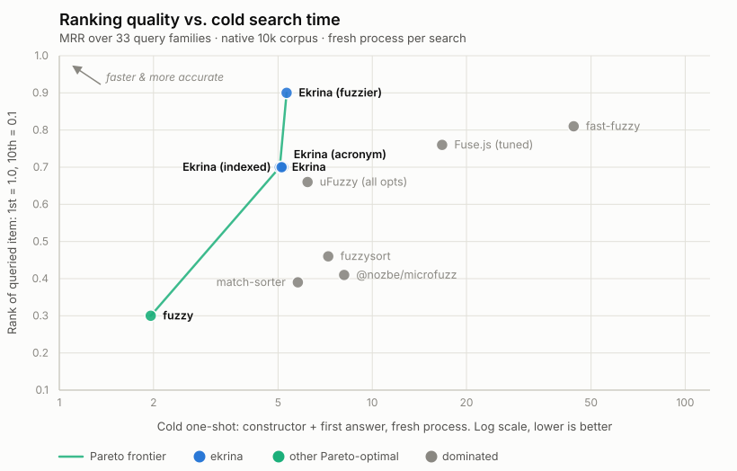

# How it compares

Ekrina answers in a few milliseconds at any realistic size.
Every library runs in a fresh process, so no cache survives from an earlier run, and the per-query time is a searcher's average once it has answered its first query.
On that measure a 24-query session over 100,000 items averages ~3–3.6 ms per query, and ~1 ms over 10,000, and `fuzzyMatch` over a 16,000-character document takes 0.48 ms.
Between the libraries, the differences are _match quality_, _what they answer that they shouldn't_, and _what you get back_.

Each library at its best-scoring configuration, native corpus at 10k items, measured November 2026 (the exact versions are the devDependencies in [`bench/package.json`](../bench/package.json)).
That configuration is chosen by these same benchmarks, so every row is the library tuned to the tests it is ranked on; uFuzzy's defaults score 0.21 and Fuse.js's 0.72 ([how each was configured](./benchmarks.md#libraries)):

<!-- bench:compare -->
| Library           |    Gzip | Deps |  MRR | junk | ms/query | Tiers | Ranges  | Typos         |
|-------------------|--------:|-----:|-----:|-----:|---------:|:-----:|:-------:|---------------|
| **Ekrina**        | ~7.7 kB |    0 | 0.91 |   0% |     1.06 |  yes  |   yes   | two edits     |
| fast-fuzzy        |  ~11 kB |    1 | 0.81 |  24% |     6.20 |  no   | partial | edit distance |
| Fuse.js (tuned)   | ~9.6 kB |    0 | 0.76 |  47% |    12.21 |  no   | opt-in  | edit distance |
| uFuzzy (all opts) | ~4.2 kB |    0 | 0.66 |   0% |     0.64 |  no   |   yes   | one edit      |
| fuzzysort         | ~3.7 kB |    0 | 0.46 |   7% |     0.41 |  no   |   yes   | none          |
| @nozbe/microfuzz  | ~1.7 kB |    0 | 0.41 |   7% |     2.10 |  no   |   yes   | none          |
| match-sorter      | ~3.5 kB |    2 | 0.39 |   7% |     2.70 |  yes  |   no    | none          |
| fuzzy             | ~0.8 kB |    0 | 0.30 |   7% |     2.10 |  no   | partial | none          |
<!-- bench:end -->

The corpora are 100,000 real Wikidata names, under their English labels and under their native ones, plus an emoji picker's labels and tags, and the ranking is the same on all three, with Ekrina at 0.91–0.92 ([the corpora](./benchmarks.md#the-corpora-and-the-query-families)).
**MRR** is the mean reciprocal rank of the first right answer, with a top-10 cutoff, over 33 query families of ten sampled queries each (typos, phonetic and real misspellings, partial words, query shapes and noise).
The families were weighted by group before anything was measured, and each query is one that at most three items could answer, with any item it could have meant counting as right ([how](./benchmarks.md#match-quality-by-query-family)).
That is 330 queries per corpus, so a gap of a few hundredths between two libraries is not a firm result, and the gaps at the top of the table are tenths.
**junk** is the share of queries with no right answer anywhere in the list that the library answers anyway.
**ms/query** is how long one query takes once the searcher has answered twenty-three real ones, the search-as-you-type number.
**Tiers** and **Ranges** say whether a result carries a match category and the characters to highlight: _partial_ is one span for fast-fuzzy and a marked-up string for fuzzy, and _opt-in_ needs a setting.
**Typos** is how far from the item a query can be: a fixed number of edits, any edit distance the library's score allows, or none.
Gzip is `esbuild --bundle --minify` tree-shaken to each library's primary API.
The size badge on the README measures the whole published package rather than the primary API.
The full matrix, every feature cell verified against the library's current source, is in [the benchmarks](./benchmarks.md#libraries).

The chart below plots accuracy against one whole cold search, the constructor plus the first answer, which is the least flattering way to measure Ekrina, since a library with no constructor does no work up front.
On query time alone, the frontier chart in [the benchmarks](./benchmarks.md) has fuzzysort and uFuzzy (all opts) on it beside Ekrina, at 0.46 and 0.66 MRR.

<picture>
  <source media="(prefers-color-scheme: dark)" srcset="./pareto-total-dark.svg">
  
</picture>

Lazy Ekrina comes out slower cold than indexed Ekrina because a typo, an acronym and a query nothing matches all need the whole-list index, so the lazy searcher scans the raw text and then builds the index anyway; on a plain prefix it is faster, at 3.2 ms against 5.1.

Ekrina is the only one of the eight that returns both a categorical `tier` and the `ranges` to highlight.
microfuzz and fuzzysort also fold diacritics, match multi-word queries and take per-field config by default, and match-sorter returns tiers without ranges.
It is built for matching in-memory lists on the client, and the cold-process numbers hold up for server-side work too.

## What to pick

Pick Ekrina, unless one of the cases below is yours.
It tops the quality scorecard on all three benchmark corpora, answers nothing it shouldn't, and runs its session several times faster than the two libraries closest to it on quality.
At ~7.7 kB gzip it is the third-largest of the eight, and only Fuse.js, at ~9.6 kB, and fast-fuzzy, at ~11 kB, are larger.
That size goes on the correction machinery, which is also where the quality lead comes from.
Pick something else when:

- **Every kilobyte counts:** @nozbe/microfuzz is ~1.7 kB, at 0.41 MRR and with no typo tolerance.
- **Query time matters more than quality:** fuzzysort answers in 0.41 ms against Ekrina's 1.06 at 10k, at 0.46 MRR, and uFuzzy (all opts) in 0.64 ms at 0.66.
- **Typos run past two edits:** Fuse.js and fast-fuzzy score any edit distance, so they can still find an item three or more edits away, while answering 47% and 24% of the queries that have no right answer.
- **A query word the item lacks must still match** (an OR-style search): Ekrina requires every word, so pick `fast-fuzzy` there, at 1.4× the bundle and ~6 ms queries, or split the query yourself.

[The recommendation](./benchmarks.md#the-recommendation) has the full argument, library by library.
