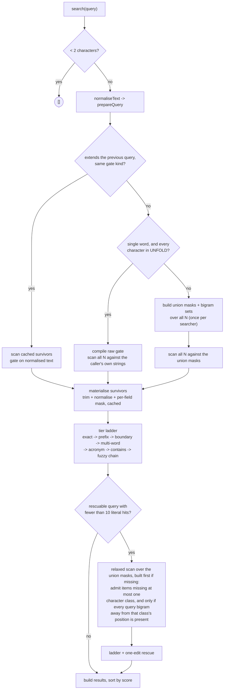

# The pipeline, and where the time goes

What `createFuzzySearch` builds, what a `search(query)` call does, how many of your records reach each stage, and how long each stage takes.
Companion to [optimisation.md](./optimisation.md) (what moved the numbers) and [measurement.md](./measurement.md) (how the harness came to be wrong).

Counts and timings come from `pnpm --filter=ekrina-bench exec vitest run cost.test.ts`, over the fourteen single-word probes at 100k, both corpora.
Stage times are measured by difference, so they overlap slightly.

## Build

Construction reads nothing.
It resolves the field specs and allocates the buffers survivors will later be written into.
No text is trimmed, normalised or copied, and no mask is computed.
At 100k that is ~0.8 ms of allocation and nothing else.

Everything an index would hold is built on demand, during queries.

## Query

Which path a query takes depends on:

1. whether it extends the previous one;
2. whether it is a single word made of characters the fold table covers;
3. whether it needs a correction.

## Who reaches what, and how long it takes

ascii 100k, mean over fourteen single-word probes:

| stage                     | records in |      records out |                           time |
| ------------------------- | ---------: | ---------------: | -----------------------------: |
| construction              |          — |                — |                        ~0.8 ms |
| raw gate (first query)    |    100,000 |  **517 — 0.52%** |                        3.25 ms |
| materialise survivors     |        517 |              517 |                        0.08 ms |
| tier ladder               |        517 |  **413 results** |                        0.18 ms |
| — rescue path only —      |            |                  |                                |
| union mask + bigram build |    100,000 |                — | **11.8 ms**, once per searcher |
| relaxed scan + rescue     |    100,000 | **5,222 — 5.2%** |                        1.39 ms |

Mixed 100k behaves the same, and tighter: the raw gate leaves _197 records, 0.20%_, at 3.29 ms; the ladder produces 147 results in 0.03 ms; the rescue's mask build is 12.0 ms and its relaxed scan admits 3,223 records (3.2%) at 0.90 ms.

Once the gate has run, the literal path takes almost no time.
0.52% of the corpus survives it, and everything downstream - materialising, normalising, masking and running the full tier ladder on those survivors - takes 0.26 ms against the gate's 3.25.

The rescue is a different pipeline.
It admits _5.2% of the corpus_, ten times what the literal gate lets through, and it is the only thing that needs a whole-corpus index.
Nine of the fourteen ascii probes take it, eight of fourteen on mixed, because the probe set is deliberately typo-heavy.
It used to admit 19.3% on a character-class test alone; the bigram stage - a field missing one class is only reachable by an edit at that class's query position, so every query bigram away from that position must be present - cut the set 3.7× and the scan's time with it.

## Stages that only some sessions run

**The union masks and bigram sets, ~12 ms.**
Built the first time a query is rescuable _and_ turns up fewer than ten literal hits, because below that a correction can still reach the visible page, and only a mask can admit the near-misses the literal gate rejected.
A session whose queries all match literally never builds them.
Multi-word and non-Latin queries have no raw-gate form, so they take the mask path and force the build immediately.
The class mask and the bigram sets come from one fused scan per field (`rawFieldScan`), folding each code unit exactly once; the two-pass build it replaced took ~18.5 ms.

**The raw gate, ~3.3 ms.**
Run by any query that cannot narrow: the first one, and any later one that isn't an extension of its predecessor.
A typed sequence runs it once; a searcher handed unrelated queries runs it every time.

Those two are the design's central trade.
Against an eagerly-built index the first query is faster and a long run of unrelated queries is slower.
`search.buildIndex()` takes the other side of it on request: the mask build moves into construction, and every query that cannot narrow filters on the masks instead of running the raw gate (the `Ekrina (indexed)` rows in [benchmarks.md](./benchmarks.md)).

## What the survivor cache does

Each query leaves behind the set that passed its gate.
The next query, if it extends the last one, scans only that set, and the set shrinks with every keystroke, because each one re-gates what the previous one kept.

Soundness rests on the filters being monotone under extension, meaning an item the shorter query rejected stays rejected.
A query that has _become_ rescuable breaks that, because it needs near-misses a literal-gated set never held.
So does a multi-word query, which needs candidates the subsequence gate has already dropped, since the multi-word tier matches out of order.
Both are checked for explicitly.

The rescue path deliberately ignores the cache: it scans all N, because the near-misses it wants are exactly what the cached set excluded.

## Where the remaining time is

For a query that returns a lot, the time goes elsewhere.
At three characters - 39,400 candidates, 15,722 results - the split is mask 0.29 ms, gate 1.50, ladder 2.62, and building and sorting the result objects 7.13 ms, 62% of the query.

0.52% of records reach the ladder and the ladder takes 0.18 ms, so filtering is no longer the slow part.
What remains is proportional to how many results a query has, not how many records it searched, and returning fewer of them is what reduces it.
